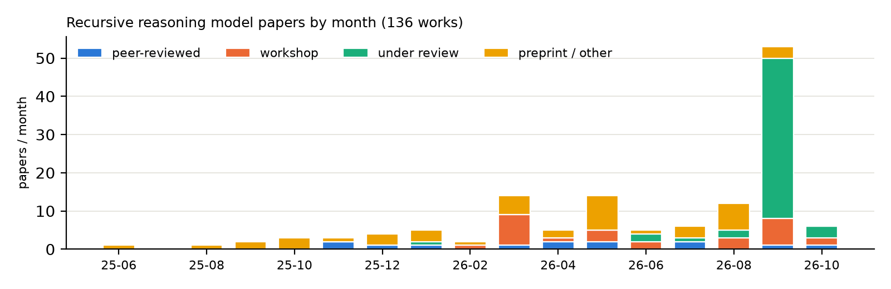

# Awesome Tiny Recursive Models 

**Tiny Recursive Models (TRM), the Hierarchical Reasoning Model (HRM), and the wider family of
recursive reasoning models: small, weight-tied networks that think by iterating.**

**479 papers** · 14 repositories · 95 annotated results · 91 peer-reviewed · 65 workshop · 147 under review · 173 preprint · 3 blog · updated 2026-10-13

---

> **What belongs here.** A *recursive reasoning model* (RRM) applies one small set of weights again and
> again to refine a carried latent and/or answer state (for example `z ← f(x + y + z)`, `y ← f(y + z)`
> in TRM), usually with deep supervision and a stopping rule. We list RRMs, their analyses and
> applications, the benchmarks they are measured on, and a curated slice of related looped models.
> Agent/harness loops (“loop engineering”, recursive self-improvement) appear only in a short boundary
> section: they repeat whole model runs, not tied weights inside one forward pass.
>
> **Reading numbers.** Scores on ARC-AGI, Sudoku-Extreme, and Maze-Hard depend heavily on protocol:
> pass@1 vs. pass@2, test-time augmentation and voting, puzzle-identity embeddings, training on
> evaluation-task demonstrations, and the number of sampled trajectories. Every result in the
> [results tables](#-protocol-annotated-results) carries its protocol; please do not rank across protocols.

## Contents

- [⭐ Start here](#-start-here)
- [🧬 Core lineage: HRM, TRM, and direct successors](#-core-lineage-hrm-trm-and-direct-successors) (5)
- [🏗️ Operator and state design](#-operator-and-state-design) (30)
- [🎓 Supervision and training contracts](#-supervision-and-training-contracts) (20)
- [🎲 Exploration, search, and selection](#-exploration-search-and-selection) (14)
- [⏱️ Depth, stability, halting, and fixed points](#-depth-stability-halting-and-fixed-points) (17)
- [🔬 Analyses, audits, and theory](#-analyses-audits-and-theory) (19)
- [🌍 Applications beyond puzzles](#-applications-beyond-puzzles) (31)
- [📏 Benchmarks, competitions, and evaluation](#-benchmarks-competitions-and-evaluation) (41)
- [🏛️ Foundations and precursors](#-foundations-and-precursors) (45)
- [🔁 Related looped and recurrent-depth models](#-related-looped-and-recurrent-depth-models) (171)
- [📚 Surveys, perspectives, and related lists](#-surveys-perspectives-and-related-lists) (9)
- [🧱 Boundary: agent, harness, and self-improvement loops](#-boundary-agent-harness-and-self-improvement-loops) (77)
- [📊 Protocol-annotated results](#-protocol-annotated-results)
- [🧰 Code and implementations](#-code-and-implementations)
- [🤝 Contributing](#-contributing)

## ⭐ Start here

1. **HRM** — Hierarchical Reasoning Model (2025-06). Introduces HRM: coupled slow high-level and fast low-level recurrent modules reasoning in one forward pass without CoT, 27M parameters, about 1000 training examples. [arXiv](https://arxiv.org/abs/2506.21734) · [OpenReview](https://openreview.net/forum?id=HFbtdgk5Hc)
2. **ARC Prize HRM analysis** — The Hidden Drivers of HRM's Performance on ARC-AGI (2025-08). Verification and ablation of HRM on ARC-AGI: semi-private score below the public one, a plain transformer within a few points, gains concentrated in the outer refinement loop, and a transductive puzzle-ID setup. [paper](https://arcprize.org/blog/hrm-analysis) · [code](https://github.com/arcprize/hierarchical-reasoning-model-analysis)
3. **Hierarchical Reasoning Models: Perspectives and Misconceptions** (2025-09). Reviews HRM-class models, examines key design choices, tests alternative variants and clarifies misconceptions; v2 removed erroneous v1 results and changed conclusions. [arXiv](https://arxiv.org/abs/2510.00355) · [OpenReview](https://openreview.net/forum?id=Dty1TyXrDI)
4. **TRM** — Less is More: Recursive Reasoning with Tiny Networks (2025-10). Proposes Tiny Recursive Model, a simpler recursive reasoning approach using a single 2-layer, 7M-parameter network that generalizes better than HRM on Sudoku, Maze, and ARC-AGI. [arXiv](https://arxiv.org/abs/2510.04871)
5. **Tiny Recursive Models on ARC-AGI-1: Inductive Biases, Identity Conditioning, and Test-Time Compute** (2025-12). Audits the ARC Prize TRM checkpoint on ARC-AGI-1: voting/augmentation drive much accuracy, puzzle-ID dependence is total, effective recursion is shallow; compares with QLoRA Llama-3-8B. [arXiv](https://arxiv.org/abs/2512.11847) · [code](https://github.com/AntonioRoye/TinyRecursiveModels)
6. **URM** — Universal Reasoning Model (2025-12). Analyzes Universal Transformer variants, attributing ARC-AGI gains to recurrent inductive bias and nonlinearity, and proposes URM with short convolution and truncated backpropagation. [arXiv](https://arxiv.org/abs/2512.14693) · [OpenReview](https://openreview.net/forum?id=cUUG3aZR5g) · [code](https://github.com/UbiquantAI/URM)
7. **Augmented HRM** — Are Your Reasoning Models Reasoning or Guessing? A Mechanistic Analysis of Hierarchical Reasoning Models (2026-01). Mechanistic HRM study: fails trivial puzzles via fixed-point violation, shows grokking-like steps and multiple fixed points; Augmented HRM scales guesses via augmentation, perturbation, bootstrapping. [arXiv](https://arxiv.org/abs/2601.10679) · [code](https://github.com/renrua52/hrm-mechanistic-analysis)
8. **LDT** — Lattice Deduction Transformers (2026-05). Lattice Deduction Transformer: recurrent transformer projecting its latent state through a lattice between passes, trained on-policy with abstract-interpretation supervision; answers correctly or abstains. [arXiv](https://arxiv.org/abs/2605.08605) · [OpenReview](https://openreview.net/forum?id=AGwDx82Vq3)
9. **GRAM** — Generative Recursive Reasoning (2026-05). GRAM turns recursive latent reasoning into stochastic multi-trajectory computation, a latent-variable model trained by amortized variational inference supporting parallel sampling and unconditional generation. [arXiv](https://arxiv.org/abs/2605.19376) · [OpenReview](https://openreview.net/forum?id=FN1ucDnPfg)
10. **PTRM** — Probabilistic Tiny Recursive Model (2026-05). Introduces Probabilistic TRM, injecting Gaussian noise at each deep recursion step to explore parallel trajectories and selecting via TRM's existing Q head, without retraining or augmentation. [arXiv](https://arxiv.org/abs/2605.19943)
11. **EqR** — Equilibrium Reasoners: Learning Attractors Enables Scalable Reasoning (2026-05). Equilibrium Reasoners learn task-conditioned attractors whose stable fixed points are solutions, scaling test-time compute by depth (more iterations) and breadth (aggregating stochastic trajectories) without verifiers. [arXiv](https://arxiv.org/abs/2605.21488) · [OpenReview](https://openreview.net/forum?id=lh95PnOlpM) · [code](https://github.com/locuslab/EqR)
12. **FPRM** — Fixed-Point Reasoners: Stable and Adaptive Deep Looped Transformers (2026-06). FPRM, a Transformer-based Fixed-Point Reasoning Model, fixes looped-depth signal propagation with pre-norm and residual scaling and uses fixed-point convergence as end-to-end halting. [arXiv](https://arxiv.org/abs/2606.18206) · [OpenReview](https://openreview.net/forum?id=s66nL9PEw1)
13. **What Limits Recursive Reasoning Models: Optimization, Architecture and Test-Time Scaling** (2026-09). Compares HRM, TRM and URM in a unified pipeline across six algorithmic domains, finding stability comes from gradient horizon, batch size and controlled state updates, not hierarchy. [arXiv](https://arxiv.org/abs/2609.39967) · [OpenReview](https://openreview.net/forum?id=Y3fYr4rY6b)

## 🧬 Core lineage: HRM, TRM, and direct successors

| Date | Paper | Venue / status | Links | TL;DR |
|:--|:--|:--|:--|:--|
| 2026-08 | **Mimir v1** — DFM Mimir v1: An Open HRM Delivering Frontier Performance at 1B Parameters Using Only Permissible Post-Training Data | arXiv | [arXiv](https://arxiv.org/abs/2608.13517) · [code](https://github.com/schneiderkamplab/HRM-Text) | Releases Mimir v1, a 1B-parameter HRM-architecture language model trained from scratch on permissible data, outperforming HRM-Text 1B and setting a Danish state of the art. |
| 2026-05 | **HRM-Text** — HRM-Text: Efficient Pretraining Beyond Scaling | arXiv | [arXiv](https://arxiv.org/abs/2605.20613) | HRM-Text replaces Transformers with HRM for language-model pretraining, adding MagicNorm and warmup deep credit assignment and training on instruction-response pairs; 1B model rivals 2-7B models. |
| 2025-12 | **URM** — Universal Reasoning Model ⭐ | arXiv | [arXiv](https://arxiv.org/abs/2512.14693) · [OpenReview](https://openreview.net/forum?id=cUUG3aZR5g) · [code](https://github.com/UbiquantAI/URM) | Analyzes Universal Transformer variants, attributing ARC-AGI gains to recurrent inductive bias and nonlinearity, and proposes URM with short convolution and truncated backpropagation. |
| 2025-10 | **TRM** — Less is More: Recursive Reasoning with Tiny Networks ⭐ | arXiv | [arXiv](https://arxiv.org/abs/2510.04871) | Proposes Tiny Recursive Model, a simpler recursive reasoning approach using a single 2-layer, 7M-parameter network that generalizes better than HRM on Sudoku, Maze, and ARC-AGI. |
| 2025-06 | **HRM** — Hierarchical Reasoning Model ⭐ | arXiv | [arXiv](https://arxiv.org/abs/2506.21734) · [OpenReview](https://openreview.net/forum?id=HFbtdgk5Hc) | Introduces HRM: coupled slow high-level and fast low-level recurrent modules reasoning in one forward pass without CoT, 27M parameters, about 1000 training examples. |

## 🏗️ Operator and state design

| Date | Paper | Venue / status | Links | TL;DR |
|:--|:--|:--|:--|:--|
| 2026-10 | **InfiLoop** — Scaling to Tens of Thousands of Test-Time Iterations with Loop-Native Attention Residuals | ICLR 2027 (under review) | [arXiv](https://arxiv.org/abs/2610.11570) · [OpenReview](https://openreview.net/forum?id=QEI9S25Ec2) · [code](https://github.com/pixeli99/InfiLoop) | Proposes InfiLoop, a loop-native residual connection with content weighting and learned temporal decay that preserves useful states, letting a 7M looped model scale beyond 20,000 iterations. |
| 2026-10 | **PaTh** — Think Before You Paint: Recursive Latent Reasoning for Diffusion Models | ICLR 2027 (under review) | [arXiv](https://arxiv.org/abs/2610.09876) · [OpenReview](https://openreview.net/forum?id=KC9GuKlWrR) | Painter-Thinker: a small TRM-inspired recursive Thinker refines a latent each denoising step and steers a frozen diffusion model via ControlNet for visual constraint puzzles. |
| 2026-09 | **BiRRM** — BiRRM: Bidirectional Token Mixing for Recurrent Reasoning Models | NeurIPS 2026 Workshop (AXIOM) | [OpenReview](https://openreview.net/forum?id=q4FCmBLlE0) | Shows causal linear-time mixers (mLSTM, GDN-2, Mamba-3) fail as RRM token mixers and proposes BiRRM, a weight-tied bidirectional construction restoring strong performance. |
| 2026-09 | **NCA** — Reasoning with Neural Cellular Automata | ICLR 2027 (under review) | [arXiv](https://arxiv.org/abs/2609.36126) · [OpenReview](https://openreview.net/forum?id=WW3DRigdv3) | Shows neural cellular automata with local, asynchronous recurrent updates solve large mazes, Sudoku, and ARC-AGI-1, generalizing to larger grids and longer rollouts when trained with replay and stochasticity. |
| 2026-09 | **PaTh** — Latent Visual Reasoning with Recursive Diffusion Models | NeurIPS 2026 Workshop (BeNTo) | [OpenReview](https://openreview.net/forum?id=EbD1JCRk20) | Proposes Painter-Thinker, a small TRM-inspired recursive Thinker that refines a latent grid inside each denoising step to steer a frozen diffusion model on pixel-space puzzles. |
| 2026-09 | **CHARM** — Structured Sparse Memory for Recurrent Reasoning | arXiv | [arXiv](https://arxiv.org/abs/2609.33270) · [code](https://github.com/water-vapor/charm) | Presents CHARM, a compact hybrid ARC model combining recurrent reasoning with compositional sparse task memory (CoSE), synthetic augmentation data and inference-time aggregation. |
| 2026-09 | **GFPR** — Reasoning on the Simplex: Geometric Fixed-Point Models | ICLR 2027 (under review) | [arXiv](https://arxiv.org/abs/2609.33540) · [OpenReview](https://openreview.net/forum?id=4lOEWc9Rp0) | GFPR iterates categorical beliefs on a product of simplices so the state is the prediction, guaranteeing a fixed point; a ~7M model is strong on Sudoku-Extreme, Maze-Hard, S5. |
| 2026-09 | **FPSA-R** — Recurrent Reasoning with Fixed Point Attention | ICLR 2027 (under review) | [OpenReview](https://openreview.net/forum?id=24jagwDpAK) | Proposes FPSA-R, an answer-conditioned fixed-point attention reasoner iterating attention to equilibrium before feedforward answer revision, trained with implicit differentiation and segment-level supervision. |
| 2026-09 | **G-Loop** — Loop Attention, not the Block | ICLR 2027 (under review) | [OpenReview](https://openreview.net/forum?id=Laa8I1vVBg) | Introduces Gated Looped Attention, moving recurrence inside self-attention with gated value remixing, approaching or beating TRM-Att puzzle accuracy at far lower FLOPs and improving DeBERTa on GLUE. |
| 2026-09 | **LRFeed** — LRFeed: Latent Residual Feedback for Efficient Reasoning in Looped Transformers | ICLR 2027 (under review) | [OpenReview](https://openreview.net/forum?id=niEvgSmsch) | LRFeed feeds back latent-state evolution to guide subsequent computation in a single-state TRM variant, strengthening long-horizon reasoning beyond the training horizon with less compute. |
| 2026-09 | Tiny Recursive Message Passing | ICLR 2027 (under review) | [OpenReview](https://openreview.net/forum?id=d36lMaMdBz) | Applies recursive-transformer procedures (deep supervision, truncated recursion, adaptive halting, deduction lattices) to message-passing networks; a 16k-parameter model exceeds 99% on Sudoku-Extreme. |
| 2026-09 | **QRR** — Looped Reasoning Finishes Earlier Than You Think | ICLR 2027 (under review) | [OpenReview](https://openreview.net/forum?id=F2Gf9kssdG) | Shows slowly decaying oscillatory latent modes bottleneck convergence in looped reasoning, and proposes QRR, a gauge-equivariant recurrent reasoner whose phase-rotation symmetry decouples them, converging faster. |
| 2026-09 | **L^nH** — Beyond the Loop: From Latent Dynamics to Performant Recurrent Models | ICLR 2027 (under review) | [OpenReview](https://openreview.net/forum?id=d6MpL4YyvG) | Analyzes HRM-Text dynamics (L-module converges to a narrow region; H applies a distinct map), proposing the simpler one-stream L^nH family and a new training recipe. |
| 2026-09 | **Random Recursive Model** — Random Recursive Models | ICLR 2027 (under review) | [OpenReview](https://openreview.net/forum?id=tBuBIeReU3) | Introduces Random Recursive Models sampling one layer per recursive step from a learned pool; matches reasoning baselines with 50-75% fewer parameters and supports depth extrapolation and Monte Carlo inference. |
| 2026-09 | **USRL** — Human-like Abstract Visual Reasoning via Understanding and Solving Reasoning Loop | CVPR 2026 | [OpenReview](https://openreview.net/forum?id=FScvogJslA) | Proposes USRL, a 7M-parameter loop in which an Understanding Module refines rule representations and a Solving Module refines a draft solution, with consistency-based adaptive halting. |
| 2026-09 | **VWN+TRM** — Tiny Recursive Models Underuse their Depth | ICLR 2027 (under review) | [OpenReview](https://openreview.net/forum?id=qLsYisXkD5) | Shows TRM recursion reaches fixed points early, wasting depth, and widens the carried state with Virtual Width Networks at unchanged backbone compute so additional supervision steps stay useful. |
| 2026-09 | **Loop-OWM** — Slots, Transitions, Loops: Learning Composable World Models for ARC | UniWorld Workshop @ ECCV2026 | [OpenReview](https://openreview.net/forum?id=vxkm7Oolhp) | Loop-OWM learns ARC rules as composable transitions over object-centric slot states, combining color-prototype slots, demonstration-conditioned summaries and a looped transition model, outperforming non-looped and looped baselines on ARC-1 and ARC-2. |
| 2026-09 | Learned Correction Dynamics in Recursive Reasoning Models | ICLR 2027 (under review) | [OpenReview](https://openreview.net/forum?id=KGYYrHn7TX) | Trajectory measurements and interventions on Sudoku-Extreme RRMs reveal learned correction dynamics; compact attention solvers reach about 99.5% with under 2M parameters; ARC candidate-pool limits. |
| 2026-09 | **NRR** — Negotiated Recursive Reasoning | ICLR 2027 (under review) | [OpenReview](https://openreview.net/forum?id=ICrQrzUlub) | Proposes Negotiated Recursive Reasoning, where shared local recursive reasoners refine per-view proposals and states while a negotiation step reduces overlap disagreement across rounds. |
| 2026-09 | **LRT** — Latent Recurrent Thoughts: Recurrent Refinement of Proposed Latents for Reasoning with Frozen LLMs | arXiv | [arXiv](https://arxiv.org/abs/2609.01117) · [code](https://github.com/czl-david/latent-recurrent-thoughts) | Proposes Latent Recurrent Thoughts: a tiny recurrent reasoner refines proposed continuous latents through bounded residual corrections, which a frozen LLM decodes into answers. |
| 2026-08 | **BDH-CQ** — BDH-CQ: In-Context Learning with Recurrent Latent Reasoning | arXiv | [arXiv](https://arxiv.org/abs/2608.09888) | BDH-CQ combines in-context learning, where demonstrations update recurrent memory, with iterative latent reasoning, analysed through controlled ARC-like interventions. |
| 2026-08 | **ReWork** — ReWork: Efficient Iterative Reasoning with Working Memory | COLM 2026 Workshop (Efficient Reasoning) | [OpenReview](https://openreview.net/forum?id=cNK4KZzHH2) | Proposes ReWork, splitting recurrent state into persistent token-aligned sensory memory and refreshed compact working memory, nesting latent recursion within discrete diffusion, with learned halting. |
| 2026-06 | When to Re-Plan: Subgoal Persistence in Hierarchical Latent Reasoning | ICML 2026 Workshop (CompLearn) | [arXiv](https://arxiv.org/abs/2606.03741) · [OpenReview](https://openreview.net/forum?id=7n485sq1xH) | Extends HRM with a feudal manager-worker interface whose high-level module emits persistent subgoals; on ARC and ConceptARC moderate persistence periods (P in 3-6) work best. |
| 2026-05 | **Attractor Models** — Solve the Loop: Attractor Models for Language and Reasoning | COLM 2026 Workshop (Efficient Reasoning) | [arXiv](https://arxiv.org/abs/2605.12466) · [OpenReview](https://openreview.net/forum?id=wtWZNZUxQO) · [code](https://github.com/jacobfa/Attractor) | Introduces Attractor Models, where an attractor module refines backbone output embeddings by solving for a fixed point with implicit gradients, applied to LM pretraining and tiny-model reasoning. |
| 2026-05 | **LDT** — Lattice Deduction Transformers ⭐ | arXiv | [arXiv](https://arxiv.org/abs/2605.08605) · [OpenReview](https://openreview.net/forum?id=AGwDx82Vq3) | Lattice Deduction Transformer: recurrent transformer projecting its latent state through a lattice between passes, trained on-policy with abstract-interpretation supervision; answers correctly or abstains. |
| 2026-03 | **RIM** — Recursive Inference Machines for Neural Reasoning | arXiv | [arXiv](https://arxiv.org/abs/2603.05234) | Recursive Inference Machines frame neural reasoners with classical inference-engine mechanisms, express TRM as an instance, and add a reweighting component improving ARC-AGI and Sudoku-Extreme, plus tabular classification. |
| 2026-03 | **SE-RRM** — Symbol-Equivariant Recurrent Reasoning Models | ICML 2026 | [arXiv](https://arxiv.org/abs/2603.02193) · [OpenReview](https://openreview.net/forum?id=Rd1oQZ3s2o) · [code](https://github.com/ml-jku/SE-RRM) | Introduces symbol-equivariant recurrent reasoning models enforcing permutation equivariance architecturally, beating prior RRMs on Sudoku with size extrapolation and needing less augmentation on ARC. |
| 2026-02 | Tiny Recursive Reasoning with Mamba-2 Attention Hybrid | ICLR 2026 Workshop (LIT) | [arXiv](https://arxiv.org/abs/2602.12078) · [OpenReview](https://openreview.net/forum?id=AEz0zbLuzg) | Replaces TRM's Transformer blocks with Mamba-2 attention hybrids at parameter parity, improving ARC-AGI-1 pass@2 and higher-K candidate coverage with pass@1 parity. |
| 2026-01 | **TR-LDM** — Tiny Recursive Language Diffusion Models | under review | [OpenReview](https://openreview.net/forum?id=3Eutnnd6Hy) | Proposes TR-LDM, a <=20M-parameter masked diffusion LM with TRM-style latent/answer recursion and optional deep supervision over denoising, with theory and a Sudoku-Extreme/Maze-Hard experimental plan. |
| 2025-09 | Investigating Design Choices for Recurrent Reasoning Models on 2D Tasks | arXiv | [OpenReview](https://openreview.net/forum?id=cL840F9yoG) | Critically reviews HRM-style recurrent reasoning models, examining key design choices and proposing variants that significantly outperform reported results on Sudoku-Extreme and Maze-Hard. |

## 🎓 Supervision and training contracts

| Date | Paper | Venue / status | Links | TL;DR |
|:--|:--|:--|:--|:--|
| 2026-09 | What Limits Recursive Reasoning Models: Optimization, Architecture and Test-Time Scaling ⭐ | ICLR 2027 (under review) | [arXiv](https://arxiv.org/abs/2609.39967) · [OpenReview](https://openreview.net/forum?id=Y3fYr4rY6b) | Compares HRM, TRM and URM in a unified pipeline across six algorithmic domains, finding stability comes from gradient horizon, batch size and controlled state updates, not hierarchy. |
| 2026-09 | **FOCUS** — Not Too Hard, Not Too Easy: Learning from Intermediate States for LLM Structured Reasoning | ICLR 2027 (under review) | [arXiv](https://arxiv.org/abs/2609.33149) · [OpenReview](https://openreview.net/forum?id=j3SAM66GRn) | Couples a pretrained LM with a weight-tied recurrent updater revising explicit solution states; FOCUS trains on frontier intermediate states from the model's own trajectories. |
| 2026-09 | **Variational Autoreasoner** — Variational Autoreasoners: Recursive Reasoning by Amortizing the Other Half of EM | ICLR 2027 (under review) | [OpenReview](https://openreview.net/forum?id=fSC9jzrkmT) | Interprets recursive reasoning models' design choices through variational EM and introduces Variational Autoreasoners, adding an instance-level M-step with per-problem memory and target-free recursive priors. |
| 2026-09 | Learning Recursive Reasoners without Solutions | ICLR 2027 (under review) | [OpenReview](https://openreview.net/forum?id=CHy7sejNlH) | Trains recursive reasoning models from black-box verifier/energy feedback alone, combining latent deterministic recurrence with stochastic refinement of explicit candidates; studies compute allocation and depth extrapolation. |
| 2026-09 | **AS-TRM** — Adaptive Supervision Helps Tiny Recursive Models Learn Better | ICLR 2027 (under review) | [OpenReview](https://openreview.net/forum?id=MNwejBwJSK) | AS-TRM partitions TRM deep-supervision signals into focus and non-focus sets by each thinking step's outcome, reducing early-step supervision noise and speeding convergence. |
| 2026-09 | **DRDM** — Learning to Refine Partial Solutions with Recursive Discrete Denoising | ICLR 2027 (under review) | [OpenReview](https://openreview.net/forum?id=PbdsrmhaI3) | DRDM trains a ~7M looped Transformer to reconstruct solutions from partially correct candidates via masking and replacement, with progressive decoding and latent memory; beats TRM. |
| 2026-09 | **Looped Flows** — Thinking with Looped Flows | ICLR 2027 (under review) | [arXiv](https://arxiv.org/abs/2609.11801) · [OpenReview](https://openreview.net/forum?id=1dgADrn8U0) | Looped flows train recurrence with local denoising objectives under decreasing shared noise, then integrate a learned probability flow for inference, enabling more compute and multiple solutions. |
| 2026-09 | **DART** — DART: Distributional Adversarial Recurrent Training for Algorithm Learning | ICLR 2027 (under review) | [arXiv](https://arxiv.org/abs/2609.05988) · [OpenReview](https://openreview.net/forum?id=VEeF3jqSrb) | DART replaces single-point supervision of recurrent reasoning models with an adversarially matched local target distribution; improves Deep Thinking systems and TRMs on Maze, Chess, masked Sudoku. |
| 2026-09 | Diffusion as a Training Curriculum for Timestep-Free Iterative Reasoning | NeurIPS 2026 Workshop (BeNTo) | [arXiv](https://arxiv.org/abs/2609.01449) · [OpenReview](https://openreview.net/forum?id=Y9U1atIWJE) | Adds a persistent hidden state to a timestep-free diffusion denoiser, yielding an anytime recursive solver whose accuracy keeps rising with depth; noise injection explores solutions without parallel rollouts. |
| 2026-08 | **R-Qwen** — Recursive Vision Language Models for General Symbolic Reasoning | arXiv | [arXiv](https://arxiv.org/abs/2608.01534) · [code](https://github.com/IMPACT-L/RQwen) | R-Qwen brings recursive refinement with deep supervision to a pretrained Qwen backbone, adding Hierarchical Supervision Weighting across recursive steps for symbolic puzzles. |
| 2026-07 | **TraceViT** — TraceViT: Grounded Trace Supervision for Visual Abstract Reasoning | arXiv | [arXiv](https://arxiv.org/abs/2607.29586) · [code](https://github.com/LiuBinnan/TraceViT) | TraceViT trains a looped visual ARC reasoner with verified intermediate grid-state transformation chains via soft trace alignment, grounded by task references and an object workspace. |
| 2026-06 | **FRM** — Flow Reasoning Models: Turning Flows Into Efficient Recurrent Reasoners | ICLR 2027 (under review) | [arXiv](https://arxiv.org/abs/2606.29150) · [OpenReview](https://openreview.net/forum?id=XA6fKZuukf) · [code](https://github.com/helblazer811/Flow-Reasoning-Models) | Flow Reasoning Models self-condition a discrete flow model on its own outputs for iterative solution refinement, using Fixed-Point Forcing to train on self-generated inference states. |
| 2026-04 | One Step Forward and K Steps Back: Better Reasoning with Denoising Recursion Models | ICML 2026 | [arXiv](https://arxiv.org/abs/2604.18839) · [OpenReview](https://openreview.net/forum?id=78MQeA1Jyq) | Introduces Denoising Recursion Models, training looped transformers to reverse noise corruption over multiple recursive steps as an intermediate-state curriculum; outperforms TRM on ARC-AGI. |
| 2026-03 | **RSM** — Form Follows Function: Recursive Stem Model | arXiv | [arXiv](https://arxiv.org/abs/2603.15641) · [code](https://github.com/navidivan/rsm) | Proposes the Recursive Stem Model, keeping TRM's backbone but detaching history, warm-up iterations, final-step loss and stochastic outer depth to learn a stable depth-agnostic operator. |
| 2026-03 | **LIT** — Latent Imagination Thinking: Beyond Recursive Models for Reasoning | ICLR 2026 Workshop (World Models) | [OpenReview](https://openreview.net/forum?id=SYVmt9mFEm) | LIT replaces observation-space recursion with teacher-student latent belief updates (imagination loss, stop-gradient targets), evaluated on hard Sudoku in language and visual (MNIST) spaces. |
| 2026-03 | How to Train Your HRM | ICLR 2026 Workshop (LIT) | [OpenReview](https://openreview.net/forum?id=vlh0YAVdkF) | Studies HRM training curricula for ARC-AGI under limited test-time compute: offline pretraining, test-time fine-tuning on all tasks, and per-task overfitting, recommending fine-tuning-heavy budgets. |
| 2026-01 | **TRM-Planner** — TRM-Planner: Offline Target Planning and Distillation for Tiny Recursive Models | Findings of ACL 2026 | [OpenReview](https://openreview.net/forum?id=ggkeH4cfjE) | TRM-Planner caches multi-step and stochastic-rollout outputs of a frozen TRM teacher offline, then distills them into a student TRM without changing inference. |
| 2025-11 | Latent Reasoning in TRMs is Secretly a Policy Improvement Operator | ICML 2026 | [arXiv](https://arxiv.org/abs/2511.16886) · [OpenReview](https://openreview.net/forum?id=SCtGXNtk7Q) | Formalizes TRM latent recursion as a policy-improvement operator and applies RL- and diffusion-inspired training to avoid dead compute, cutting forward passes 18x at maintained performance. |
| 2025-11 | Test-time Adaptation of Tiny Recursive Models | arXiv | [arXiv](https://arxiv.org/abs/2511.02886) · [code](https://github.com/TrelisResearch/TinyRecursiveModels) | Shows a TRM pre-trained on public ARC tasks can be fully fine-tuned on ARC Prize 2025 competition tasks within compute limits, reaching 6.67% on semi-private evaluation. |
| 2025-10 | **HRM-Agent** — HRM-Agent: Training a recurrent reasoning model in dynamic environments using reinforcement learning | arXiv | [arXiv](https://arxiv.org/abs/2510.22832) | HRM-Agent trains an HRM variant purely with reinforcement learning to navigate dynamic, uncertain mazes, reusing recurrent computation across environment time-steps. |

## 🎲 Exploration, search, and selection

| Date | Paper | Venue / status | Links | TL;DR |
|:--|:--|:--|:--|:--|
| 2026-09 | **xRRM** — xRRMs: Explorative Recurrent Reasoning Models | NeurIPS 2026 Workshop (AXIOM) | [OpenReview](https://openreview.net/forum?id=x3FOpcswLP) | xRRM adds exploration to HRM/TRM-style RRMs via random initial states and learned-variance noise, training only the trajectory closest to a valid solution; Sudoku-Extreme and Game-of-24. |
| 2026-09 | **ICS** — Input-Conditioned Search for Efficient Test-Time Scaling of Recursive Reasoners | ICLR 2027 (under review) | [OpenReview](https://openreview.net/forum?id=rmRnCsS98o) | Proposes Input-Conditioned Search, a training-free test-time method exploring alternative update maps of a pretrained recursive reasoner by searching over input conditions to escape incorrect attractors. |
| 2026-09 | **DRLM** — Breaking Diffusion: Parallel Reasoning with Draft Refinement | ICLR 2027 (under review) | [OpenReview](https://openreview.net/forum?id=1jtNAI8NRC) | Draft Refinement Language Models: one denoiser proposes parallel draft revisions and scores drafts with a one-pass cavity energy, keeping only lower-energy revisions. |
| 2026-09 | Latent Trajectory Steering Unlocks Trapped Capacity in Recursive Reasoning | ICLR 2027 (under review) | [OpenReview](https://openreview.net/forum?id=0695Ka8KEw) | Finds success and failure basins with high-FTLE ridges in HRM/TRM latent trajectories; training-free ridge perturbations plus Gibbs-weighted selection recover failed rollouts. |
| 2026-08 | **RoFB** — Steering Recurrent Reasoners at Inference Time with Readout Feedback | ICLR 2027 (under review) | [arXiv](https://arxiv.org/abs/2608.24136) · [OpenReview](https://openreview.net/forum?id=uGG2zuJPp4) | Introduces Readout Feedback, a test-time intervention turning intermediate readout probabilities into pairwise coupling forces that steer latent dynamics of recurrent reasoners (AKOrN, ItrSA++, TRM). |
| 2026-07 | **ERM** — Energy-guided Recursive Model | ICLR 2027 (under review) | [arXiv](https://arxiv.org/abs/2607.10128) · [OpenReview](https://openreview.net/forum?id=8ib0Zj3PxI) | Proposes the Energy-guided Recursive Model, using Hopfield-type memories to score candidate trajectories for selection, recurrent-depth choice, and parallel-tempering exploration in recursive models. |
| 2026-07 | **G-RRM** — G-RRM: Guiding Symbolic Solvers with Recurrent Reasoning Models | NeSy 2026 | [arXiv](https://arxiv.org/abs/2607.02491) · [OpenReview](https://openreview.net/forum?id=nI0Jd4pr6g) | G-RRM uses symbol-equivariant recurrent reasoning models to propose Sudoku solutions that guide backtracking and SAT solvers, delineating when neural guidance speeds search. |
| 2026-05 | Boosting Inference with Guided Reasoning: Stochastic Exploration for Recursive Models | ICML 2026 Workshop (SPIGM) | [arXiv](https://arxiv.org/abs/2605.25230) · [OpenReview](https://openreview.net/forum?id=cNMqROb62w) | Frames tiny recursive reasoners' inference as approximate inference over latent trajectories, using stochastic perturbations reweighted by the early-stopping head, with label-free diagnostics predicting when it helps. |
| 2026-05 | **PTRM** — Probabilistic Tiny Recursive Model ⭐ | arXiv | [arXiv](https://arxiv.org/abs/2605.19943) | Introduces Probabilistic TRM, injecting Gaussian noise at each deep recursion step to explore parallel trajectories and selecting via TRM's existing Q head, without retraining or augmentation. |
| 2026-05 | **GRAM** — Generative Recursive Reasoning ⭐ | arXiv | [arXiv](https://arxiv.org/abs/2605.19376) · [OpenReview](https://openreview.net/forum?id=FN1ucDnPfg) | GRAM turns recursive latent reasoning into stochastic multi-trajectory computation, a latent-variable model trained by amortized variational inference supporting parallel sampling and unconditional generation. |
| 2026-04 | **C-voting** — C-voting: Confidence-Based Test-Time Voting without Explicit Energy Functions | ICLR 2026 | [arXiv](https://arxiv.org/abs/2604.13521) · [OpenReview](https://openreview.net/forum?id=kYQFfEKtx5) | C-voting selects among multiple randomly initialized latent trajectories of recurrent reasoners (HRM, AKOrN) by average top-1 confidence; introduces ItrSA++, a randomized-initialization attention-based recurrent model. |
| 2026-03 | **GRAM** — Generative Recursive Reasoning Models | ICLR 2026 Workshop (RSI) | [OpenReview](https://openreview.net/forum?id=Vxu6kcIjwV) | GRAM recasts latent recursive reasoning architectures as stochastic generative recursion trained by amortized variational inference, exploring multiple latent trajectories; competitive on ARC-1 and ARC-2. |
| 2026-03 | Recursive Reasoning as Attractor Landscape Search: Mechanistic Dynamics of the Tiny Recursive Model | ICLR 2026 Workshop (LIT) | [OpenReview](https://openreview.net/forum?id=kKps9W1K7n) | Mechanistic analysis of TRM on Sudoku-Extreme (SAEs, latent PCA) showing early hypotheses, periodic stabilization and high-loss attractors; answer-init noise and more guesses escape them without retraining. |
| 2026-01 | **WTA** — Speed is Confidence | arXiv | [arXiv](https://arxiv.org/abs/2601.19085) · [code](https://github.com/jvdillon/sic) | Uses halting time as confidence for TRM ensembles (halt-first selection) and internalizes it by training K parallel latents with winner-take-all backprop, matching ensemble accuracy at single-model cost. |

## ⏱️ Depth, stability, halting, and fixed points

| Date | Paper | Venue / status | Links | TL;DR |
|:--|:--|:--|:--|:--|
| 2026-10 | **ImR** — Invariant-Measure Reasoners: Stable Representations for Latent Reasoning | ICLR 2027 (under review) | [arXiv](https://arxiv.org/abs/2610.10996) | Invariant-measure reasoners predict from the expectation over the long-run distribution of latent states of recurrent reasoners, reducing prediction instability across depths on maze and Sudoku. |
| 2026-09 | **TAPS** — Scheduling Recursive Reasoning in Looped Transformers | ICLR 2027 (under review) | [arXiv](https://arxiv.org/abs/2609.36653) · [OpenReview](https://openreview.net/forum?id=s5YLl1VTc7) | TAPS adapts recurrent update step size online from a persistent-progress versus fluctuation decomposition of terminal-loss sensitivity, improving accuracy without retraining. |
| 2026-09 | **Looped Actor** — Looped Actor: Depth-Recurrent Reasoning Models for Reinforcement Learning | ICLR 2027 (under review) | [arXiv](https://arxiv.org/abs/2609.37432) · [OpenReview](https://openreview.net/forum?id=LP8lY2E8bR) · [code](https://github.com/camail-official/LoopedActor) | Introduces Looped Actor, a transformer policy refining a latent toward a fixed point with a shared block and state-dependent loop counts, with complexity-theoretic motivation for adaptive compute. |
| 2026-09 | **Mimir** — Mimir: A Sub-2B Hierarchical Reasoning Model Trained on Permissible Data Punches Above Its Weight Class | ICLR 2027 (under review) | [OpenReview](https://openreview.net/forum?id=YGnpHMuhJI) | Mimir: 1.78B HRM-Text language model with iterated, interleaved L/H stacks trained from scratch on permissibility-constrained data; ablates inference-time recurrent depth. |
| 2026-09 | **SFPRM** — Spherical Fixed-Point Reasoners: Adaptive Loop Halting on the Hypersphere | ICLR 2027 (under review) | [OpenReview](https://openreview.net/forum?id=97opj03iSk) | Proposes Spherical Fixed-Point Reasoners, running damped fixed-point looping with geodesic injection, damping and halting on the nGPT hypersphere, with existence and convergence proofs. |
| 2026-09 | **ReGRAM** — Reinforced Generative Recursive Reasoning for Native Adaptive Computation Depth | ICLR 2027 (under review) | [OpenReview](https://openreview.net/forum?id=gmpIqVKZzs) | Proposes ReGRAM, treating a generative recursive model's Gaussian latent transitions as a policy: variational pretraining, then outcome RL over transitions and a residual-conditioned halting action. |
| 2026-09 | **ATWD** — When Does Per-Token Halting Help? Adaptive Token-Wise Damping for Fixed-Point Reasoning Models in Looped Transformers | ICLR 2027 (under review) | [OpenReview](https://openreview.net/forum?id=L4Y1gbrK0i) | Adaptive Token-Wise Damping for Fixed-Point Reasoning Models: per-token damping with periodic step-size refresh against slow-token halting; mixed results on A5, S5 and Sudoku. |
| 2026-06 | **FPRM** — Fixed-Point Reasoners: Stable and Adaptive Deep Looped Transformers ⭐ | ICML 2026 Workshop (CompLearn) | [arXiv](https://arxiv.org/abs/2606.18206) · [OpenReview](https://openreview.net/forum?id=s66nL9PEw1) | FPRM, a Transformer-based Fixed-Point Reasoning Model, fixes looped-depth signal propagation with pre-norm and residual scaling and uses fixed-point convergence as end-to-end halting. |
| 2026-05 | **EqR** — Equilibrium Reasoners: Learning Attractors Enables Scalable Reasoning ⭐ | ICML 2026 | [arXiv](https://arxiv.org/abs/2605.21488) · [OpenReview](https://openreview.net/forum?id=lh95PnOlpM) · [code](https://github.com/locuslab/EqR) | Equilibrium Reasoners learn task-conditioned attractors whose stable fixed points are solutions, scaling test-time compute by depth (more iterations) and breadth (aggregating stochastic trajectories) without verifiers. |
| 2026-05 | **S-AI-Recursive** — S-AI-Recursive: Convergent Recursive Reasoning | arXiv | [arXiv](https://arxiv.org/abs/2605.13872) | Proposes S-AI-Recursive, a bio-inspired hormonally regulated recursive reasoning cycle with convergence/uncertainty-based stopping, contraction and Lyapunov analysis, and warm-start memory. |
| 2026-04 | Universal Transformers Need Memory: Depth-State Trade-offs in Adaptive Recursive Reasoning | arXiv | [arXiv](https://arxiv.org/abs/2604.21999) · [code](https://github.com/che-shr-cat/utm-jax) | Single-block Universal Transformer with ACT on Sudoku-Extreme: memory tokens are necessary and substitute for ponder depth; identifies an ACT router-initialization trap fixed by negative bias. |
| 2026-03 | **CMM** — Dynamical Systems Theory Behind a Hierarchical Reasoning Model | arXiv | [arXiv](https://arxiv.org/abs/2603.22871) | Contraction Mapping Model recasts HRM/TRM-style recursion as neural ODEs/SDEs enforcing convergence to stable equilibria with hyperspherical repulsion against collapse; compact models top Sudoku-Extreme. |
| 2026-03 | Unrolled Policy Iteration for Tiny Recursive Models | ICLR 2026 Workshop (RSI) | [OpenReview](https://openreview.net/forum?id=rIzREKws05) | Formalizes TRM plan editing as an MDP and analyzes approximate policy iteration with truncated internal evaluation, bounding error by contraction modulus and unroll depth; Sudoku experiments. |
| 2026-02 | **Loop-ViT** — LoopViT: Scaling Visual ARC with Looped Transformers | arXiv | [arXiv](https://arxiv.org/abs/2602.02156) · [code](https://github.com/WenjieShu/LoopViT) | Loop-ViT iterates a weight-tied convolution-attention hybrid block for visual ARC with a parameter-free entropy-based Dynamic Exit; the 18M model reaches 65.8% on ARC-AGI-1. |
| 2026-01 | **Augmented HRM** — Are Your Reasoning Models Reasoning or Guessing? A Mechanistic Analysis of Hierarchical Reasoning Models ⭐ | arXiv | [arXiv](https://arxiv.org/abs/2601.10679) · [code](https://github.com/renrua52/hrm-mechanistic-analysis) | Mechanistic HRM study: fails trivial puzzles via fixed-point violation, shows grokking-like steps and multiple fixed points; Augmented HRM scales guesses via augmentation, perturbation, bootstrapping. |
| 2025-12 | **LRT** — Liquid Reasoning Transformers: A Sudoku-Based Prototype for Chess-Scale Algorithmic Tasks | arXiv | [arXiv](https://arxiv.org/abs/2512.12792) | Proposes the Liquid Reasoning Transformer, which updates a recurrent reasoning token over internal steps with discard-based correction and a learned stop gate, evaluated on Sudoku. |
| 2025-11 | **CGAR** — Accelerating Training Speed of Tiny Recursive Models with Curriculum Guided Adaptive Recursion | Neural Networks 2027 | [arXiv](https://arxiv.org/abs/2511.08653) · [code](https://github.com/Kaleemullahqasim/CGAR) | CGAR speeds TRM training with a progressive recursion-depth curriculum and exponentially decaying supervision-step weights, preserving Sudoku-Extreme accuracy and halting behaviour. |

## 🔬 Analyses, audits, and theory

| Date | Paper | Venue / status | Links | TL;DR |
|:--|:--|:--|:--|:--|
| 2026-10 | Pretraining and Test-Time Training Budgets Matter for ARC: A Controlled Study of VARC and TRM | BNAIC/BeNeLearn 2026 | [arXiv](https://arxiv.org/abs/2610.13660) · [OpenReview](https://openreview.net/forum?id=JVmYVft0UP) · [code](https://github.com/AdrienDeliege/arc-training-budgets) | Controlled study crossing five pretraining and four test-time-training budgets for VARC and TRM on ARC-AGI-1 under a common inductive protocol. |
| 2026-10 | Verifiable Mathematical Reasoning as a Probe of Emergent Global Workspaces | NeurIPS 2026 Workshop (MATH-AI) | [OpenReview](https://openreview.net/forum?id=RPsfeyQUm4) | Jacobian lenses on multi-solution n-queens compare a recursive latent reasoner with an AR LLM; a tiny latent subspace determines which solution the recursive model returns. |
| 2026-09 | A Tilted Bowl Is Not a Slippery Slope: Compressing Looped Models | ICLR 2027 (under review) | [arXiv](https://arxiv.org/abs/2609.39277) · [OpenReview](https://openreview.net/forum?id=zaBYeZd24c) | Shows quantization error in settling loops shifts the fixed point rather than accumulating, predicts failures label-free, and finishes halting-head-triggered inference with 8-bit loops. |
| 2026-09 | Competence without Performance: Representation Without Control on ARC-AGI-3 | NeurIPS 2026 Workshop (PhysUnderstand) | [OpenReview](https://openreview.net/forum?id=aCUDp8kUVi) | Puts a 7M TRM and DreamerV3 through a shared ARC-AGI-3 substrate; both collapse, and diagnosis shows models represent games but reward discovery and control fail. |
| 2026-09 | When Recursive Models Finish Computing | ICLR 2027 (under review) | [arXiv](https://arxiv.org/abs/2609.26487) · [OpenReview](https://openreview.net/forum?id=irVKjZ7a6I) | Studies completion dynamics of attention and MLP TRMs on 1,000 hard Sudoku: extended recurrence solves many nominal failures; completed states show trajectory-conditioned anisotropic stability. |
| 2026-09 | Probing the Emergent Global Workspace of Reasoning Models on Structured Reasoning Tasks | ICLR 2027 (under review) | [OpenReview](https://openreview.net/forum?id=FwNyRCul6v) | Jacobian-lens probing finds a thin, causally necessary workspace subspace in a recursive latent reasoner that repairs single-step damage, contrasted with an autoregressive LLM. |
| 2026-09 | Knowledge transfer between simple discrete worlds | ICLR 2027 (under review) | [OpenReview](https://openreview.net/forum?id=ApDGui1ZYU) | Trains a depth-recurrent model on Sudoku-like puzzles with combinable rules and tests four novelty levels when rules are given as symbolic descriptions versus solved examples. |
| 2026-09 | Interaction Locality in Spatial Reasoning | ICLR 2027 (under review) | [OpenReview](https://openreview.net/forum?id=ltDDkopBuV) | Defines interaction locality as calibrated causal-effect fraction within task relations; analyses HRM/TRM against a matched Transformer and uses it as a fine-tuning regularizer. |
| 2026-08 | Dissecting Hierarchical Reasoning Models: A Mechanistic Study | ICML 2026 Workshop (Mech Interp) | [arXiv](https://arxiv.org/abs/2609.22197) · [OpenReview](https://openreview.net/forum?id=x7a5aCnTzI) · [code](https://github.com/LeoRodrigues05/HRM) | Mechanistically dissects HRM on Sudoku, Maze and ARC-AGI-2 using baselines, state interventions, probes and SAEs, concluding it performs constraint-aware iterative refinement of a solution state. |
| 2026-08 | When Wrong Answers Remain Unsettled: Failure Dynamics in Recurrent Reasoners | ICLR 2027 (under review) | [OpenReview](https://openreview.net/forum?id=IbYlE3lDII) | Measures answer persistence under continued recurrence in HRM, TRM and GRAM-guided TRM on Sudoku-Extreme, separating persistence, local geometry and perturb-and-reselect efficacy. |
| 2026-06 | What Survives When You Compress a Recursive Reasoner for the Edge? | arXiv | [arXiv](https://arxiv.org/abs/2606.26488) | Studies compressing few-million-parameter recursive reasoning models for edge on three puzzle tasks: pruning, distillation and linear attention destroy puzzle-exact accuracy; calibrated INT4 recovers it. |
| 2026-06 | Quantizing Recursive Reasoning Models | ICLR 2027 (under review) | [arXiv](https://arxiv.org/abs/2607.16237) · [OpenReview](https://openreview.net/forum?id=9fAgUx2f15) | Quantizing recursive reasoning models: per-tensor 4-bit error accumulates into drift that collapses Sudoku accuracy; blockwise MXInt4 scaling restores it and transfers to ARC-AGI. |
| 2026-05 | Interaction Locality in Hierarchical Recursive Reasoning | arXiv | [arXiv](https://arxiv.org/abs/2605.20784) | Proposes interaction locality via SAE feature ablations and activation patching; HRM/TRM high-level states write locally while recursion accumulates global structure; contrasted with MTU3D. |
| 2026-05 | **AIR** — One Model, Two Roles: Emergent Specialization in a Shared Recurrent Transformer | arXiv | [arXiv](https://arxiv.org/abs/2605.17811) · [OpenReview](https://openreview.net/forum?id=AMq8dARBTH) · [code](https://github.com/juchengshen/air) | Asymmetric Input Recurrence reuses one Transformer for HRM-style L and H updates; on Sudoku-Extreme and Maze, z_H becomes a committed proposal while z_L keeps local uncertainty. |
| 2026-04 | **LASER** — LASER: Low-Rank Activation SVD for Efficient Recursion | ICLR 2026 Workshop (LIT) | [arXiv](https://arxiv.org/abs/2604.17224) · [OpenReview](https://openreview.net/forum?id=ApxoeCZByZ) | Finds TRM activations during recursion occupy a low-dimensional linear subspace and exploits this with LASER, dynamic low-rank activation compression via matrix-free subspace tracking. |
| 2026-03 | Depth vs Recursion: Outperforming Transformers in Jigsaw Reconstruction | ICLR 2026 Workshop (RSI) | [OpenReview](https://openreview.net/forum?id=1zDG1o16xB) | Benchmarks TRM against encoder-only Transformers on jigsaw puzzle reconstruction; TRM keeps scaling where stacked Transformers collapse and shows abrupt learning transitions. |
| 2025-12 | Tiny Recursive Models on ARC-AGI-1: Inductive Biases, Identity Conditioning, and Test-Time Compute ⭐ | arXiv | [arXiv](https://arxiv.org/abs/2512.11847) · [code](https://github.com/AntonioRoye/TinyRecursiveModels) | Audits the ARC Prize TRM checkpoint on ARC-AGI-1: voting/augmentation drive much accuracy, puzzle-ID dependence is total, effective recursion is shallow; compares with QLoRA Llama-3-8B. |
| 2025-09 | Hierarchical Reasoning Models: Perspectives and Misconceptions ⭐ | arXiv | [arXiv](https://arxiv.org/abs/2510.00355) · [OpenReview](https://openreview.net/forum?id=Dty1TyXrDI) | Reviews HRM-class models, examines key design choices, tests alternative variants and clarifies misconceptions; v2 removed erroneous v1 results and changed conclusions. |
| 2025-08 | **ARC Prize HRM analysis** — The Hidden Drivers of HRM's Performance on ARC-AGI ⭐ | ARC Prize blog | [paper](https://arcprize.org/blog/hrm-analysis) · [code](https://github.com/arcprize/hierarchical-reasoning-model-analysis) | Verification and ablation of HRM on ARC-AGI: semi-private score below the public one, a plain transformer within a few points, gains concentrated in the outer refinement loop, and a transductive puzzle-ID setup. |

## 🌍 Applications beyond puzzles

### Control, robotics, and RL

| Date | Paper | Venue / status | Links | TL;DR |
|:--|:--|:--|:--|:--|
| 2026-09 | **TRP** — Tiny Recursive Policy: Recursive Latent Refinement for Visuomotor Control | ICLR 2027 (under review) | [OpenReview](https://openreview.net/forum?id=ZYi3Jbzoao) | Tiny Recursive Policy: behaviour-cloning visuomotor policy with TRM-style high/low latent refinement each control step and a persistent carry across steps. |
| 2026-05 | **TRM-PL** — Tiny Recursive Models for Solving the J2-Perturbed Lambert Problem | arXiv | [arXiv](https://arxiv.org/abs/2606.00895) · [code](https://github.com/MinduliW/TRCLambert) | TRM-PL applies TRM's two-level latent recursion to the J2-perturbed Lambert problem, iteratively correcting departure velocity from simulated tracking error; compares three supervision paradigms. |
| 2025-12 | **TRC** — Tiny Recursive Control: Iterative Reasoning for Efficient Optimal Control | AIAA SciTech 2026 | [arXiv](https://arxiv.org/abs/2512.16824) | Tiny Recursive Control repeatedly applies a ~1.5M-parameter network through a two-level latent hierarchy, refining control sequences from simulated tracking error, for oscillator stabilization and powered descent. |

### Vision and generation

| Date | Paper | Venue / status | Links | TL;DR |
|:--|:--|:--|:--|:--|
| 2026-09 | **Spatial-TRM** — Look, Reason, Draw a Region: Recursive Refinement for Spatial Context Prediction | ICLR 2027 (under review) | [OpenReview](https://openreview.net/forum?id=hE7zfzHgNM) | Introduces Spatial-TRM, a compact weight-tied recursive reasoner over frozen vision-language features with a convex region decoder for spatial context prediction. |
| 2026-05 | **FastTab** — FastTab: A Fast Table Recognizer with a Tiny Recursive Module and 1D Transformers | LNCS 2026 | [arXiv](https://arxiv.org/abs/2605.22422) · [code](https://github.com/hamdilaziz/FastTab) | Introduces FastTab, a grid-centric table-structure recognizer combining a lightweight Tiny Recursive Module for global reasoning with axial 1D Transformers, avoiding autoregressive HTML decoding. |
| 2026-03 | **ViTRM** — Vision Tiny Recursion Model (ViTRM): Parameter-Efficient Image Classification via Recursive State Refinement | arXiv | [arXiv](https://arxiv.org/abs/2603.19503) | Introduces ViTRM, replacing a ViT encoder with one tiny 3-layer block applied recursively N times, staying competitive on CIFAR-10/100 with far fewer parameters. |
| 2025-10 | **HRM** — Exploring the Hierarchical Reasoning Model for Small Natural-Image Classification Without Augmentation | arXiv | [arXiv](https://arxiv.org/abs/2510.03598) | Evaluates HRM as an image classifier on MNIST, CIFAR-10, and CIFAR-100 without augmentation; it optimizes stably but overfits and trails simple CNNs. |

### Language, code, and speech

| Date | Paper | Venue / status | Links | TL;DR |
|:--|:--|:--|:--|:--|
| 2026-09 | **SRM** — Stream Recursion Model (SRM) | arXiv | [arXiv](https://arxiv.org/abs/2609.28809) | Introduces the Stream Recursion Model, an HRM modification with multiple interacting latent streams updated by recursive refinement, built for mechanistic interpretability and matching GPT-2 per parameter. |
| 2026-09 | Nearly Opposite Gradients in Shrinking Regions of Looped Networks | ICLR 2027 (under review) | [OpenReview](https://openreview.net/forum?id=oJ6wTTe7zz) | In a hierarchical loop with m low-level iterations, truncated backpropagation can give gradients nearly opposite to the full gradient in shrinking regions; restoring early contributions improves alignment on looped-Transformer checkpoints. |
| 2026-08 | **TRM-AR** — Evaluating Tiny Recursive Models Across Training for Code Generation | arXiv | [arXiv](https://arxiv.org/abs/2608.29376) | Compares a ~28M-parameter autoregressive TRM with parameter- and depth-matched transformers on NL-to-Python generation across 40 epochs, finding its advantage is overfitting resistance, not capability. |
| 2026-08 | **ReLIT** — Think Deep, Speak Once: Relit, A Recursive Latent Implicit Transformer Framework | ICLR 2026 Workshop (LIT) | [arXiv](https://arxiv.org/abs/2608.08113) · [OpenReview](https://openreview.net/forum?id=UiXmATYnrH) · [code](https://github.com/mdgspace/Think-Deep-Speak-Once-ReLIT) | ReLIT adds a lightweight TRM-inspired recursive block to a frozen TinyLlama-1.1B that iteratively refines a latent z before output, targeting logical reasoning (GLoRE, ProofWriter, RuleTaker). |
| 2026-08 | **REIMU** — REIMU: Efficient Heterogeneous Hierarchical Reasoning for SSL-Based Speech Deepfake Detection | arXiv | [arXiv](https://arxiv.org/abs/2608.00857) · [code](https://github.com/saki-ciallo/REIMU-SDD) | Controlled study comparing single-pass, weight-shared recurrent, homogeneous HRM, and heterogeneous HRM backbones on SSL features for speech deepfake detection on ASVspoof 2019/2021. |
| 2026-05 | **CosmicFish-HRM** — CosmicFish-HRM: Adaptive Reasoning via Hierarchical Recurrent Mechanisms in Compact Language Models | arXiv | [arXiv](https://arxiv.org/abs/2605.28919) · [code](https://github.com/MistyozAI/CosmicFish-HRM) | Builds a compact autoregressive LM around an HRM core with high- and low-level reasoning cycles and learned halting, showing non-uniform reasoning-step allocation across inputs. |
| 2026-04 | **HRM-LM** — Hierarchical vs. Flat Iteration in Shared-Weight Transformers | arXiv | [arXiv](https://arxiv.org/abs/2604.14442) | HRM-LM replaces stacked Transformer layers with HRM-style fast/slow shared-weight recurrence and compares it with a parameter-matched 1.2B Universal Transformer, reporting a sharp empirical gap. |
| 2026-03 | **TRM-QE** — Parameter-Efficient Quality Estimation via Frozen Recursive Models | workshop | [arXiv](https://arxiv.org/abs/2603.14593) · [code](https://github.com/surrey-nlp/TRMQE) | Tests transfer of TRM's recursion to low-resource MT quality estimation; recursion barely helps, but frozen-embedding TRM-QE matches fine-tuning with 37x fewer trainable parameters. |

### Tabular, time series, and recommendation

| Date | Paper | Venue / status | Links | TL;DR |
|:--|:--|:--|:--|:--|
| 2026-07 | **RecRec** — RecRec: Latent Interests Recursive Reasoning for Sequential Recommendation | RecSys 2026 | [arXiv](https://arxiv.org/abs/2607.12945) | RecRec: RL-free recursive reasoning for sequential recommendation; a Context Compressor distills latent interests and a Recursive Reasoner refines them in a separate latent space with deep supervision. |
| 2026-07 | **RecRec** — RecRec: Recursive Refinement for Sequential Recommendation | arXiv | [arXiv](https://arxiv.org/abs/2607.10541) | Proposes RecRec, a sequential recommender that recursively refines a compact latent user state with a shared module and an evidence-anchored correction gate preventing drift. |
| 2026-01 | **Tab-TRM** — Tab-TRM: Tiny Recursive Model for Insurance Pricing on Tabular Data | arXiv | [arXiv](https://arxiv.org/abs/2601.07675) | Adapts TRM to insurance pricing on tabular data, iteratively refining a learnable answer token and reasoning state with a compact recursive network, linked to actuarial iterative fitting. |

### Science and engineering

| Date | Paper | Venue / status | Links | TL;DR |
|:--|:--|:--|:--|:--|
| 2026-09 | **MolGAN** — MolGAN: Few-Step 3D Molecule Generation with Hierarchical Reasoning | ICLR 2027 (under review) | [OpenReview](https://openreview.net/forum?id=ziKfmgJXjk) | Few-step 3D molecule generator combining energy-based adversarial training with HRM multi-timescale latent computation; the learned energy enables test-time scaling of molecular-property scores. |
| 2026-09 | **DEPTH** — Recursive Transformer with State Injection and Per-Slice Supervision for Thermo-Mechanical Surrogate Modeling | ICLR 2027 (under review) | [OpenReview](https://openreview.net/forum?id=QzvTscsiCZ) | DEPTH: recursive transformer with state injection and per-step supervision producing per-layer stress contours for semiconductor package surrogates, benchmarked against TRM and UT. |
| 2026-07 | Recursive transformers for semiconductor thermo-mechanical reliability | arXiv | [arXiv](https://arxiv.org/abs/2607.27251) | Hardware-aware comparison of TRM, a proposed Depth Recursive transformer and a simple recursive transformer as surrogates for semiconductor thermo-mechanical reliability and a Laplace PDE solver. |
| 2026-05 | Reasoning Across Space: Tiny Recursive Models for Spatial Omics | ICML 2026 Workshop (FoGen) | [OpenReview](https://openreview.net/forum?id=vtTox3sHaS) | Applies Tiny Recursive Models to spatial omics, outperforming parameter-matched supervised baselines in domain identification and gene-expression prediction, with recursion enabling test-time scaling. |

### Graphs and combinatorial optimization

| Date | Paper | Venue / status | Links | TL;DR |
|:--|:--|:--|:--|:--|
| 2026-10 | **RELAGRAM** — RELAGRAM: Recursive Latent Graph Model for Capacitated Vehicle Routing Problem | NeurIPS 2026 Workshop (MLxOR) | [OpenReview](https://openreview.net/forum?id=bb4DbQgvgM) | RELAGRAM brings latent recursion to CVRP: a compact transformer recurrently updates edge-token latents, outputting an edge heatmap decoded autoregressively into feasible routes. |
| 2026-09 | Unsupervised Recursive Reasoners for Combinatorial Problems | NeurIPS 2026 Workshop (AXIOM) | [OpenReview](https://openreview.net/forum?id=nD6DCIrA7i) | Introduces a data-free recursive reasoning model with hierarchical recurrence trained by a solution-quality energy, studying compute split between resampling and recurrence on graph coloring. |
| 2026-09 | Compute Time Scaling with Recursive Models for Combinatorial Optimization | ICLR 2027 (under review) | [arXiv](https://arxiv.org/abs/2609.34585) · [OpenReview](https://openreview.net/forum?id=5EFbawgRGl) | Adapts Tiny Recursive Models to combinatorial optimization with a graph-aware recursive latent model, adaptive halting, parallel sampling width and self-relabeling training. |
| 2026-09 | **TRGNN** — Recursive Message Passing is Topology-Adaptive | ICLR 2027 (under review) | [OpenReview](https://openreview.net/forum?id=5X9lX8FOch) | Tiny Recursive GNNs combine recursive message passing with iterative prediction refinement, yielding topology-adaptive effective depth and anytime prediction with far fewer parameters. |
| 2026-08 | Behaviour Is an Incomplete Measure of Reasoning Development: Cross-surface pre-arrival accessibility and the limits of developmental inference in a recurrent-depth reasoner | arXiv | [arXiv](https://arxiv.org/abs/2608.16085) · [code](https://github.com/primecalibre-research/ltg-replication-receipts) | Studies a 30M-parameter recurrent-depth relational reasoner with dense behavioural trajectories and preregistered probes, showing behaviour, internal accessibility and training-time development are distinct observables. |
| 2026-03 | Thinking Deeper, Not Longer: Memory-Efficient Test-Time Reasoning with Depth-Recurrent Transformers for Compositional Generalization | arXiv | [arXiv](https://arxiv.org/abs/2603.21676) · [code](https://github.com/hhchen1105/Depth-Recurrent-Transformer) | Studies a depth-recurrent shared-block Transformer with silent final-only supervision, LayerScale and identity-biased gating, finding a computational frontier and depth extrapolation; per-step supervision harms extrapolation. |

### Other domains

| Date | Paper | Venue / status | Links | TL;DR |
|:--|:--|:--|:--|:--|
| 2026-09 | **RTSM** — RTSM: Adapting Recursive Models to Multivariate Time-Series Classification | ICLR 2027 (under review) | [OpenReview](https://openreview.net/forum?id=l06ZB2czBv) | RTSM adapts recursive models to multivariate time-series classification with a convolutional temporal tokenizer, single-state weight-tied refinement, and a pooled readout. |
| 2026-08 | The Ignition Is Real, and It Lives at the Readout: Latent composition, difficulty-clocked ignition, and the interface-constituted commit in a recurrent-depth reasoner | arXiv | [arXiv](https://arxiv.org/abs/2608.03263) · [code](https://github.com/primecalibre-research/ltg-replication-receipts) | Independently regrows a published 30M-parameter recurrent-depth reasoner and shows its compositional 'ignition' is real, difficulty-clocked, and located at the vocabulary readout. |
| 2026-03 | **Autoregressive TRM** — Tiny Autoregressive Recursive Models | ICLR 2026 Workshop (LIT) | [arXiv](https://arxiv.org/abs/2603.08082) · [OpenReview](https://openreview.net/forum?id=8Rojq5F3VV) | Proposes an Autoregressive TRM and a controlled suite morphing a Transformer into it; compute-matched character-level algorithmic tasks show no reliable gains from the full architecture. |

## 📏 Benchmarks, competitions, and evaluation

| Date | Paper | Venue / status | Links | TL;DR |
|:--|:--|:--|:--|:--|
| 2026-10 | Distinguishing Performance From Competence in Evaluations of Humanlike Abstract Reasoning | NeurIPS 2026 Workshop (IAB) | [OpenReview](https://openreview.net/forum?id=nWreEKVI2B) | Evaluates AI reasoning models on ConceptARC across modalities, tools and effort, using rule-level analysis to separate performance from competence in humanlike abstract reasoning. |
| 2026-09 | How Humans Learn Unfamiliar Worlds: A Think-Aloud Dataset on ARC-AGI-3 | ICLR 2027 (under review) | [OpenReview](https://openreview.net/forum?id=wIT6q20aK0) | Releases a think-aloud dataset of 144 human trajectories (64 participants, 25 ARC-AGI-3 games) plus 250 LLM-agent trajectories, annotated for mechanism discovery, errors and recovery. |
| 2026-09 | **Continual-ARC** — Continual-ARC: Measuring Skill Acquisition over a Working Lifetime | ICLR 2027 (under review) | [OpenReview](https://openreview.net/forum?id=oU4IJuA1Kc) | Proposes Continual-ARC, a lifelong task stream from three ARC-AGI editions scoring feedback-budget use, comparing memory-based harnesses and weight-based learners on one scale. |
| 2026-09 | Freeze, Refit, Compare: A Procedure-Level Contamination Audit for Symbolic ARC Solvers | ICLR 2027 (under review) | [OpenReview](https://openreview.net/forum?id=f1J5bOFhmz) | Proposes a freeze-refit-compare audit that detects evaluation contamination in symbolic ARC solvers by comparing reserved-training and public-evaluation success rates. |
| 2026-09 | **ConceptARC-100** — ConceptARC at Scale: Studying Conceptual Understanding in Reasoning Models | ICLR 2027 (under review) | [OpenReview](https://openreview.net/forum?id=2siSqdx8wm) | ConceptARC at Scale generates ARC-style tasks targeting a given concept and releases ConceptARC-100 (1,600 reviewed tasks, 100 per concept, ten times ConceptARC), evaluating LRMs and from-scratch models and probing representation clusters by transformation type. |
| 2026-09 | **Compiled Worlds** — Compiled Worlds: What Adaptation Costs on Transformed ARC-AGI-3 Games | ICLR 2027 (under review) | [OpenReview](https://openreview.net/forum?id=8u4GwD0Jwm) | Introduces Compiled Worlds, a protocol editing ARC-AGI-3 game programs into paired variants (colour, action, layout, rule changes) to measure agent harnesses' adaptation costs. |
| 2026-09 | **Embed-TTT** — Implicit Rule Induction with Test-Time Task Embeddings in ARC-like Tasks | ICLR 2027 (under review) | [OpenReview](https://openreview.net/forum?id=mCm6MwKprF) | Studies test-time task embeddings in Vision ARC, introducing two-step Embed-TTT (embedding first, then backbone) that yields rule-aligned embeddings on ARC-AGI-1, ConceptARC, and controlled datasets. |
| 2026-09 | Competence Without Performance: Models Represent ARC-AGI-3 but Cannot Play It | ICLR 2027 (under review) | [OpenReview](https://openreview.net/forum?id=cJPfi08SM6) | Builds a Gymnasium/DreamerV3 wrapper for ARC-AGI-3 and a model-based RL baseline, finding world models capture game structure while policies fail to act. |
| 2026-09 | **CompressARC** — ARC-AGI Without Pretraining | ICLR 2027 (under review) | [OpenReview](https://openreview.net/forum?id=auyZ4A1BXU) | Introduces CompressARC, a 76K-parameter model without pretraining that solves ARC-AGI-1 puzzles by minimizing description length on each target puzzle at inference. |
| 2026-08 | Diagnosing Agent Capabilities through Information-Axis Knockouts | COLM 2026 Workshop (WAB) | [OpenReview](https://openreview.net/forum?id=gzyVgXngzx) | Decomposes agent task specification into World, Mechanics and Feedback axes and measures agent robustness through single-axis knockouts in three ARC-AGI-3 environments. |
| 2026-05 | **COGITAO** — COGITAO: A Procedural and Object-Centric Framework to Evaluate Compositional and Systematic Generalization | ICML 2026 Workshop (CompLearn) | [OpenReview](https://openreview.net/forum?id=qKGuqB5SAv) | Introduces COGITAO, an ARC-inspired procedural grid framework with 28 composable object transformations for evaluating compositional and systematic generalization, with UT/PonderNet and LLaDA baselines. |
| 2026-05 | When Do Benchmark Scores Predict Deployment? A Validity Framework for Capability Claims | ICML 2026 Workshop (CTB) | [OpenReview](https://openreview.net/forum?id=KQDZdKROze) | Validity framework separating method-ranking from capability claims; formalizes when benchmark rankings transfer (e.g., ARC-AGI-1 to ARC-AGI-2 collapse) and proposes a Robustness Ratio diagnostic. |
| 2026-05 | **AERA** — Explore Before You Solve: The Speed--Depth Trade-off in Epistemic Agents for ARC-AGI-3 | arXiv | [arXiv](https://arxiv.org/abs/2605.25931) | Shows all 25 public ARC-AGI-3 games are solvable by trivial strategies, and presents AERA, an explore-verify-plan agent analyzed with a speed-depth trade-off framework. |
| 2026-05 | **TinyLM** — Multi-Perspective Transformers in ARC-AGI-2 Challenge | arXiv | [arXiv](https://arxiv.org/abs/2605.01154) | Describes an ARC-AGI-2 approach using TinyLM with test-time training and products of experts, reaching 96.1% on the training set and 21.7% on the evaluation set. |
| 2026-04 | **RecurrReason** — Recurrent Reasoning on Symbolic Puzzles with Sequence Models | ICLR 2026 Workshop (LLM Reasoning) | [OpenReview](https://openreview.net/forum?id=ErgAON9dOW) | Introduces RecurrReason, a difficulty-controlled benchmark of four recurrent logic puzzles with BFS-verified trajectories, and evaluates T5-style and GPT-2-style Transformers in-distribution and out-of-distribution. |
| 2026-03 | **ARC-AGI-3** — ARC-AGI-3: A New Challenge for Frontier Agentic Intelligence | arXiv | [arXiv](https://arxiv.org/abs/2603.24621) | Introduces ARC-AGI-3, an interactive turn-based benchmark of novel abstract environments requiring exploration, goal inference, world modelling and planning, with human-calibrated efficiency-based scoring. |
| 2026-03 | **ARC-TGI** — ARC-TGI: Human-Validated Task Generators with Reasoning Chain Templates for ARC-AGI | Proceedings of the 32nd ACM SIGKDD Conference on K | [arXiv](https://arxiv.org/abs/2603.05099) | Releases ARC-TGI, 461 human-validated Python task-family generators with reasoning-chain templates covering ARC-Mini, ARC-AGI-1 and ARC-AGI-2 tasks for scalable, controlled benchmarking. |
| 2026-01 | **ARC Prize 2025** — ARC Prize 2025: Technical Report | arXiv | [arXiv](https://arxiv.org/abs/2601.10904) | Official ARC Prize 2025 report surveying top ARC-AGI-2 methods, framing 2025 around refinement loops including tiny zero-pretraining networks, discussing knowledge-dependent overfitting and previewing ARC-AGI-3. |
| 2025-12 | In Benchmarks We Trust ... Or Not? | arXiv | [OpenReview](https://openreview.net/forum?id=JDJAKYF10o) | Surveys NLP benchmarking issues and proposed fixes, proposes checklists for benchmark creation and usage, and applies them to SuperGLUE, WinoGrande and ARC-AGI. |
| 2025-12 | **ARCTraj** — ARCTraj: A Dataset and Benchmark of Human Reasoning Trajectories for Abstract Problem Solving | Proceedings of the 32nd ACM SIGKDD Conference on K | [OpenReview](https://openreview.net/forum?id=AlavWQq9sY) | ARCTraj: about 10,000 human object-level action trajectories on 400 ARC-AGI-1 training tasks, with an MDP pipeline for RL, generative, and sequence models. |
| 2025-12 | Your Reasoning Benchmark May Not Test Reasoning: Revealing Perception Bottleneck in Abstract Reasoning Benchmarks | ACL 2026 | [arXiv](https://arxiv.org/abs/2512.21329) · [OpenReview](https://openreview.net/forum?id=AQUuf0wQ3Z) | Separates perception from reasoning with a two-stage pipeline on Mini-ARC, ACRE and Bongard-LOGO, finding VLM failures on ARC-style benchmarks are dominated by perception errors. |
| 2025-12 | A Neural Affinity Framework for Abstract Reasoning: Diagnosing the Compositional Gap in Transformer Architectures via Procedural Task Taxonomy | arXiv | [arXiv](https://arxiv.org/abs/2512.07109) | Builds a validated 9-category taxonomy of the 400 re-arc tasks and uses it to diagnose a compositional gap where small transformers get local cells right but fail whole grids. |
| 2025-11 | **VARC** — ARC Is a Vision Problem! | CVPR 2026 | [arXiv](https://arxiv.org/abs/2511.14761) | Frames ARC as image-to-image translation on a canvas and trains a vanilla ViT from scratch on ARC data with test-time training (VARC). |
| 2025-11 | **CellARC** — CellARC: Measuring Intelligence with Cellular Automata | arXiv | [arXiv](https://arxiv.org/abs/2511.07908) | Introduces CellARC, a synthetic 1D cellular-automata abstraction benchmark with controllable difficulty and 95k training episodes, evaluating symbolic, recurrent, transformer, recursive (TRM, HRM), and LLM baselines. |
| 2025-09 | Do AI models perform human-like abstract reasoning across modalities? | arXiv | [OpenReview](https://openreview.net/forum?id=CcYCgF491G) | Evaluates frontier models on ConceptARC across text/visual modalities, tool use and reasoning effort, scoring generated rules to test whether intended abstractions, not shortcuts, drive accuracy. |
| 2025-09 | **COGITAO** — COGITAO: A Procedural Object-Centric Framework to Study Compositional Generalization | arXiv | [OpenReview](https://openreview.net/forum?id=4XBaqkreEP) | Introduces COGITAO, an ARC-inspired procedural generator of object-centric grid tasks over 28 composable transformations; UT/PonderNet and diffusion baselines fail compositional generalization. |
| 2025-09 | Out-of-Distribution Generalization in the ARC-AGI Domain: Comparing Execution-Guided Neural Program Synthesis and Test-Time Fine-Tuning | arXiv | [OpenReview](https://openreview.net/forum?id=0ACUx9pMWJ) | Controlled ARC-AGI compositional generalization experiment comparing execution-guided neural program synthesis with test-time fine-tuning; TTFT success mainly elicits in-distribution knowledge. |
| 2025-05 | **ARC-AGI-2** — ARC-AGI-2: A New Challenge for Frontier AI Reasoning Systems | arXiv | [arXiv](https://arxiv.org/abs/2505.11831) · [OpenReview](https://openreview.net/forum?id=9jVUUf0eZg) | Introduces ARC-AGI-2, an upgraded ARC benchmark with newly curated, harder tasks and extensive human-testing baselines for measuring abstract reasoning and fluid intelligence. |
| 2025-05 | Product of Experts with LLMs: Boosting Performance on ARC Is a Matter of Perspective | venue | [arXiv](https://arxiv.org/abs/2505.07859) · [OpenReview](https://openreview.net/forum?id=dsBjxI6l8W) | Uses task-specific augmentations in training, generation and scoring, DFS sampling, and the LLM as product-of-experts scorer to reach 71.6% on public ARC-AGI evaluation cheaply. |
| 2024-12 | **T5-ARC** — [AML] T$^5$-ARC: Test-Time Training for Transductive Transformer Models in ARC-AGI Challenge | under review | [OpenReview](https://openreview.net/forum?id=TtGONY7UKy) | Course project on test-time training for transductive Transformers on ARC-AGI; a small from-scratch Transformer with TTT reportedly matches SOTA LLMs. |
| 2024-12 | **ARC Prize 2024** — ARC Prize 2024: Technical Report | arXiv | [arXiv](https://arxiv.org/abs/2412.04604) | Reports the ARC Prize 2024 competition: private-set SOTA rose from 33% to 55.5%; surveys top approaches (program synthesis, test-time training) and discusses ARC-AGI-1 limitations. |
| 2024-11 | The Surprising Effectiveness of Test-Time Training for Few-Shot Learning | arXiv | [arXiv](https://arxiv.org/abs/2411.07279) | The Surprising Effectiveness of Test-Time Training for Few-Shot Learning |
| 2024-11 | Combining Induction and Transduction for Abstract Reasoning | arXiv | [arXiv](https://arxiv.org/abs/2411.02272) | Combining Induction and Transduction for Abstract Reasoning |
| 2024-10 | System 2 Reasoning for Human-AI Alignment: Generality and Adaptivity via ARC-AGI | arXiv | [arXiv](https://arxiv.org/abs/2410.07866) | Position paper on transformer weaknesses on ARC-AGI proposing symbolic pipelines, feedback-driven reasoning loops, and test-time augmentation, and adapting ARC-AGI evaluation to track them. |
| 2024-09 | Causal Language Modeling Can Elicit Search and Reasoning Capabilities on Logic Puzzles | arXiv | [arXiv](https://arxiv.org/abs/2409.10502) | Causal Language Modeling Can Elicit Search and Reasoning Capabilities on Logic Puzzles |
| 2024-09 | H-ARC: A Robust Estimate of Human Performance on the Abstraction and Reasoning Corpus Benchmark | arXiv | [arXiv](https://arxiv.org/abs/2409.01374) | H-ARC: A Robust Estimate of Human Performance on the Abstraction and Reasoning Corpus Benchmark |
| 2024-04 | Addressing the Abstraction and Reasoning Corpus via Procedural Example Generation | arXiv | [arXiv](https://arxiv.org/abs/2404.07353) | Addressing the Abstraction and Reasoning Corpus via Procedural Example Generation |
| 2024-02 | Beyond A*: Better Planning with Transformers via Search Dynamics Bootstrapping | arXiv | [arXiv](https://arxiv.org/abs/2402.14083) | Beyond A*: Better Planning with Transformers via Search Dynamics Bootstrapping |
| 2023-05 | The ConceptARC Benchmark: Evaluating Understanding and Generalization in the ARC Domain | arXiv | [arXiv](https://arxiv.org/abs/2305.07141) | The ConceptARC Benchmark: Evaluating Understanding and Generalization in the ARC Domain |
| 2021-08 | Datasets for Studying Generalization from Easy to Hard Examples | arXiv | [arXiv](https://arxiv.org/abs/2108.06011) | Datasets for Studying Generalization from Easy to Hard Examples |
| 2019-11 | **ARC** — On the Measure of Intelligence | arXiv | [arXiv](https://arxiv.org/abs/1911.01547) | Critiques skill-based AI evaluation, defines intelligence as skill-acquisition efficiency via Algorithmic Information Theory, and introduces the Abstraction and Reasoning Corpus (ARC) as a benchmark of human-like fluid intelligence. |

## 🏛️ Foundations and precursors

| Date | Paper | Venue / status | Links | TL;DR |
|:--|:--|:--|:--|:--|
| 2024-10 | On the Role of Depth and Looping for In-Context Learning with Task Diversity | arXiv | [arXiv](https://arxiv.org/abs/2410.21698) · [OpenReview](https://openreview.net/forum?id=lYongcxaNz) | Theory of depth for in-context linear regression with diverse tasks: layer lower bounds, non-robustness of multilayer Transformers, and provable robustness and monotone depth behavior of looped Transformers. |
| 2024-10 | Deep Equilibrium Algorithmic Reasoning | NeurIPS 2024 | [arXiv](https://arxiv.org/abs/2410.15059) | Solves neural algorithmic reasoning tasks by directly finding GNN equilibria instead of step-matched recurrence, needing no ground-truth step counts; validated on CLRS-30. |
| 2024-10 | Bypassing the Exponential Dependency: Looped Transformers Efficiently Learn In-context by Multi-step Gradient Descent | arXiv | [arXiv](https://arxiv.org/abs/2410.11268) · [OpenReview](https://openreview.net/forum?id=4C1aRz2gRq) | Shows linear looped Transformers efficiently implement multi-step gradient descent for in-context learning, needing only n=O(d) examples given constant condition number. |
| 2024-10 | Looped ReLU MLPs May Be All You Need as Practical Programmable Computers | arXiv | [arXiv](https://arxiv.org/abs/2410.09375) · [OpenReview](https://openreview.net/forum?id=XjNFnBqrEi) | Proves a looped 23-layer ReLU-MLP can perform the basic operations of a programmable computer, more efficiently than looped transformers. |
| 2024-10 | Can Looped Transformers Learn to Implement Multi-step Gradient Descent for In-context Learning? | ICML 2024 | [arXiv](https://arxiv.org/abs/2410.08292) · [OpenReview](https://openreview.net/forum?id=o8AaRKbP9K) | Proves the global minimizer of linear looped transformers for in-context linear regression implements multi-step preconditioned gradient descent, with fast gradient-flow convergence via gradient dominance. |
| 2024-10 | On Expressive Power of Looped Transformers: Theoretical Analysis and Enhancement via Timestep Encoding | ICML 2025 | [arXiv](https://arxiv.org/abs/2410.01405) · [OpenReview](https://openreview.net/forum?id=H4BuhRezCV) | Establishes approximation rates of looped Transformers via a modulus of continuity, reveals a looping-specific limitation, and adds timestep-conditioned per-loop scaling to address it. |
| 2024-09 | Looped Transformers for Length Generalization | ICLR 2025 | [arXiv](https://arxiv.org/abs/2409.15647) · [OpenReview](https://openreview.net/forum?id=2edigk8yoU) | Shows looped transformers with an adaptive number of steps, trained with a proposed algorithm, length-generalize on iterative RASP-L arithmetic and algorithmic tasks. |
| 2024-08 | Scaling LLM Test-Time Compute Optimally can be More Effective than Scaling Model Parameters | arXiv | [arXiv](https://arxiv.org/abs/2408.03314) | Scaling LLM Test-Time Compute Optimally can be More Effective than Scaling Model Parameters |
| 2024-05 | **MoEUT** — MoEUT: Mixture-of-Experts Universal Transformers | NeurIPS 2024 | [arXiv](https://arxiv.org/abs/2405.16039) · [OpenReview](https://openreview.net/forum?id=ZxVrkm7Bjl) | Proposes MoEUT, a mixture-of-experts shared-layer Universal Transformer with UT-specific normalization and grouping that slightly outperforms standard Transformers on language modeling at lower compute. |
| 2024-02 | **AlgoFormer** — AlgoFormer: An Efficient Transformer Framework with Algorithmic Structures | TMLR | [arXiv](https://arxiv.org/abs/2402.13572) · [OpenReview](https://openreview.net/forum?id=oYP2Pd5aQt) | Designs AlgoFormer, chaining a pre-transformer, a looped transformer for iterative optimization, and a post-transformer, with expressivity theory and gains over standard and looped transformers. |
| 2024-02 | Simulation of Graph Algorithms with Looped Transformers | ICML 2024 | [arXiv](https://arxiv.org/abs/2402.01107) · [OpenReview](https://openreview.net/forum?id=aA2326y3hf) | Proves by construction that looped transformers with extra graph-attention heads simulate Dijkstra, BFS/DFS and Kosaraju with graph-size-independent parameters; shows finite-precision limits and Turing completeness. |
| 2024-01 | **AlgoFormer** — On the Expressive Power of a Variant of the Looped Transformer | arXiv | [OpenReview](https://openreview.net/forum?id=NwghnqOpOp) | AlgoFormer: pre-transformer, looped transformer and post-transformer blocks with theoretical and empirical evidence of greater algorithmic expressiveness than standard or vanilla looped Transformers. |
| 2023-11 | Looped Transformers are Better at Learning Learning Algorithms | ICLR 2024 | [arXiv](https://arxiv.org/abs/2311.12424) · [OpenReview](https://openreview.net/forum?id=HHbRxoDTxE) | Proposes looped transformers and a training methodology for in-context learning of iterative data-fitting algorithms, matching standard transformers with under 10% of the parameters. |
| 2023-11 | **AdRNN** — Adaptive recurrent vision performs zero-shot computation scaling to unseen difficulty levels | NeurIPS 2023 | [arXiv](https://arxiv.org/abs/2311.06964) | Adaptive ConvRNNs with Graves-style learnable halting scale iterations with difficulty and zero-shot generalize to harder PathFinder and maze instances by iterating longer. |
| 2023-10 | On the Neural Tangent Kernel of Equilibrium Models | arXiv | [arXiv](https://arxiv.org/abs/2310.14062) | Shows the neural tangent kernel of deep equilibrium models stays deterministic as width and depth jointly go to infinity, and computes it efficiently via root-finding. |
| 2023-10 | **SUT** — Sparse Universal Transformer | Proceedings of the 2023 Conference on Empirical Me | [arXiv](https://arxiv.org/abs/2310.07096) · [OpenReview](https://openreview.net/forum?id=yXYJPAlLqn) | Sparse Universal Transformer combines sparse mixture-of-experts with stick-breaking dynamic halting to cut UT compute while keeping parameter efficiency and compositional generalization. |
| 2023-07 | **Recurrent Transformer** — Learning to Solve Constraint Satisfaction Problems with Recurrent Transformer | ICLR 2023 | [arXiv](https://arxiv.org/abs/2307.04895) | Shows a Transformer extended with recurrence learns to solve constraint satisfaction problems end-to-end, beating GNNs, SATNet and neuro-symbolic models, handling visual input and enabling sample-efficient and semi-supervised learning. |
| 2023-01 | Looped Transformers as Programmable Computers | ICML 2023 | [arXiv](https://arxiv.org/abs/2301.13196) · [OpenReview](https://openreview.net/forum?id=fiHVIUkulb) | Shows a looped 13-layer transformer programmed with specific weights can emulate a small instruction-set computer, running a calculator, linear algebra, and backprop-based in-context learning. |
| 2022-11 | **Path independence** — Path Independent Equilibrium Models Can Better Exploit Test-Time Computation | NeurIPS 2022 | [arXiv](https://arxiv.org/abs/2211.09961) | Shows equilibrium models generalize upwards to harder instances with more test-time iterations, and that this correlates with path independence, which interventions can promote or penalize. |
| 2022-07 | Confident Adaptive Language Modeling | NeurIPS 2022 | [arXiv](https://arxiv.org/abs/2207.07061) | Confident Adaptive Language Modeling |
| 2022-07 | Transformers discover an elementary calculation system exploiting local attention and grid-like problem representation | Neural Networks 2022 | [arXiv](https://arxiv.org/abs/2207.02536) · [OpenReview](https://openreview.net/forum?id=MeIotpkUBG) | Shows universal transformers with local attention and adaptive halting learn multi-digit addition on a grid-like memory, extrapolating beyond training via human-like strategies such as place-value alignment. |
| 2022-03 | Self-Consistency Improves Chain of Thought Reasoning in Language Models | ICLR 2023 | [arXiv](https://arxiv.org/abs/2203.11171) | Self-Consistency Improves Chain of Thought Reasoning in Language Models |
| 2022-02 | End-to-end Algorithm Synthesis with Recurrent Networks: Logical Extrapolation Without Overthinking | NeurIPS 2022 | [arXiv](https://arxiv.org/abs/2202.05826) | Identifies 'overthinking' in recurrent extrapolating networks and fixes it with a recall architecture re-injecting the input plus progressive training, enabling much harder test-time extrapolation. |
| 2021-11 | **Phantom gradient** — On Training Implicit Models | arXiv | [arXiv](https://arxiv.org/abs/2111.05177) | Proposes phantom gradients, cheap gradient estimates for implicit models based on damped unrolling or Neumann series, which speed backward passes about 1.7x and can beat exact-gradient training on ImageNet. |
| 2021-07 | **PonderNet** — PonderNet: Learning to Ponder | arXiv | [arXiv](https://arxiv.org/abs/2107.05407) | PonderNet learns end-to-end how many computation steps to take via a probabilistic halting formulation, beating prior adaptive-computation methods and extrapolating on synthetic tasks. |
| 2021-06 | Stabilizing Equilibrium Models by Jacobian Regularization | ICML 2021 | [arXiv](https://arxiv.org/abs/2106.14342) | Stabilizing Equilibrium Models by Jacobian Regularization |
| 2021-06 | Can You Learn an Algorithm? Generalizing from Easy to Hard Problems with Recurrent Networks | NeurIPS 2021 | [arXiv](https://arxiv.org/abs/2106.04537) | Shows recurrent networks trained on easy instances with few iterations solve harder prefix-sum, maze and chess problems by running more recurrences at test time. |
| 2021-04 | **Sequence/Cycle sharing** — Lessons on Parameter Sharing across Layers in Transformers | workshop | [arXiv](https://arxiv.org/abs/2104.06022) | Proposes Sequence, Cycle and Cycle(rev) strategies for sharing Transformer parameters across layers, relaxing Universal-Transformer full sharing for efficiency, evaluated on machine translation. |
| 2021-02 | **Uncanny Similarity** — The Uncanny Similarity of Recurrence and Depth | arXiv | [arXiv](https://arxiv.org/abs/2102.11011) | Shows recurrent networks with shared filters reproduce hierarchical behavior and depth-related gains of feed-forward networks on image classification and maze solving, often with far fewer parameters. |
| 2020-07 | Hopfield Networks is All You Need | ICLR 2021 | [arXiv](https://arxiv.org/abs/2008.02217) | Hopfield Networks is All You Need |
| 2020-06 | Denoising Diffusion Probabilistic Models | NeurIPS 2020 | [arXiv](https://arxiv.org/abs/2006.11239) | Denoising Diffusion Probabilistic Models |
| 2020-06 | **MDEQ** — Multiscale Deep Equilibrium Models | NeurIPS 2020 | [arXiv](https://arxiv.org/abs/2006.08656) | Proposes multiscale deep equilibrium models that solve for and backpropagate through equilibria of multiple resolutions via implicit differentiation with O(1) memory, matching competitive vision models on ImageNet and Cityscapes. |
| 2020-06 | **monDEQ** — Monotone operator equilibrium networks | NeurIPS 2020 | [arXiv](https://arxiv.org/abs/2006.08591) | Develops monotone operator equilibrium networks, whose parameterization guarantees a unique equilibrium and stable convergence via operator-splitting solvers, outperforming Neural ODE-based implicit models. |
| 2019-10 | **Neural Execution of Grap** — Neural Execution of Graph Algorithms | ICLR 2020 | [arXiv](https://arxiv.org/abs/1910.10593) | Trains GNN architectures to imitate individual steps of classical graph algorithms (BFS, Bellman-Ford, Prim), finding maximisation-based message passing best suited and showing positive transfer between shortest-path and reachability. |
| 2019-10 | Depth-Adaptive Transformer | ICLR 2020 | [arXiv](https://arxiv.org/abs/1910.10073) | Depth-Adaptive Transformer |
| 2019-09 | **DEQ** — Deep Equilibrium Models | NeurIPS 2019 | [arXiv](https://arxiv.org/abs/1909.01377) | Proposes deep equilibrium models that find fixed points of weight-tied layers via root-finding and backpropagate by implicit differentiation, giving constant-memory infinite-depth sequence models. |
| 2019-05 | **SATNet** — SATNet: Bridging deep learning and logical reasoning using a differentiable satisfiability solver | ICML 2019 | [arXiv](https://arxiv.org/abs/1905.12149) | Introduces SATNet, a differentiable MAXSAT layer solved by SDP coordinate descent, learning parity and 9x9 (including visual) Sudoku end-to-end from examples. |
| 2018-08 | **Equilibrium Propagation** — Generalization of Equilibrium Propagation to Vector Field Dynamics | arXiv | [arXiv](https://arxiv.org/abs/1808.04873) | Generalizes Equilibrium Propagation to vector-field dynamics, giving a local two-phase learning rule for fixed-point recurrent networks without symmetric weights that approximates the gradient. |
| 2018-07 | **UT** — Universal Transformers | ICLR 2019 | [arXiv](https://arxiv.org/abs/1807.03819) | Introduces the Universal Transformer, a parallel-in-time, weight-tied recurrent-depth Transformer with dynamic per-position halting, Turing-complete under assumptions. |
| 2018-06 | Neural Ordinary Differential Equations | NeurIPS 2018 | [arXiv](https://arxiv.org/abs/1806.07366) | Neural Ordinary Differential Equations |
| 2018-02 | Learning a SAT Solver from Single-Bit Supervision | ICLR 2019 | [arXiv](https://arxiv.org/abs/1802.03685) | Learning a SAT Solver from Single-Bit Supervision |
| 2017-11 | **RRN** — Recurrent Relational Networks | NeurIPS 2018 | [arXiv](https://arxiv.org/abs/1711.08028) | Introduces the recurrent relational network, a graph-based module for many-step relational reasoning; solves 20/20 bAbI tasks, introduces Pretty-CLEVR, and solves hard Sudoku. |
| 2016-03 | **ACT** — Adaptive Computation Time for Recurrent Neural Networks | arXiv | [arXiv](https://arxiv.org/abs/1603.08983) | Introduces Adaptive Computation Time, a differentiable mechanism letting recurrent networks learn how many computation steps to take per input; large gains on synthetic tasks, little on char-level language modelling. |
| 2015-11 | **Neural GPU** — Neural GPUs Learn Algorithms | ICLR 2016 | [arXiv](https://arxiv.org/abs/1511.08228) | Introduces the Neural GPU, a parallel convolutional-GRU recurrent architecture that learns binary addition and multiplication, generalizing from 20-bit to much longer inputs; proposes parameter-sharing relaxation. |
| 2015-11 | **DRCN** — Deeply-Recursive Convolutional Network for Image Super-Resolution | CVPR 2016 | [arXiv](https://arxiv.org/abs/1511.04491) | DRCN applies a very deep recursive layer (up to 16 recursions) for image super-resolution, where deeper recursion improves results without new parameters; recursive-supervision and skip-connections ease training. |

## 🔁 Related looped and recurrent-depth models

| Date | Paper | Venue / status | Links | TL;DR |
|:--|:--|:--|:--|:--|
| 2026-12 | **LoopCoder** — LoopCoder: Scaling Code Intelligence via Looped Language Models | Findings of ACL 2026 | [OpenReview](https://openreview.net/forum?id=hGaZzTGWou) | Presents LoopCoder, a large looped transformer for code pretrained on 12T+ tokens via dense-to-loop initialization, with looped pre- and post-training, matching larger dense models. |
| 2026-10 | **Eco-RNA** — Scaling RNA Foundation Models through Iterative Refinement | arXiv | [arXiv](https://arxiv.org/abs/2610.13106) | Presents Eco-RNA, an 80M RNA foundation model whose shared input-conditioned Transformer core is applied iteratively, with test-time-selectable depth trained via state regularization and anchoring loss. |
| 2026-10 | **RAMP** — RAMP: Recurrent Adaptive Mixed Precision for Efficient Prefill in Recurrent-Depth Language Models | arXiv | [arXiv](https://arxiv.org/abs/2610.13041) | Shows quantization errors early in recurrent depth are attenuated by later steps and proposes RAMP: low-precision early refinement, high-precision terminal refinement for prefill. |
| 2026-10 | **ELR / Koi-4B** — One Model to Loop Them All: Elastic Latent Recurrence for Language Models | arXiv | [arXiv](https://arxiv.org/abs/2610.12582) | Elastic Latent Recurrence trains looped LMs without the one-loop tax via a gated state update, mixed loop counts per optimizer update and loop-index conditioning; keeping only the last loop's KV cache limits memory, and Koi-4B scores about 18 at one loop and 29 at four. |
| 2026-10 | **reViT** — One Block, Multiple Depths: Recurrent Vision Transformers with Depth-Programmed Experts | ICLR 2027 (under review) | [arXiv](https://arxiv.org/abs/2610.12448) · [OpenReview](https://openreview.net/forum?id=oGutlRaMCf) | Introduces reViT, a single recurrent ViT block whose per-depth FFN is a convex mixture of a shared expert bank programmed by a normalized-depth coordinate, enabling elastic depth. |
| 2026-10 | **LoopOPD / D-LoopOPD** — Recurrent Self-Improvement: Dynamic Cross-Loop On-Policy Distillation for Looped Language Models | ICLR 2027 (under review) | [arXiv](https://arxiv.org/abs/2610.10623) · [OpenReview](https://openreview.net/forum?id=Q9pki3nH6t) | LoopOPD distills a looped LM's terminal-loop policy into intermediate loops on student rollouts; D-LoopOPD refreshes the teacher as shared weights update, giving dense self-supervision. |
| 2026-10 | **SanSi** — SanSi: A Looped Typed Decision Model for System 1.5 Thinking | arXiv | [arXiv](https://arxiv.org/abs/2610.07730) | Proposes SanSi, turning a pretrained looped LM into a typed decision model read out after every loop and trained per loop with a proper scoring rule. |
| 2026-10 | Towards Looped Models Done Right, Part II: Rethinking at Fixed Points | arXiv | [arXiv](https://arxiv.org/abs/2610.06833) | Shows near-fixed-point looped LMs enable truncated backprop, terminal KV sharing, fast prefill distillation and cheap RL, and improves them with a learned depth prior and orthogonal injection. |
| 2026-10 | **Loopy** — Loopy: Low-Bit Quantization Framework for Looped Language Models | ICLR 2027 (under review) | [arXiv](https://arxiv.org/abs/2610.05265) · [OpenReview](https://openreview.net/forum?id=mxQL37KqBY) | Proposes Loopy, post-training quantization for looped LMs that selects shared-core channel-scaling or rotation configurations by final loss at the target recurrent depth. |
| 2026-10 | Improving Efficient Recurrent Depth Via Next-Latent Alignment | NeurIPS 2026 Workshop (ODI) | [OpenReview](https://openreview.net/forum?id=KuM2k2fB0C) | Adds a small loop-boundary MLP trained to predict same-position hidden states of previous loops to Parallel Loop Transformers, restoring monotonic per-loop gains while keeping decode-time parallelism. |
| 2026-10 | What Breaks Depth Extrapolation in Looped Language Models? | NeurIPS 2026 Workshop (LP4FM) | [OpenReview](https://openreview.net/forum?id=IwMfUz9KNj) | Uses a symbolic-to-natural-language task ladder to show layout diversity and next-token objectives block depth extrapolation in looped LMs; answer-token loss reweighting restores it. |
| 2026-10 | **LOOM** — Looping Beyond Twice: A Scalable Recipe for Looped Mixture-of-Experts | ICLR 2027 (under review) | [arXiv](https://arxiv.org/abs/2610.01153) · [OpenReview](https://openreview.net/forum?id=Hs8YuqijHZ) | Diagnoses variance growth and expert-selection collapse in looped MoE LLMs and proposes LOOM with residual scaling, per-loop input re-injection, per-loop routers and a looping residual. |
| 2026-10 | **LoopCD** — Decoding Looped Transformers Better for (Almost) Free | ICLR 2027 (under review) | [arXiv](https://arxiv.org/abs/2610.02185) · [OpenReview](https://openreview.net/forum?id=Cy47kynZ5K) | LoopCD: training-free contrastive decoding that contrasts final and earlier loop predictions in looped Transformers, allowing halved loops with matched or better accuracy. |
| 2026-09 | Shared Weights, Selected Computations: How Looped Transformers Route What Each Loop Does | ICLR 2027 (under review) | [arXiv](https://arxiv.org/abs/2609.39892) · [OpenReview](https://openreview.net/forum?id=bz5YoJ20wr) | Shows on graph walks that loops of a looped Transformer need not each take one step, that a learned linear layer on the entering hidden state selects which transition a frozen loop computes via attention, and that intermediate supervision changes which transitions can be induced. |
| 2026-09 | **Loop Scaling Laws** — Scaling Laws for Looped Mixture of Experts | ICLR 2027 (under review) | [arXiv](https://arxiv.org/abs/2609.40316) · [OpenReview](https://openreview.net/forum?id=wvQiB7TLyy) | Loop Scaling Laws jointly model recurrence, MoE sparsity, model size and data, predicting looped-MoE loss and guiding design under compute and memory budgets. |
| 2026-09 | **Looped-DiT** — Looped Diffusion Transformer | ICLR 2027 (under review) | [arXiv](https://arxiv.org/abs/2609.40305) · [OpenReview](https://openreview.net/forum?id=36cnc26Js4) | Proposes Looped-DiT, looping shared Transformer blocks within each denoising step with deep supervision across intermediate loops and self-modulating attention to stabilize looped text-to-image generation. |
| 2026-09 | Closing the Loop: Practical Training Recipes for Looped Language Models | ICLR 2027 (under review) | [arXiv](https://arxiv.org/abs/2610.00673) · [OpenReview](https://openreview.net/forum?id=zsC1D9PH9q) | Practical looped-LM training recipes: a 310B-token from-scratch pipeline with warmup and exit-gate regularization, controlled dense comparisons, and a minimal dense-to-looped conversion with a smoothed exit loss. |
| 2026-09 | **recurrent KV replay** — Architectures and KV Replay for Depth-Recurrent Language Models | NeurIPS 2026 Workshop (LIGHT) | [OpenReview](https://openreview.net/forum?id=qDo6ykdwWv) | Studies reducing KV memory growth in depth-recurrent LMs via looped hybrids with mLSTM/Gated DeltaNet blocks, Parcae-style recurrent workspaces, and recurrent KV replay across iterations. |
| 2026-09 | What Makes Recurrence Generalize Across Lengths? | NeurIPS 2026 Workshop (AXIOM) | [OpenReview](https://openreview.net/forum?id=r9gIjLoGX7) | Controlled study of recurrent Transformers on state tracking: operation representation, positional encoding, and recurrent-operator scale determine length generalization beyond the training range. |
| 2026-09 | What Makes Recurrence Effective in Looped Language Models? | ICLR 2027 (under review) | [arXiv](https://arxiv.org/abs/2609.36636) · [OpenReview](https://openreview.net/forum?id=0mjJmLz7LT) | Controlled study of when and where recurrence helps in looped LMs; proposes channel-wise history-state injection with timestep conditioning for robustness across unroll budgets. |
| 2026-09 | **LoopVL** — LoopVL: Recurrent Visual Intelligence | arXiv | [arXiv](https://arxiv.org/abs/2609.38426) | LoopVL extends Loop Transformers to vision-language models, combining Module-Loop and Model-Loop computation to iteratively update a unified vision-language state; trained from scratch, it beats similarly sized and larger non-recurrent models. |
| 2026-09 | **fixed-first training** — Adaptive-Depth Is a Finishing Stage | NeurIPS 2026 Workshop (AXIOM) | [OpenReview](https://openreview.net/forum?id=HnzKqEb3aD) | Introduces fixed-first training for looped transformers, varying loop depth only in a short final phase, cutting training compute while keeping NLL across inference depths nearly unchanged. |
| 2026-09 | **LoopICL** — LoopICL: Looping a single transformer block to solve tabular tasks | ICLR 2027 (under review) | [arXiv](https://arxiv.org/abs/2609.36108) · [OpenReview](https://openreview.net/forum?id=27eKWCdSy4) | LoopICL loops a single two-stream (cell/row) transformer block for tabular in-context learning, trained with variable loop counts and a learned exit gate. |
| 2026-09 | **Loop Dropout** — Loop Dropout: Regularizing Shared Updates in Looped Language Models | ICLR 2027 (under review) | [arXiv](https://arxiv.org/abs/2609.34218) · [OpenReview](https://openreview.net/forum?id=NczdGFCwWU) | Identifies late-loop bias of LoRA in looped LMs and proposes Loop Dropout, stochastically masking adapter applications across loops with inverse-survival rescaling. |
| 2026-09 | **TaH2** — Improving Test-Time Scaling with Adaptive Looped Transformers | ICLR 2027 (under review) | [arXiv](https://arxiv.org/abs/2609.35748) · [OpenReview](https://openreview.net/forum?id=m61N49mzzc) | TaH2 post-trains looped transformers with an iteration decider via lookahead depth supervision, focusing extra iterations on tokens that benefit, improving AIME test-time scaling. |
| 2026-09 | **FlexLoop** — FlexLoop: Depth-Elastic Looped Policies for Adaptive Test-Time Computation in Deep RL | ICLR 2027 (under review) | [arXiv](https://arxiv.org/abs/2609.34488) · [OpenReview](https://openreview.net/forum?id=1wQ37vPKGx) | Finds pretrained looped RL policies specialize to their trained depth and proposes FlexLoop, post-training with adjacent-depth policy distillation for depth-elastic, state-adaptive inference. |
| 2026-09 | Beyond the Training Horizon: Mechanisms and Limits of Length Generalization in Looped Transformers | ICLR 2027 (under review) | [arXiv](https://arxiv.org/abs/2609.33144) · [OpenReview](https://openreview.net/forum?id=w5pN56hfMt) | Mechanistically compares matched- and decoupled-recurrence looped Transformers, revealing distinct length-generalization mechanisms, their depth limits, and states that encode computational status. |
| 2026-09 | Statistical Gains from Looped Estimation under Parameter Budgets | arXiv | [arXiv](https://arxiv.org/abs/2609.25778) | Compares looped and untied networks under parameter budgets, proving looped sieve MLE attains minimax rates with fixed parameters while untied worst-case risk stays bounded away from zero. |
| 2026-09 | **LoopCD** — LoopCD: Loop-wise Contrastive Decoding for Improving Reasoning in Looped Language Models | arXiv | [arXiv](https://arxiv.org/abs/2609.24196) | Identifies loop instability producing uncertain hard tokens in looped LMs and proposes LoopCD, contrasting earlier-iteration and final-iteration logits at inference without training. |
| 2026-09 | When Do Two Hops Suffice? Learning Reusable Composition in Looped Transformers | ICLR 2027 (under review) | [OpenReview](https://openreview.net/forum?id=7gjlGpGNEn) | Trains looped Transformers on single-step and selected two-step compositions with state targets and a waiting-state preservation loss, achieving deep composition from shallow supervision. |
| 2026-09 | **WFD** — WaveFront Decoding: Parallelized Self-Speculative Decoding for Looped Language Models | ICLR 2027 (under review) | [arXiv](https://arxiv.org/abs/2609.23033) · [OpenReview](https://openreview.net/forum?id=RIXrEpabOM) | Proposes Wavefront Decoding, training-free self-speculative decoding for looped LMs using shallow-recurrence drafts and batched mixed-depth states, plus cross-recurrence KV sharing. |
| 2026-09 | Residual Geometry Separates State Motion from Predictive Change in Weight-Tied Iterative Refinement | ICLR 2027 (under review) | [OpenReview](https://openreview.net/forum?id=sI3TpJxlWx) | Decomposes weight-tied refinement updates into shared scale, unit-wise heterogeneity and direction, showing residual convergence diagnostics mislead, and proposes a geometry-and-readout halting gate. |
| 2026-09 | **SETTLE** — Let it Settle: Allocating Test-Time Compute in Looped Language Models | ICLR 2027 (under review) | [OpenReview](https://openreview.net/forum?id=gPGnc81k3P) | SETTLE allocates looped-LM inference compute between loop count and chain-of-thought length using answer-settling measurements and a small labelled calibration set. |
| 2026-09 | Identity Supervision for Readable Intermediate States | ICLR 2027 (under review) | [OpenReview](https://openreview.net/forum?id=OlR1pLUKxy) | Controlled study of how weight-tied versus untied transformers organize readable intermediate states on modular addition and two-hop composition, varying supervision location and gradient exposure. |
| 2026-09 | **Growth/looping and ICL** — How Depth Growth and Looping Shape In-Context Learning in Language Models | ICLR 2027 (under review) | [OpenReview](https://openreview.net/forum?id=MOIKCu9eSG) | Shows looped and depth-grown LMs up to 3B acquire in-context learning earlier, retain it more strongly and rely more on induction heads than a full-depth reference. |
| 2026-09 | **LARM** — Depth-Conditioned looped Transformers for Adaptive ASR Inference | ICLR 2027 (under review) | [OpenReview](https://openreview.net/forum?id=EWlhtIywvZ) | LARM: depth-conditioned looped ASR encoder with sparse CTC checkpoints, supervision-clock embeddings, FiLM depth conditioning and soft-posterior feedback, allowing anytime stopping. |
| 2026-09 | When Do Stored Facts Become Available in Looped Transformers? | ICLR 2027 (under review) | [OpenReview](https://openreview.net/forum?id=vzsNgu6lFR) | Shows stored facts become readable progressively across recurrences in looped Transformers, needing more loops under higher memorization load; multi-hop intermediate entities emerge in order. |
| 2026-09 | The Loop Records Where It Slipped: Verifying Execution Slips in Looped Language Models | ICLR 2027 (under review) | [OpenReview](https://openreview.net/forum?id=5kvxELC0Rp) | Linear probes on Ouro loop states localize arithmetic execution slips and act as verifiers for candidate selection and selective resampling. |
| 2026-09 | Some Tokens Think, Others Remember: Separating Compute and Capacity in LLMs | ICLR 2027 (under review) | [OpenReview](https://openreview.net/forum?id=rv2p3FKcKx) | Separates compute (looped depth) from capacity (width) via a dual-path block combining a K-times shared deep sublayer and a once-applied wide FFN with per-token gates. |
| 2026-09 | **ReMem** — ReMem: Reusable Latent Computation for Depth Extrapolation in Looped Language Models | ICLR 2027 (under review) | [OpenReview](https://openreview.net/forum?id=6rIi22UcqG) | Proposes ReMem, a training-free recurrent memory that preserves and reuses historical loop states, weighted via the frozen LM head, to improve recurrent-depth extrapolation. |
| 2026-09 | Prediction Dynamics in Depth-Recurrent Language Models | arXiv | [arXiv](https://arxiv.org/abs/2609.21383) | Derives a margin characterization of why depth-recurrent LMs' intermediate answers agree with the endpoint while scores still change, decomposing score motion across Huginn-3.5B and Ouro-1.4B. |
| 2026-09 | **Megrez** — Megrez: Reconstructing Intermediate Supervision for Ternary Looped Transformers | ICLR 2027 (under review) | [OpenReview](https://openreview.net/forum?id=v2s01DQuOl) | Proposes Megrez, calibrating ternary looped Transformers by reconstructing per-call teacher targets via a shared orthogonal map, alternating with shared ternary weight updates. |
| 2026-09 | **LoopQ** — LoopQ: Quantization for Looped Language Models | ICLR 2027 (under review) | [OpenReview](https://openreview.net/forum?id=Ww8nQMWeiH) | Identifies loop-specific post-training quantization failure sources and proposes LoopQ with loop-aware activation scaling, cross-loop state alignment, and trajectory-aware calibration for looped LMs. |
| 2026-09 | **LoopDistill** — LoopDistill: Student-Aware Knowledge Distillation for Looped Language Models | ICLR 2027 (under review) | [OpenReview](https://openreview.net/forum?id=wc1I8t7wS6) | LoopDistill builds loop-specific teacher supervision from trajectories generated at selected recurrent depths to distill reasoning into looped LMs like Ouro-2.6B. |
| 2026-09 | Learning to Loop: Reinforcement Learning for Looped Transformers | ICLR 2027 (under review) | [OpenReview](https://openreview.net/forum?id=6NkDZW0hTr) | Trains a lightweight RL controller deciding after each layer whether to repeat it in frozen 7-8B LMs, learning question-specific repetition routes under a compute cap. |
| 2026-09 | **EGPT-GPT hybrid** — Latent Test-Time Computation with Energy Transformer Components | ICLR 2027 (under review) | [OpenReview](https://openreview.net/forum?id=nea9pdbfVz) | Combines energy-based EGPT blocks with GPT blocks in looped models, finding distributed refinement that tolerates fewer loops and permits early halting, unlike concentrated construction. |
| 2026-09 | How Training Loop Counts Shape Computation in Looped Transformers | ICLR 2027 (under review) | [OpenReview](https://openreview.net/forum?id=PjfQgrbPXy) | Shows training loop count shapes a looped transformer's computation-frontier speed on permutation-product tasks; fewer training loops yield faster frontiers and extra loops can hurt. |
| 2026-09 | Depth Is Not Enough: Compositional Generalization In Looped Transformers | ICLR 2027 (under review) | [OpenReview](https://openreview.net/forum?id=0j1zyCWT7r) | Uses a task ladder from prefix scans to arithmetic trees to show looped transformers fail compositional extrapolation through syntax inference, not depth; extra iterations stop helping. |
| 2026-09 | **DDE** — DELAYED DEPTH EXPANSION FOR LOOPED TRANSFORMERS | ICLR 2027 (under review) | [OpenReview](https://openreview.net/forum?id=L49FACvzY7) | Delayed Depth Expansion trains a shallower dense Transformer first, then converts it to parameter-shared recurrent depth with step-relaxed recurrence, cutting training FLOPs at matched loss. |
| 2026-09 | Agreement rather than normalisation keeps depth reusable in looped language models | ICLR 2027 (under review) | [OpenReview](https://openreview.net/forum?id=i097UD5gny) | Shows depth reuse in looped LMs depends on agreement between training and inference loops, not loop-boundary normalization, using Ouro ablations and 19M-parameter from-scratch models. |
| 2026-09 | **ARLoop** — ARLoop: Strong Fully-Open Looped Transformers with Attention Residuals | ICLR 2027 (under review) | [OpenReview](https://openreview.net/forum?id=i1h0zQU3cl) | Introduces ARLoop, a looped Transformer aggregating layer inputs by attention over depth (sliding-window suffices), scaling to 1.3B parameters with notable math and coding gains. |
| 2026-09 | **LSTM-UT** — Storing Is Not Remembering: LSTM-UT and Bounded Gated Memory for Looped Transformers | ICLR 2027 (under review) | [arXiv](https://arxiv.org/abs/2609.19521) · [OpenReview](https://openreview.net/forum?id=EE7uHTkSCM) | Shows cached history (CoTFormer) hurts depth extrapolation and recall versus a state-only Block Universal Transformer, and proposes LSTM-UT with a bounded gated cell state. |
| 2026-09 | **Looped NodePFN** — Looping in Context: Node Classification with Looped Prior-Fitted Networks | ICLR 2027 (under review) | [OpenReview](https://openreview.net/forum?id=Sp9jcZDRoC) | Looped NodePFN applies one block repeatedly, choosing depth per graph in context from held-out labels, reaching 66.3% accuracy versus 66.6% for the 12-layer model with a tenth of the parameters. |
| 2026-09 | **LoopAhead** — LoopAhead: Parallelling Recurrent Depth In Looped Transformers | ICLR 2027 (under review) | [OpenReview](https://openreview.net/forum?id=RqYZS5HaYn) | LoopAhead runs multiple loop depths in parallel for the same prefix, using a predictor to start later loops early and a corrector to refine them, cutting looped-transformer decoding latency. |
| 2026-09 | How to Loop Your Transformer: Loop Scaling, Specialization, and Parallel Inference | ICLR 2027 (under review) | [OpenReview](https://openreview.net/forum?id=Mu5daDrvj9) | Studies looping trade-offs in from-scratch decoder-only transformers up to 1B parameters and 32 loops, adds loop-specific low-rank updates, and fixes Parallel Loop Transformer quality. |
| 2026-09 | How Weight Tying Elicits Iterative Computation in Looped Transformers | ICLR 2027 (under review) | [OpenReview](https://openreview.net/forum?id=vJgG20sjea) | Shows gradient pooling across repeated uses of a shared block produces looped transformers' staircase solutions on directed permutation traversal; training on one iteration's gradient prevents it. |
| 2026-09 | **EoE** — Experts of Exit: Risk-Controlled Halting in Looped Language Models | ICLR 2027 (under review) | [OpenReview](https://openreview.net/forum?id=jOaOEA2iY9) | Finds no reliable default stopping rule for looped LMs and casts adaptive depth as risk-controlled selection among exit experts with simultaneous bootstrap bounds (EoE-Safe). |
| 2026-09 | **CoReLoop** — CoReLoop: Parameter-Efficient Controlled Recurrent Refinement for Audio Deepfake Detection | arXiv | [arXiv](https://arxiv.org/abs/2609.19818) | Proposes CoReLoop, retrofitting recurrent refinement into a frozen SSL audio deepfake detector with controlled state updates, loop-specific LoRA, and an optional halting head. |
| 2026-09 | **DCP** — Beyond Depth Truncation: Controlled Evaluation of Depth Utilization in Recursive Language Models | arXiv | [arXiv](https://arxiv.org/abs/2609.19934) | Shows depth-truncation curves conflate fewer block applications, less distinct computation and out-of-distribution readout, and proposes the Depth Control Protocol with positive/negative controls for depth-recurrent LMs. |
| 2026-09 | **recAMPLIFY** — recAMPLIFY: Large-Scale Pretraining of Recursive Protein Language Models | ICLR 2027 (under review) | [OpenReview](https://openreview.net/forum?id=r7z9xY47M2) | recAMPLIFY: recursive pretraining of masked protein LMs with a weight-tied core; Gated Mixture Recurrence unifies halting and gating, recovering PonderNet as a special case. |
| 2026-09 | What Does Another Loop Buy? Attention Reallocation Tracks the Marginal Value of Test-Time Compute in Looped Transformers | ICLR 2027 (under review) | [OpenReview](https://openreview.net/forum?id=mQUR2BQm7r) | Shows attention reallocation between iterations tracks the marginal value of another loop and derives a training-free stopping rule transferring from synthetic tasks to pretrained looped LMs. |
| 2026-09 | **PonderLM-3** — PonderLM-3: Token-Adaptive Pondering with Differentiable Masking | ICLR 2027 (under review) | [OpenReview](https://openreview.net/forum?id=eGVeq4Cvyk) | Introduces PonderLM-3, self-supervised token-adaptive pondering pretraining that learns per-token pondering steps via differentiable attention masking, realized by hard pruning at inference. |
| 2026-09 | How Model Growth, Recursion, and Boundary Operators Influence Scaling Exponents | arXiv | [arXiv](https://arxiv.org/abs/2609.19107) | Shows architectural interventions, notably loop-based model growth and boundary operators, change pre-training scaling exponents; under data constraints, looping regularizes and compute-optimal loop counts grow with scale. |
| 2026-09 | Do More Loops Follow the Evidence? | ICLR 2027 (under review) | [OpenReview](https://openreview.net/forum?id=FnZaqERwFp) | Introduces a path-redirection framework showing extra recurrent steps in looped LMs yield acquisition, sharpening, or margin-control divergence rather than uniformly better evidence use. |
| 2026-09 | **T-LoopFormer** — T-LoopFormer: Token-Level Elastic-Depth Looped Transformers with Dynamic Routing | ICLR 2027 (under review) | [OpenReview](https://openreview.net/forum?id=ce4t4zXhPj) | T-LoopFormer lets each token choose its own loop count via token-choice routing and adds recursion-wise KV caches for faster decoding. |
| 2026-09 | Right Direction, Wrong Step: Geometric Analysis of Finite-Step Failure in Looped Transformers | ICLR 2027 (under review) | [arXiv](https://arxiv.org/abs/2609.16665) · [OpenReview](https://openreview.net/forum?id=07XHuKCnNy) | Analyzes finite-step failure in looped Transformers, where locally improving update directions overshoot at full step; curvature decomposition and a quadratic model predict useful step scales. |
| 2026-09 | **LoopSpec** — LoopSpec: Pipelined Self-Speculative Decoding for Looped Transformers | NeurIPS 2026 Workshop (ODI) | [arXiv](https://arxiv.org/abs/2609.17184) · [OpenReview](https://openreview.net/forum?id=u1R10tk7hW) | Proposes LoopSpec, training-free pipelined self-speculative decoding for looped Transformers that drafts tokens from early recurrent states, with closed-form optimal proposal depths. |
| 2026-09 | **AsymLoop** — Asymmetric Looped Transformers: Fixed Global Representations for an Iterative Decoder | ICLR 2027 (under review) | [OpenReview](https://openreview.net/forum?id=Uf1hyKjI0d) | AsymLoop separates a single-pass encoder producing fixed global KV caches from a weight-tied recurrent decoder, with a dynamic learning-rate schedule; 60M-1B FineWeb-Edu models. |
| 2026-09 | **T-LoopFormer** — T-LoopFormer: Token-Level Elastic-Depth Looped Transformers for Latent Reasoning with Dynamic Routing | arXiv | [arXiv](https://arxiv.org/abs/2609.15160) | T-LoopFormer adds token-choice routing so each token picks its own loop count, plus a recursion-wise KV cache per loop for faster autoregressive decoding in looped transformers. |
| 2026-09 | **Dual-Mod Attention** — Dual-Mod Attention: Token Recurrence Beats Looping | ICLR 2027 (under review) | [OpenReview](https://openreview.net/forum?id=6G4PNsgJ3H) | Argues looped transformers saturate and cannot extend beyond training iterations or length, and proposes token recurrence via an append-only recurrently computed KV-tape in softmax attention. |
| 2026-09 | **Looped GPT-BERT** — Looped GPT-BERT: Trading Parameters for Computation in Small Language Modeling | arXiv | [arXiv](https://arxiv.org/abs/2609.09691) | Studies a 12.18M-parameter looped GPT-BERT (4 layers x 12 traversals) in BabyLM 2026 Strict-small, comparing objectives, looped vs non-looped architectures, and loop counts. |
| 2026-09 | **ALoDLM** — ALoDLM: Adaptively Looped Diffusion Language Models | ICLR 2027 (under review) | [OpenReview](https://openreview.net/forum?id=cMNaCZyQdB) | ALoDLM adds token-adaptive latent recurrence inside each diffusion-LM denoising step, committing ready tokens as discrete context while refining unresolved latents, trained with a conditional NELBO over compute schedules. |
| 2026-09 | **Loop-μP** — Loop-μP: Residual Scaling and Hyperparameter Transfer in Looped Transformers | ICLR 2027 (under review) | [OpenReview](https://openreview.net/forum?id=vnYE7hZoKz) | Derives Loop-μP, scaling residual branches by 1/N in loop count (combined with the L^-1/2 depth factor) so learning rates transfer across loop counts in looped Transformers. |
| 2026-09 | **RecurTrace** — RecurTrace: Adaptive Latent Reasoning with Loop-Time Memory | arXiv | [arXiv](https://arxiv.org/abs/2609.03379) | RecurTrace adds loop-memory attention over a layer's earlier iterations and an oracle-supervised halting head to middle-layer looped language models. |
| 2026-09 | **SMELT** — SMELT: Scaling Laws for Compute-Matched MoE Looped Transformers | ICLR 2027 (under review) | [arXiv](https://arxiv.org/abs/2609.01343) · [OpenReview](https://openreview.net/forum?id=RFvMxqnGL9) | SMELT loops the middle MoE layers twice under matched FLOPs, parameters, and KV cache, and fits scaling laws up to 54B parameters showing faster loss reduction. |
| 2026-09 | Looped Transformers under the Jacobian Lens: Does the Global Workspace Survive Recurrence? | ICLR 2027 (under review) | [arXiv](https://arxiv.org/abs/2609.01924) · [OpenReview](https://openreview.net/forum?id=EwfPUo0f4x) | Extends the Jacobian lens to looped models, finding Ouro and Huginn form a global workspace in iterated layers but differ in cross-loop content transport and steerability. |
| 2026-08 | LOOPED TRANSFORMERS LEARN ONE OF TWO ALGORITHMS, AND TRAINING MOVES THE ODDS | ICLR 2027 (under review) | [OpenReview](https://openreview.net/forum?id=MvvZQZQ1NN) | Causal interventions show looped Transformers computing running group products learn one of two algorithms; training shifts the odds, while capacity buys fidelity, not speed. |
| 2026-08 | Squeezing More from Limited Data with Recursive Transformers | arXiv | [arXiv](https://arxiv.org/abs/2608.26973) | Recursive Transformers with shared blocks and factorized embeddings for 10M-100M word pretraining outperform standard Transformers and are competitive with BabyLM 2025 winners. |
| 2026-08 | Dynamical phase selection controls compute scaling in looped transformers | arXiv | [arXiv](https://arxiv.org/abs/2608.26556) | Shows identically trained looped transformers realize distinct dynamical phases (saddle-node fold vs Neimark-Sacker) set by initialization, and that the phase governs test-time compute scaling. |
| 2026-08 | Rethinking at Fixed Points in Looped Language Models | ICLR 2027 (under review) | [OpenReview](https://openreview.net/forum?id=kN54kfhdDB) | Exploits fixed-point convergence in looped LMs to substitute terminal states for trajectories (truncated backprop, terminal KV reuse, distillation) and improves depth sampling and input injection. |
| 2026-08 | **Jacobi recirculation** — Jacobi Recirculation: Parallelizing Recirculation with Fixed-Point Iteration | ICLR 2027 (under review) | [OpenReview](https://openreview.net/forum?id=jrYRhzjMcs) | Jacobi recirculation replaces token-wise recirculation (feeding deeper-layer states back to shallower layers and rewriting the KV cache) with a few parallel fixed-point rounds, proved exact in finitely many rounds and geometrically convergent under local contraction. |
| 2026-08 | Scaling Laws for Latent Reasoning: How Test-Time Compute Tracks Circuit Depth | ICLR 2027 (under review) | [OpenReview](https://openreview.net/forum?id=cnkL9N9iiM) | Scaling law for recurrent-depth LMs: latent accuracy follows the CDF of task circuit depth discounted by per-step reliability; verified on a 19M-121M ladder and Huginn-3.5B. |
| 2026-08 | Recurrent Refinement Moves Candidate-Quality Readability Earlier and Stabilizes Its Coordinates | ICLR 2027 (under review) | [OpenReview](https://openreview.net/forum?id=6AMsJpfxDX) | Probes when candidate-quality information becomes linearly readable across loops of frozen Ouro-2.6B, finding it emerges by loops 3-4 with stable coordinates after a first-pass shift. |
| 2026-08 | **preference write-back** — Learning from Recurrence: Internalizing Depth-Induced Preferences in Looped Language Models | ICLR 2027 (under review) | [OpenReview](https://openreview.net/forum?id=dcQKvnC6cP) | Proposes preference write-back, self-distilling deeper-execution trajectories into the shared recurrent block of a 1B recurrent-depth LM, improving one-pass and full-depth math reasoning. |
| 2026-08 | Shared Computation, Different Readouts: Depth Compatibility in Looped Transformers | ICLR 2027 (under review) | [OpenReview](https://openreview.net/forum?id=25DdNVKXg6) | Analyzes depth compatibility in looped Transformers: multi-depth training lowers shared-readout error but raises depth-specific error, and a few shared adaptation directions remove most sharing cost. |
| 2026-08 | Looped Language Models Improve Compositional Tool Calling | NeurIPS 2026 Workshop (PTA) | [arXiv](https://arxiv.org/abs/2608.18171) · [OpenReview](https://openreview.net/forum?id=5o9IEfoDDu) | Evaluates native and retrofitted looped LMs on compositional tool calling (API-Bank, BFCL, NESTful), finding gains grow with recurrent depth and adaptive inference improves compute trade-offs. |
| 2026-08 | **Gated Recurrent Transfor** — Gated Recurrent Transformers: Expressive Depth through Recurrent Modulation | ICLR 2027 (under review) | [arXiv](https://arxiv.org/abs/2608.15062) · [OpenReview](https://openreview.net/forum?id=FT6beCc5Ju) | Gated Recurrent Transformer: prelude/coda around a shared core whose updates are modulated by a GRU-like gate conditioned on state, prelude output and per-step noise. |
| 2026-08 | **CDB** — Depth-adaptive Inference of Looped Language Models via Continuous Depth Batching | ICLR 2027 (under review) | [arXiv](https://arxiv.org/abs/2608.09444) · [OpenReview](https://openreview.net/forum?id=Mqc049lbCI) | Introduces continuous depth batching for depth-adaptive looped LMs, re-forming batches between loop steps with looped KV caching and exit prediction; evaluated on Ouro 1.4B and Huginn 3.5B. |
| 2026-08 | When Do Looped Transformers Need More Loops? Calibrated Measurement of External Stop Signals | COLM 2026 Workshop (Sci-FM) | [OpenReview](https://openreview.net/forum?id=x7juhOGLYw) | Calibrated test of external, output-distribution stopping rules for looped LMs (Ouro, Huginn) on controlled algorithmic tasks; none beats the validation-selected fixed loop. |
| 2026-08 | **bViT** — Training Crossroads for Recurrent Vision Transformers: Recurrence, Neural ODEs, and Deep Supervision | arXiv | [arXiv](https://arxiv.org/abs/2608.04879) | Characterizes a single-block recurrent ViT on CIFAR-100 across matched-FLOPs/parameter comparisons, neural-ODE solver training, and stage-wise deep supervision that trades accuracy for robustness beyond the training horizon. |
| 2026-08 | **LoopMTP** — LoopMTP: A looped transformer guided by latent multi-token prediction | arXiv | [arXiv](https://arxiv.org/abs/2608.03624) | LoopMTP aligns the hidden state of loop t with the embedding of the token t steps ahead, giving looped transformers dense multi-token-prediction supervision across iterations with a gate. |
| 2026-07 | **SCSE** — Looped Transformers with Source-Centered State Evolution | arXiv | [arXiv](https://arxiv.org/abs/2607.27656) | Proposes Source-Centered State Evolution for looped Transformers, a learned anchor that is an exact one-step fixed point, reconciling input injection with reference-preserving recurrence. |
| 2026-07 | **Loopie** — Loop the Loopies! | ICLR 2027 (under review) | [arXiv](https://arxiv.org/abs/2607.16051) · [OpenReview](https://openreview.net/forum?id=ddEHXdTXQA) | Loopie: looped MoE models (20B-A2B, 6B-A0.6B) that beat compute-matched vanilla Transformers, addressing why looping usually loses to parameter scaling, plus reasoning post-training. |
| 2026-07 | Per-Token Fixed-Point Convergence in Depth-Recurrent Transformers | arXiv | [arXiv](https://arxiv.org/abs/2607.14427) | Measures per-token fixed-point convergence in a 135M depth-recurrent LM and shows a training-free output-stabilization halting rule beats a learned router for adaptive depth. |
| 2026-07 | **DeepLoop** — DeepLoop: Depth Scaling for Looped Transformers | ICLR 2027 (under review) | [arXiv](https://arxiv.org/abs/2607.13491) · [OpenReview](https://openreview.net/forum?id=E0U7EyQXHz) | Derives a tied-depth residual-scaling rule for looped transformers via a visit-alignment perturbation bound, extending DeepNorm; improves GPT-2 small/medium looped LMs once recurrence is active. |
| 2026-07 | The Equilibrium Is the Initialization: Lazy Identity Collapse in Physics-Structured Deep Equilibrium Reasoning | arXiv | [arXiv](https://arxiv.org/abs/2607.11116) | Shows a port-Hamiltonian DEQ reasoner's solved equilibrium equals its learned initialization, making implicit computation a no-op; traces it to gradient starvation and offers a four-test audit. |
| 2026-07 | LayerNorm as Implicit Gain Control in Looped Transformers | arXiv | [arXiv](https://arxiv.org/abs/2607.10681) | Pre-LayerNorm in looped transformers acts as implicit gain control, making the recurrence Jacobian non-normal yet contractive at fixed points; the linear carry stabilizes rather than stores memory. |
| 2026-07 | **CHASE** — CHASE: Cache-Hole-Adapted Skip Exit for Looped State-Space Language Models | arXiv | [arXiv](https://arxiv.org/abs/2607.10110) | Studies looped Mamba and hybrid Mamba-Transformer LMs and introduces cache-hole adaptation so Ouro-style exit gates work on state-space backbones. |
| 2026-07 | Adaptive Depth in Looped Transformers: Diagnosing Learned Halting Gates and Trajectory Readouts | arXiv | [arXiv](https://arxiv.org/abs/2607.20519) · [OpenReview](https://openreview.net/forum?id=FOz5OWi6bb) | Diagnoses learned halting in looped Transformers through a trajectory-readout lens; fixed-prior depth supervision with post-hoc confidence readouts often matches learned gates, including on Ouro checkpoints. |
| 2026-06 | **LOTUS** — Bridging the Gap Between Latent and Explicit Reasoning with Looped Transformers | ICLR 2027 (under review) | [arXiv](https://arxiv.org/abs/2606.31779) · [OpenReview](https://openreview.net/forum?id=d09ROpuTpH) | Proposes LOTUS, a looped padded Transformer processing K latent blocks for R iterations with per-position gold CoT-token supervision, closing the latent-versus-explicit CoT gap at 3B. |
| 2026-06 | Stabilizing Extrapolation in Looped Transformers via Learned Stochastic Stopping | ICML 2026 Workshop (AdaptFM) | [arXiv](https://arxiv.org/abs/2606.29983) · [OpenReview](https://openreview.net/forum?id=xExWu1Bhuw) | Traces brittle length generalization of looped transformers to spurious length-loop correlations, showing stochastic loop counts and learned RL-Halting schedules stabilize extrapolation across inference-time loop counts. |
| 2026-06 | **AdaR** — Adaptive Recurrent Message Passing for Test Time Computing on Graphs | ICML 2026 | [arXiv](https://arxiv.org/abs/2606.22462) | AdaR proves step dependence is necessary and sufficient for adaptively convergent recurrence on graphs, encodes step information and uses gradient-based supervision to enable test-time computing without changing parameters. |
| 2026-06 | **R-MDM** — Recursive Scaling in Masked Diffusion Models | NeurIPS 2026 Workshop (BeNTo) | [arXiv](https://arxiv.org/abs/2606.18022) · [OpenReview](https://openreview.net/forum?id=ZvJC2npwL7) | Introduces Recursive Masked Diffusion Models that apply a shared denoiser L times per step, plus entropy-guided rules jointly choosing loop count and tokens to commit. |
| 2026-06 | On the Residual Scaling of Looped Transformers: Stability and Transferability | ICLR 2026 Workshop (LIT) | [arXiv](https://arxiv.org/abs/2606.18524) · [OpenReview](https://openreview.net/forum?id=bj8l2FYjSd) | Shows weight-shared residual loops need epsilon=1/N scaling (factored lambda/(N*sqrt(L))), making optimal learning rate independent of loop count and enabling hyperparameter transfer. |
| 2026-06 | **LoopCoder-v2** — LoopCoder-v2: Only Loop Once for Efficient Test-Time Computation Scaling | arXiv | [arXiv](https://arxiv.org/abs/2606.18023) | Studies loop-count selection in parallel loop Transformers by training 7B coders from scratch on 18T tokens: two loops give broad gains (SWE-bench Verified 43.0 to 64.4), while three or more regress, with later loops giving oscillatory, diminishing updates. |
| 2026-06 | Dense Supervision Is Not Enough: The Readout Blind Spot in Looped Language Models | ICLR 2027 (under review) | [arXiv](https://arxiv.org/abs/2606.24898) · [OpenReview](https://openreview.net/forum?id=2QIz8gaMnE) | Shows dense per-loop cross-entropy in looped LMs controls only readout-visible variables; scale-invariant readouts let hidden-state norms explode, fixed by scale-visible readouts or norm control. |
| 2026-06 | **PoLar** — Skip a Layer or Loop It? Learning Program-of-Layers in LLMs | ICML 2026 | [arXiv](https://arxiv.org/abs/2606.06574) | Shows pretrained LLM layers can be skipped or looped per input as a program-of-layers, and trains a lightweight predictor generating such programs to improve math reasoning. |
| 2026-06 | **MPCoT** — MPCoT: Reward-Guided Multi-Path Latent Reasoning for Test-Time Scalable Vision-Language-Action | arXiv | [arXiv](https://arxiv.org/abs/2606.06245) | Proposes MPCoT, which refines M latent hypotheses for K weight-tied steps with a reward-supervised path scorer and soft aggregation before action decoding in VLA policies. |
| 2026-06 | **LARM** — Test-Time Compute Scaling for ASR with Depth-Conditioned Looped Transformers | arXiv | [arXiv](https://arxiv.org/abs/2606.04678) | LARM, a depth-conditioned looped Transformer ASR encoder with sparse CTC checkpoints, supervision-clock embeddings, FiLM depth conditioning and soft-posterior feedback, makes loop count a test-time compute axis. |
| 2026-06 | **LoopMoE** — LoopMoE: Unifying Iterative Computation with Mixture-of-Experts for Language Modeling | under review | [arXiv](https://arxiv.org/abs/2606.04438) · [OpenReview](https://openreview.net/forum?id=xLvAYjZ9Ep) | Presents LoopMoE, a looped MoE LM using IterAdaLN to break weight-sharing symmetry and capacity balancing, enabling a strictly matched comparison against vanilla MoE at 3B and 9B. |
| 2026-05 | **CART** — CART: Context-Anchored Recurrent Transformer -- A Parameter-Efficient Architecture with Learned Stability | arXiv | [arXiv](https://arxiv.org/abs/2606.01495) | CART reuses a shared core block cross-attending to prelude-computed KV with a learned LTI stability gate; reports negative parameter-parity and variable-depth results. |
| 2026-05 | **DéjàView** — Déjà View: Looping Transformers for Multi-View 3D Reconstruction | arXiv | [arXiv](https://arxiv.org/abs/2605.30215) | DéjàView applies a single looped transformer block for K refinement steps in multi-view 3D reconstruction, exposing K as an inference-time compute knob. |
| 2026-05 | A Dual-Path Architecture for Scaling Compute and Capacity in LLMs | arXiv | [arXiv](https://arxiv.org/abs/2605.30202) | Proposes a dual-path block with a shared deep sublayer looped K times and a wide single-pass sublayer, gated per token, to scale compute and capacity separately. |
| 2026-05 | **STARS** — Stabilizing Recurrent Dynamics for Test-Time Scalable Latent Reasoning in Looped Language Models | ICML 2026 | [arXiv](https://arxiv.org/abs/2605.26733) · [OpenReview](https://openreview.net/forum?id=tbdSfBMlbq) | STARS trains looped LMs toward asymptotically stable fixed points via Jacobian spectral-radius regularization with random loop sampling, avoiding performance collapse at larger recurrence depths. |
| 2026-05 | **LoopMDM** — Looped Diffusion Language Models | COLM 2026 Workshop (NonAR-LM) | [arXiv](https://arxiv.org/abs/2605.26106) | LoopMDM loops early-middle layers of masked diffusion LMs, matching same-size models with up to 3.3 fewer training FLOPs, gaining up to 8.5 GSM8K points, and scaling compute via loop count. |
| 2026-05 | Training-Free Looped Transformers | ICLR 2027 (under review) | [arXiv](https://arxiv.org/abs/2605.23872) · [OpenReview](https://openreview.net/forum?id=zeWVqzCMLZ) | Retrofits recurrence onto frozen pretrained LLMs by looping a mid-stack block at inference, replacing naive block reapplication with damped Euler-style sub-steps. |
| 2026-05 | **Fully Looped Transformer** — Simply Stabilizing the Loop via Fully Looped Transformer | ICLR 2027 (under review) | [arXiv](https://arxiv.org/abs/2605.18797) · [OpenReview](https://openreview.net/forum?id=tZ1MSgevTs) | Fully Looped Transformer adds two parameter-free changes (fully looped architecture, attention injection) that fix residual explosion and gradient oscillation, enabling stable training up to 12 loops. |
| 2026-05 | **bViT** — Investigating Single-Block Recurrence in Vision Transformers for Image Recognition | arXiv | [arXiv](https://arxiv.org/abs/2605.10661) | bViT, a single-block recurrent ViT, reaches 0.779 ImageNet-1K accuracy versus 0.789 for ViT-B with 8.6M rather than 86.6M parameters; the gap narrows with width, and analyses show step-dependent parameter use. |
| 2026-05 | **LoopUS** — LoopUS: Recasting Pretrained LLMs into Looped Latent Refinement Models | arXiv | [arXiv](https://arxiv.org/abs/2605.11011) | Converts pretrained LLMs into looped latent-refinement models via block decomposition, a selective gate against hidden-state drift, random deep supervision, and a confidence head for early exit. |
| 2026-05 | **Looped-MoE** — Sparse Layers are Critical to Scaling Looped Language Models | arXiv | [arXiv](https://arxiv.org/abs/2605.09165) | Finds Looped-MoE language models scale better than standard transformers while dense looped models do not, due to routing divergence across loops; loop boundaries make superior early-exit points. |
| 2026-05 | **RD-ViT** — RD-ViT: Recurrent-Depth Vision Transformer for Semantic Segmentation with Reduced Data Dependence Extending the Recurrent-Depth Transformer Architecture to Dense Prediction | arXiv | [arXiv](https://arxiv.org/abs/2605.03999) | Adapts recurrent-depth transformers to segmentation with one shared looped block, LTI-stable state injection, ACT, depth-wise LoRA and optional MoE, evaluated on ACDC cardiac MRI. |
| 2026-04 | How Much Is One Recurrence Worth? Iso-Depth Scaling Laws for Looped Language Models | arXiv | [arXiv](https://arxiv.org/abs/2604.21106) · [OpenReview](https://openreview.net/forum?id=OkZRWtSs6m) | Fits iso-depth scaling laws for looped LMs across recurrence counts, measuring a recurrence-equivalence exponent phi that also diagnoses truncated BPTT and hyperconnections. |
| 2026-04 | **Parcae** — Parcae: Scaling Laws For Stable Looped Language Models | COLM 2026 | [arXiv](https://arxiv.org/abs/2604.12946) · [OpenReview](https://openreview.net/forum?id=pIBqtrqFeP) | Recasts looping as a residual-stream dynamical system, stabilizes it by constraining injection spectral norms, and derives training and test-time scaling laws for looped LMs. |
| 2026-04 | A Mechanistic Analysis of Looped Reasoning Language Models | arXiv | [arXiv](https://arxiv.org/abs/2604.11791) | Mechanistically analyzes looped LMs, finding per-layer cyclic fixed points, stabilizing attention heads, repeated feedforward-like inference stages, and effects of block size, injection, normalization. |
| 2026-04 | **ELT** — ELT: Elastic Looped Transformers for Visual Generation | LNCS 2026 | [arXiv](https://arxiv.org/abs/2604.09168) · [OpenReview](https://openreview.net/forum?id=7DB1Xc8e7o) | Introduces Elastic Looped Transformers for image/video generation, trained with Intra-Loop Self Distillation so intermediate loops match the max-loop teacher, enabling any-time inference. |
| 2026-04 | Loop, Think, & Generalize: Implicit Reasoning in Recurrent-Depth Transformers | COLM 2026 | [arXiv](https://arxiv.org/abs/2604.07822) · [OpenReview](https://openreview.net/forum?id=8fz7WRThKL) | Recurrent-depth transformers trained from scratch reach systematic generalization (via three-stage grokking) and depth extrapolation in implicit multi-hop reasoning; identifies overthinking. |
| 2026-03 | **LoopRPT** — LoopRPT: Reinforcement Pre-Training for Looped Language Models | arXiv | [arXiv](https://arxiv.org/abs/2603.19714) · [OpenReview](https://openreview.net/forum?id=3yk00iwx9u) | LoopRPT: reinforcement pre-training that assigns RL signals to latent loop steps using an EMA teacher and noisy latent rollouts, instantiated on Ouro. |
| 2026-03 | Adaptive Loops and Memory in Transformers: Think Harder or Know More? | ICLR 2026 Workshop (LIT) | [arXiv](https://arxiv.org/abs/2603.08391) · [OpenReview](https://openreview.net/forum?id=GCAk2hSyUi) | Transformers with adaptive per-layer looping (learned halting) and gated memory banks: looping aids math, memory aids commonsense; combined model beats an iso-FLOP deeper baseline. |
| 2026-03 | **TaH** — Think-at-Hard: Selective Latent Iterations to Improve Reasoning Language Models | ICLR 2026 Workshop (LIT) | [OpenReview](https://openreview.net/forum?id=3dOB7kznDk) | Identifies latent overthinking in looped LMs and proposes Think-at-Hard: a neural decider iterates only hard tokens, with depth-aware LoRA and duo-causal attention. |
| 2026-03 | **PonderLM-3** — PonderLM-3: Adaptive Token-Wise Pondering with Differentiable Masking | arXiv | [arXiv](https://arxiv.org/abs/2603.02023) | PonderLM-3 pretrains token-wise adaptive pondering with a differentiable attention mask plus matching hard pruning at inference, achieving lower perplexity than recursive or adaptive baselines at equal inference FLOPs. |
| 2026-03 | **Parcae** — Parcae: A Dynamical Systems Perspective to Stable Looped LLMs | ICLR 2026 Workshop (LIT) | [OpenReview](https://openreview.net/forum?id=ri0LAMdhd9) | Recasts layer looping as a nonlinear time-variant dynamical system, derives stability conditions, and proposes Parcae, a looped Transformer enforcing stability on looped layers. |
| 2026-03 | **AdaPonderLM** — AdaPonderLM: Gated Pondering Language Models with Token-Wise Adaptive Depth | arXiv | [arXiv](https://arxiv.org/abs/2603.01914) | Proposes AdaPonderLM, a recurrent LM with iteration-specific gates and monotonic halting masks that learns token-wise early exit during pretraining, plus KV reuse for halted tokens. |
| 2026-02 | **Growing to Looping** — From Growing to Looping: A Unified View of Iterative Computation in LLMs | arXiv | [arXiv](https://arxiv.org/abs/2602.16490) | Shows looped and depth-grown LLMs share depth-wise signatures consistent with common iterative computation; inference-time looping on a depth-grown model's middle blocks improves some reasoning primitives by up to 2x. |
| 2026-02 | **SpiralFormer** — SpiralFormer: Looped Transformers Can Learn Hierarchical Dependencies via Multi-Resolution Recursion | arXiv | [arXiv](https://arxiv.org/abs/2602.11698) | Proposes SpiralFormer, a looped Transformer recurring under a multi-resolution schedule over compressed latents, inducing iteration-wise scale specialization and better parameter and compute efficiency. |
| 2026-02 | **RLTT** — Prioritize the Process, Not Just the Outcome: Rewarding Latent Thought Trajectories Improves Reasoning in Looped Language Models | ICML 2026 | [arXiv](https://arxiv.org/abs/2602.10520) · [OpenReview](https://openreview.net/forum?id=cPAgJwcn3h) | Proposes RLTT, an RL objective that distributes reward across the full latent reasoning trajectory of looped LMs instead of only the final latent state, replacing GRPO. |
| 2026-02 | **LoopFormer** — LoopFormer: Elastic-Depth Looped Transformers for Latent Reasoning via Shortcut Modulation | ICLR 2026 | [arXiv](https://arxiv.org/abs/2602.11451) · [OpenReview](https://openreview.net/forum?id=OBJjhoRRss) | LoopFormer trains looped Transformers on variable-length trajectories with shortcut-consistency and time/step-size conditioning, enabling budget-conditioned elastic-depth reasoning. |
| 2026-02 | **ANIRA** — Understanding Dynamic Compute Allocation in Recurrent Transformers | ICML 2026 | [arXiv](https://arxiv.org/abs/2602.08864) · [OpenReview](https://openreview.net/forum?id=vzzTxg0cbU) | Introduces a complexity-controlled evaluation and the ANIRA recurrent Transformer for per-token variable depth, finding compute aligns with complexity yet fails to give algorithmic extrapolation. |
| 2026-02 | **RecursiveVLM** — Looping Back to Move Forward: Recursive Transformers for Efficient and Flexible Large Multimodal Models | arXiv | [arXiv](https://arxiv.org/abs/2602.09080) | RecursiveVLM loops a multimodal transformer with a Recursive Connector aligning features across steps and a Monotonic Recursion Loss supervising every step so quality rises with recursion depth; +3% over standard Transformers and +7% over vanilla recursive baselines. |
| 2026-02 | **RD-VLA** — Recurrent-Depth VLA: Implicit Test-Time Compute Scaling of Vision-Language-Action Models via Latent Iterative Reasoning | ICLR 2026 Workshop (LIT) | [arXiv](https://arxiv.org/abs/2602.07845) · [OpenReview](https://openreview.net/forum?id=hsIm52gD9p) | Introduces RD-VLA, a VLA with a weight-tied recurrent action head trained by TBPTT and halted adaptively by latent convergence, giving constant-memory test-time compute scaling. |
| 2026-01 | Beyond What Seems Necessary: Hidden Gains from Scaling Training-Time Reasoning Length under Outcome Supervision | arXiv | [arXiv](https://arxiv.org/abs/2602.00927) · [OpenReview](https://openreview.net/forum?id=Oa4K9rJLpA) | Shows theoretically and empirically that under outcome-only supervision OOD performance keeps improving with training-time reasoning length (loop count or RL token budget) after ID saturates. |
| 2026-01 | **Dreamer** — Depth-Recurrent Attention Mixtures: Giving Latent Reasoning the Attention it Deserves | arXiv | [arXiv](https://arxiv.org/abs/2601.21582) · [OpenReview](https://openreview.net/forum?id=FLjZe6LJhK) | Dreamer: modular depth-recurrent attention mixtures (sequence, depth, sparse-expert attention) relieving the hidden-size bottleneck, evaluated against FLOP-, parameter- and memory-matched baselines. |
| 2026-01 | **MoDr** — MoDr: Mixture-of-Depth-Recurrent Transformers for Test-Time Reasoning | ICLR 2026 | [OpenReview](https://openreview.net/forum?id=9Pba4rcQbE) | Proposes MoDr, turning Huginn's chain-like depth recurrence into LoRA-based multi-branch latent reasoning with learnable hard-gate routing and auxiliary-loss-free load balancing. |
| 2026-01 | **ChainGPT** — ChainGPT: Dual-Reasoning Model with Recurrent Depth and Multi-Rank State Updates | ICLR 2026 | [OpenReview](https://openreview.net/forum?id=kdZbxizwGK) | ChainGPT: dual-reasoning LM with multi-substep in-layer state updates, state-guided sparse attention, and cross-layer recurrent depth with adaptive training and stopping. |
| 2026-01 | Loop as a Bridge: Can Looped Transformers Truly Link Representation Space and Natural Language Outputs? | arXiv | [arXiv](https://arxiv.org/abs/2601.10242) · [OpenReview](https://openreview.net/forum?id=oXbLhNZ2PQ) | Tests whether looped transformers' iterations bridge internal knowledge and linguistic outputs; more loops narrow the gap partly by degrading internal representations, and perception appears only in the final loop. |
| 2025-12 | **LSRL** — LSRL: Process-Supervised GRPO on Latent Recurrent States Improves Mathematical Reasoning | Findings of ACL 2025 | [OpenReview](https://openreview.net/forum?id=LT7FpRjJFZ) | Proposes LSRL, process-supervised GRPO that decodes and grades each recurrent depth of Huginn-3.5B to give dense per-latent-step rewards, improving math reasoning with LoRA. |
| 2025-12 | **Raptor** — Block-Recurrent Dynamics in Vision Transformers | ICLR 2026 | [arXiv](https://arxiv.org/abs/2512.19941) · [OpenReview](https://openreview.net/forum?id=gH3HhnfWLC) | Proposes the Block-Recurrent Hypothesis that trained ViTs are rewritable with few recurrently applied blocks, trains Raptor surrogates, and analyzes depth dynamics converging to attractors. |
| 2025-11 | **TaH** — Think-at-Hard: Dynamic Looped Transformers for Improved Reasoning | ICML 2026 | [arXiv](https://arxiv.org/abs/2511.08577) · [OpenReview](https://openreview.net/forum?id=eQaJSRZiGn) | Identifies latent overthinking in looped LMs and proposes Think-at-Hard, a looped transformer with a neural decider for selective token iteration, depth-aware LoRA and duo-causal attention. |
| 2025-11 | **Retrofitted Recurrence** — Teaching Pretrained Language Models to Think Deeper with Retrofitted Recurrence | COLM 2026 | [arXiv](https://arxiv.org/abs/2511.07384) · [OpenReview](https://openreview.net/forum?id=PXVQTHYwgt) | Converts pretrained non-recurrent LMs into depth-recurrent models with a curriculum over recurrence counts, outperforming plain post-training at matched compute on mathematics. |
| 2025-10 | **Ouro** — Scaling Latent Reasoning via Looped Language Models | arXiv | [arXiv](https://arxiv.org/abs/2510.25741) · [OpenReview](https://openreview.net/forum?id=GMlyQPt7sW) | Presents Ouro, pre-trained looped language models with latent iteration, an entropy-regularized objective for learned depth allocation, and 7.7T-token scaling. |
| 2025-10 | Efficient Parallel Samplers for Recurrent-Depth Models and Their Connections to Diffusion Language Models | NeurIPS 2025 Workshop (ER) | [OpenReview](https://openreview.net/forum?id=nA5IRfAfbn) | Relates recurrent-depth language models to diffusion LMs and derives a diffusion-forcing sampler that decodes new tokens while earlier latents keep refining, applicable without tuning. |
| 2025-10 | Efficient Parallel Samplers for Recurrent-Depth Models and Their Connection to Diffusion Language Models | ICML 2026 | [arXiv](https://arxiv.org/abs/2510.14961) · [OpenReview](https://openreview.net/forum?id=h7WBYYJF1Q) | Links recurrent-depth LMs to diffusion LMs and develops a diffusion-forcing sampler that decodes new tokens each pass while refining latents in parallel, speeding up a 3.5B model. |
| 2025-10 | **SHIFT** — What Makes Looped Transformers Perform Better Than Non-Recursive Ones | arXiv | [arXiv](https://arxiv.org/abs/2510.10089) | Explains looped-attention advantages via a River-V-Valley loss-landscape inductive bias and proposes SHIFT, a staged progressive training strategy that accelerates looped-transformer training. |
| 2025-10 | **MeSH** — MeSH: Memory-as-State-Highways for Recursive Transformers | ICLR 2026 | [arXiv](https://arxiv.org/abs/2510.07739) · [OpenReview](https://openreview.net/forum?id=IhTrFvY7p3) | Diagnoses undifferentiated computation and information overload in recursive Transformers; MeSH externalizes state into a memory buffer with routers diversifying computation across iterations. |
| 2025-10 | **ETD** — Encode, Think, Decode: Scaling test-time reasoning with recursive latent thoughts | ICLR 2026 Workshop (LIT) | [arXiv](https://arxiv.org/abs/2510.07358) · [OpenReview](https://openreview.net/forum?id=jY5Kh5Rjc7) | Encode-Think-Decode trains a base LLM to iterate over a few reasoning-relevant layers during mid-training, yielding +28.4% relative accuracy on GSM8K and +36% on MATH with OLMo-2 1B. |
| 2025-10 | Expressive Power of Implicit Models: Rich Equilibria and Test-Time Scaling | ICLR 2026 | [arXiv](https://arxiv.org/abs/2510.03638) · [OpenReview](https://openreview.net/forum?id=Pwnf1vsucu) | Proves that iterating a simple implicit weight-tied operator lets expressive power grow with test-time compute, validated in image reconstruction, scientific computing, operations research and LLM reasoning. |
| 2025-09 | **LTO** — Latent Thinking Optimization: Your Latent Reasoning Language Model Secretly Encodes Reward Signals in Its Latent Thoughts | arXiv | [arXiv](https://arxiv.org/abs/2509.26314) | Analyzes Huginn-3.5B latent thoughts, shows a latent classifier predicts answer correctness, and uses it as a latent reward model to optimize latent thinking at test time. |
| 2025-09 | Two-Scale Latent Dynamics for Recurrent-Depth Transformers | NeurIPS 2025 Workshop (UniReps) | [arXiv](https://arxiv.org/abs/2509.23314) · [OpenReview](https://openreview.net/forum?id=Akvp3hXStx) | Characterizes recurrent-depth Transformer iterates as small within-block refinements plus larger cross-block drift, and proposes a second-order step-size early exit outperforming KL-based exits. |
| 2025-09 | **SHIFT** — What Makes Looped Transformers Perform Better Than Non-Recursive Ones (Provably) | arXiv | [OpenReview](https://openreview.net/forum?id=7kLRpAH5at) | Explains looped Transformers' advantage via a River-V-Valley loss-landscape inductive bias and proposes SHIFT, a staged progressive training framework that accelerates looped training. |
| 2025-07 | **MoR** — Mixture-of-Recursions: Learning Dynamic Recursive Depths for Adaptive Token-Level Computation | NeurIPS 2025 | [arXiv](https://arxiv.org/abs/2507.10524) | Mixture-of-Recursions reuses a shared layer stack across recursion steps; lightweight routers assign per-token recursion depths with selective KV caching, forming a new Pareto frontier at 135M-1.7B parameters. |
| 2025-07 | **AbbIE** — AbbIE: Autoregressive Block-Based Iterative Encoder for Efficient Sequence Modeling | arXiv | [arXiv](https://arxiv.org/abs/2507.08567) | AbbIE iterates a Transformer in latent space and upward-generalizes from 2 training iterations to arbitrary test-time iterations, with up to 12% zero-shot ICL and 5% perplexity gains. |
| 2025-07 | **CoLa** — Skip a Layer or Loop it? Test-Time Depth Adaptation of Pretrained LLMs | arXiv | [arXiv](https://arxiv.org/abs/2507.07996) | CoLa builds per-sample chains of layers from a pretrained LLM, skipping or repeating layers, found by MCTS on math and commonsense benchmarks. |
| 2025-07 | Latent Chain-of-Thought? Decoding the Depth-Recurrent Transformer | COLM 2025 Workshop (XLLM-Reason-Plan) | [arXiv](https://arxiv.org/abs/2507.02199) · [OpenReview](https://openreview.net/forum?id=roIQdXMuEj) | Probes Huginn-3.5B with Logit and Coda Lens on arithmetic, finding limited interpretable latent CoT, inconsistent probing across blocks, and marginal gains from more recurrence. |
| 2025-05 | **SCOUT** — SCOUT: Teaching Pre-trained Language Models to Enhance Reasoning via Flow Chain-of-Thought | NeurIPS 2025 | [arXiv](https://arxiv.org/abs/2505.24181) · [OpenReview](https://openreview.net/forum?id=eXckZbaYma) | SCOUT fine-tunes pretrained LMs for Flow-CoT recursive latent iterations using progressive per-iteration teacher distillation and a cross-attention retrospective module. |
| 2025-02 | Reasoning with Latent Thoughts: On the Power of Looped Transformers | ICLR 2025 | [arXiv](https://arxiv.org/abs/2502.17416) · [OpenReview](https://openreview.net/forum?id=din0lGfZFd) | Shows k-layer transformers looped L times nearly match kL-layer models on synthetic and LM reasoning tasks, proves loops simulate CoT steps, and proposes looping-based regularization. |
| 2025-02 | **RELAY** — Enhancing Auto-regressive Chain-of-Thought through Loop-Aligned Reasoning | Proceedings of the 19th Conference of the European | [arXiv](https://arxiv.org/abs/2502.08482) · [OpenReview](https://openreview.net/forum?id=dM1QkMAz1f) | RELAY aligns chain-of-thought steps with looped-transformer iterations via iteration-wise supervision, then uses the looped model's length-generalizing reasoning chains to fine-tune autoregressive models. |
| 2025-02 | **RINS** — Recursive Inference Scaling: A Winning Path to Scalable Inference in Language and Multimodal Systems | NeurIPS 2025 | [arXiv](https://arxiv.org/abs/2502.07503) | RINS, a recursive-depth recipe, beats 55+ recursion variants at fixed size and compute in language modelling and multimodal systems (+2% 0-shot ImageNet for SigLIP-B/16), with data scaling laws. |
| 2025-02 | **implicit SSM** — Implicit Language Models are RNNs: Balancing Parallelization and Expressivity | ICML 2025 | [arXiv](https://arxiv.org/abs/2502.07827) | Proposes implicit SSMs iterated to a fixed point, proving they realize nonlinear RNN state transitions; approximate convergence suffices, enabling a parallel training curriculum and 1.3B-parameter pretraining. |
| 2025-02 | **Huginn** — Scaling up Test-Time Compute with Latent Reasoning: A Recurrent Depth Approach | NeurIPS 2025 | [arXiv](https://arxiv.org/abs/2502.05171) · [OpenReview](https://openreview.net/forum?id=S3GhJooWIC) | Introduces a recurrent-depth language model that iterates a shared block to arbitrary test-time depth for latent reasoning, scaled to 3.5B parameters and 800B tokens. |
| 2024-10 | **Relaxed Recursive Transf** — Relaxed Recursive Transformers: Effective Parameter Sharing with Layer-wise LoRA | ICLR 2025 | [arXiv](https://arxiv.org/abs/2410.20672) · [OpenReview](https://openreview.net/forum?id=WwpYSOkkCt) | Converts pretrained LLMs into Recursive Transformers that loop one block, relaxed by depth-wise LoRA, and proposes continuous depth-wise batching with early exiting. |
| 2024-02 | Investigating Recurrent Transformers with Dynamic Halt | arXiv | [arXiv](https://arxiv.org/abs/2402.00976) | Studies inductive biases of depth-wise (Universal Transformer) and chunk-wise recurrent Transformers and proposes a global mean-based dynamic halting mechanism; tests on LRA, ListOps, logical inference. |
| 2023-07 | Revisiting Implicit Models: Sparsity Trade-offs Capability in Weight-tied Model for Vision Tasks | arXiv | [arXiv](https://arxiv.org/abs/2307.08013) | Benchmarks implicit models on vision, finding plain weight-tied networks more effective, stable and efficient than DEQs; proposes sparse masks and depth/width/sparsity guidelines. |

## 📚 Surveys, perspectives, and related lists

| Date | Paper | Venue / status | Links | TL;DR |
|:--|:--|:--|:--|:--|
| 2026-08 | The Co-evolution Cycle of AI and Science | NeurIPS 2026 Workshop (WiML) | [OpenReview](https://openreview.net/forum?id=QFz6hXZIbF) | Position paper arguing next-token prediction lacks simulation, memory and feedback; surveys test-time inference, recursion, neuro-symbolic hybrids, evolutionary loops and agentic memory. |
| 2026-06 | A Survey on the Abstraction and Reasoning Corpus | TMLR | [OpenReview](https://openreview.net/forum?id=qzFxBcK9Cg) | Systematic survey of ARC-AGI-1 methods with an inductive/transductive taxonomy, enabling techniques and auxiliary datasets, plus early ARC-AGI-2 and ARC Prize 2025 developments. |
| 2026-03 | The ARC of Progress towards AGI: A Living Survey of Abstraction and Reasoning | arXiv | [arXiv](https://arxiv.org/abs/2603.13372) | Living survey of 82 ARC-AGI approaches across three benchmark versions and ARC Prize 2024-2025, analysing cross-version degradation, cost trends, test-time adaptation and refinement loops. |
| 2025-09 | Bitter Lesson of the ARC-AGI Challenge: Intelligence may look very different in machines and humans | NeurIPS 2025 Workshop (CogInterp) | [OpenReview](https://openreview.net/forum?id=glcyJdmdPx) | Position paper arguing ARC-AGI progress (o3, augmentation-heavy solutions) suggests machine intelligence differs from human cognition, motivating new concepts and benchmarks. |
| 2025-09 | Implicit Reasoning in Large Language Models: A Comprehensive Survey | arXiv | [arXiv](https://arxiv.org/abs/2509.02350) | Surveys implicit reasoning in LLMs with an execution-paradigm taxonomy (latent optimization, signal-guided control, layer-recurrent execution), reviewing evidence, metrics and benchmarks. |
| 2025-07 | A Survey on Latent Reasoning | arXiv | [arXiv](https://arxiv.org/abs/2507.06203) | Surveys latent reasoning in LLMs: layers as computational substrate, activation-based recurrence, hidden-state propagation, CoT-internalizing fine-tuning, and infinite-depth reasoning via masked diffusion. |
| 2025-05 | Reasoning Beyond Language: A Comprehensive Survey on Latent Chain-of-Thought Reasoning | arXiv | [arXiv](https://arxiv.org/abs/2505.16782) | Surveys latent chain-of-thought reasoning, with a taxonomy running from token-wise horizontal approaches to layer-wise vertical strategies, plus design principles, applications and open challenges. |
| 2025-04 | A Short Survey on Small Reasoning Models: Training, Inference, Applications and Research Directions | Frontiers of Computer Science | [arXiv](https://arxiv.org/abs/2504.09100) | Surveys about 170 papers on small reasoning models (SRMs, often distilled from large reasoning models), covering training and inference techniques, domain applications and research directions. |
| 2025-01 | Position: Bitter lesson of the ARC-AGI Challenge: Intelligence may look very different in machines and humans | arXiv | [OpenReview](https://openreview.net/forum?id=GCqffUAyiu) | Position paper discussing ARC-AGI winners' reliance on augmentation and test-time training, arguing machine and human reasoning may differ and calling for better machine benchmarks. |

## 🧱 Boundary: agent, harness, and self-improvement loops

| Date | Paper | Venue / status | Links | TL;DR |
|:--|:--|:--|:--|:--|
| 2026-10 | Tracing the Thoughts of a Coding Agent Playing ARC-AGI-3: Lessons for Continual Learning | NeurIPS 2026 Workshop (CL4FMAgents) | [arXiv](https://arxiv.org/abs/2610.11450) · [OpenReview](https://openreview.net/forum?id=aBClkHtFzS) | Traces how a frozen-model coding agent forms, carries, corrects and abandons file-recorded thoughts across ARC-AGI-3 levels, giving a white-box continual-learning measurement protocol. |
| 2026-10 | **Memento 3** — Memento 3: Model-Based Recursive Self-Improvement through Reflective Rulebooks | arXiv | [arXiv](https://arxiv.org/abs/2610.11794) | Memento 3: a frozen-LLM agent maintains a revisable natural-language rulebook compiled into verified code, framed as model-based recursive self-improvement; evaluated on ARC-AGI-3 and Pong. |
| 2026-10 | **FreeEvolve** — FreeEvolve: Learning to Evolve Beyond Fixed Loops | ICLR 2027 (under review) | [arXiv](https://arxiv.org/abs/2610.09197) · [OpenReview](https://openreview.net/forum?id=8UyLPIcKqX) | FreeEvolve lets an agent evolver decide what to test, which candidates to pursue and when to stop, guided by a meta-evolved editable skill. |
| 2026-10 | Useful Memories Become Faulty When Continuously Updated by LLMs | NeurIPS 2026 Workshop (CL4FMAgents) | [OpenReview](https://openreview.net/forum?id=hFzQqcftGJ) | Shows LLM agents' continuously updated textual memory abstractions become faulty and harmful over time, attributing failures to iterative consolidation and recommending episodic, selectively gated abstraction. |
| 2026-10 | Proof-Gated Skill Compilation: Continual Learning for LLM Agents Without Trusting the Model | NeurIPS 2026 Workshop (CL4FMAgents) | [OpenReview](https://openreview.net/forum?id=rRoTzJ2JIi) | Proof-gated skill compilation persists agent solutions only as independently executed programs, after finding frontier teachers' self-verification claims largely false; evaluated on an ARC-AGI-2-derived benchmark. |
| 2026-10 | **GitSwarm** — GitSwarm: Decentralized Compounding Inference | arXiv | [arXiv](https://arxiv.org/abs/2610.04862) | GitSwarm: compounding inference in which agents explore and build on a shared branchable Git repository memory, for long-horizon problem solving and GPU-backed research. |
| 2026-10 | **VISTA** — VISTA: A Visual Harness for Reasoning in an Interactive World | arXiv | [arXiv](https://arxiv.org/abs/2610.02200) | Introduces VISTA, a visual harness giving a general multimodal model long-horizon vision with lossless visual memory it can actively retrieve and reorganize while reasoning in interactive environments. |
| 2026-10 | Semantic Density Does Not Predict Agent-Memory Collapse | NeurIPS 2026 Workshop (PALM) | [OpenReview](https://openreview.net/forum?id=7HBFahIr6g) | Preregistered test finding memory-store geometry statistics fail to warn of accuracy decline in LLM agents with persistent memory across six environments including ARC-AGI. |
| 2026-09 | **Schema** — Schema: Discovering Unknown Environments via Agentic Program Induction | ICLR 2027 (under review) | [arXiv](https://arxiv.org/abs/2609.39140) · [OpenReview](https://openreview.net/forum?id=3IWnGo30Hq) | Introduces Schema, an LLM agent harness that expresses evolving environment understanding as executable programs in a persistent workspace, checked against history and used for verified planning. |
| 2026-09 | **Kepler** — Kepler: Auditable World Models for ARC-AGI-3 | NeurIPS 2026 Workshop (IAB) | [arXiv](https://arxiv.org/abs/2610.00834) · [OpenReview](https://openreview.net/forum?id=r2Dz6wu5h6) | Kepler: open-source ARC-AGI-3 harness representing hypotheses as executable world models with prediction checks; reports perfect public-set scores and evaluation failures such as leakage. |
| 2026-09 | Combining LLMs and Genetic Search for ARC-AGI-2 | arXiv | [arXiv](https://arxiv.org/abs/2609.27242) | Seeds genetic-algorithm search over a compact ARC DSL with programs from a quantized Qwen3.5-4B, solving more ARC-AGI-2 tasks than either alone. |
| 2026-09 | **RecursiveWebJudge** — Recursive LLM-as-a-Judge for Long-Horizon Web-Agent Trajectories | ICLR 2027 (under review) | [OpenReview](https://openreview.net/forum?id=D1tgJZlgAI) | RecursiveWebJudge: an LLM-as-judge that partitions long web-agent trajectories into windows with adaptive evidence acquisition, stopping, and rubric-specific aggregation. |
| 2026-09 | **λ-RLM** — $\lambda$-RLM: Statically Restricted Control for Recursive Long-Context Reasoning | ICLR 2027 (under review) | [OpenReview](https://openreview.net/forum?id=D3RjQ1gZX0) | λ-RLM replaces model-generated control code in Recursive Language Models with a closed λ-calculus plan over compositional operators, invoking the LLM only on bounded leaf subproblems. |
| 2026-09 | **EvoLyapunov** — Self-Evolution Should Be Stable, Not Frozen: Lyapunov-Gated Recursive Self-Improvement | ICLR 2027 (under review) | [OpenReview](https://openreview.net/forum?id=3t0j2Y05EH) | Frames recursive self-improvement of agents as a stochastic dynamical system and admits self-modifications only under a Lyapunov drift condition and amplification bound. |
| 2026-09 | Replace or Repair? Isolating Handover Value in Stalled Agents | ICLR 2027 (under review) | [OpenReview](https://openreview.net/forum?id=rBf29ZC7f7) | Factorial study isolating replacement versus advice and context repair for stalled long-horizon agents, then a budget-aware manager evaluated on Craftax, FLE, SWE-bench Pro, ARC-AGI-3. |
| 2026-09 | Induction and Adaptation in Natural Language | ICLR 2027 (under review) | [OpenReview](https://openreview.net/forum?id=7faF0IyPXX) | Represents agent world models as natural-language beliefs induced by LLM propose-grade-refine hypothesis search, improving next-state prediction and ARC-AGI-3 interactive decision-making. |
| 2026-09 | **GitSwarm** — GitSwarm: Cumulative Inference Over Structured Persistent Memory | ICLR 2027 (under review) | [OpenReview](https://openreview.net/forum?id=WnWuMmsljg) | GitSwarm: asynchronous agents accumulate inference through a shared branchable Git repository with provenance, for long-horizon problem solving and architecture research. |
| 2026-09 | Can LLMs Improve Their Own Harness? A Controlled Study on ARC-AGI-3 | ICLR 2027 (under review) | [OpenReview](https://openreview.net/forum?id=z5WQY0LczU) | Tests whether frontier LLMs can autonomously build and revise ARC-AGI-3 harnesses, finding feedback-driven revisions often fail to improve or transfer to held-out games. |
| 2026-09 | **ARC-Golf Bench** — ARC-Golf Bench: Benchmarking Continual Program Optimization with Code Golf Agents | ICLR 2027 (under review) | [OpenReview](https://openreview.net/forum?id=p2MB01N5QE) | Introduces ARC-Golf Bench, 96 ARC-AGI code-golf tasks for evaluating coding agents' continual program optimization across harnesses and accumulating token budgets. |
| 2026-09 | Scaling Discovery through Test-Time Communication | ICLR 2027 (under review) | [arXiv](https://arxiv.org/abs/2609.21032) · [OpenReview](https://openreview.net/forum?id=YOfJGZYmd0) | Shows multi-agent test-time communication via a shared directory beats independent parallel attempts on ARC-AGI-3 and research tasks like polyomino packing and MNIST classifier compression. |
| 2026-09 | **CoEvo-RSI** — CoEvo-RSI: A Recursive Self-Improvement Framework for Long-Horizon Model--Harness Co-Evolution | ICLR 2027 (under review) | [OpenReview](https://openreview.net/forum?id=7UXKgr1Akp) | Introduces CoEvo-RSI, a recursive self-improvement framework co-evolving an LLM and its harness using effect- and attribution-weighted task scoring over long horizons. |
| 2026-09 | **VeriACT** — VeriACT: Action-Grounded Verification for Efficient Interactive Visual Reasoning | ICLR 2027 (under review) | [OpenReview](https://openreview.net/forum?id=G2TjewZKzr) | VeriACT makes action-grounded verification an explicit agent-loop step for VLM agents on ARC-AGI-3, triggering replanning and memory updates. |
| 2026-09 | **CoMATE** — CoMATE: Consolidating Memory Across Trajectories for Long-Horizon Interactive Exploration on ARC-AGI-3 | ICLR 2027 (under review) | [OpenReview](https://openreview.net/forum?id=X9BcfhZsuB) | Introduces CoMATE, evidence-grounded consolidation of parallel agents' memories and trajectories into collective knowledge for long-horizon interactive exploration on ARC-AGI-3. |
| 2026-09 | Think-Verify-Revise: Neuro-Symbolic Visual Reasoning with Vision-Language Models and Dynamic Logic Tensor Networks | MARS2 2026 | [arXiv](https://arxiv.org/abs/2609.05388) | Couples a VLM proposing first-order-logic rules with a dynamic Logic Tensor Network verifier in a think-verify-revise loop to induce visual Sudoku constraint rules. |
| 2026-08 | **Meta^n** — Meta$^n$: Recursive Self-Improvement through Emergent Depth | arXiv | [arXiv](https://arxiv.org/abs/2608.24735) | Proposes Meta^n, recursive self-improvement that repeatedly applies a fixed meta-operation to its own solver traces and code, with convergence-set depth and an evolutionary archive. |
| 2026-08 | **Prime Agent** — Prime Agent: A Self-Improving RLM Harness | arXiv | [arXiv](https://arxiv.org/abs/2608.23552) | Open-source long-horizon agent harness following the Recursive Language Model abstraction with a persistent REPL, continual harness memory, and recursive subagents communicating directly. |
| 2026-08 | **miniFlux** — miniFlux: Exploring Agent-Directed Harness Evolution for Online Adaptation | ICLR 2027 (under review) | [OpenReview](https://openreview.net/forum?id=1YacpejHL6) | Introduces miniFlux, where one model alternates between executing a task and an evolver that revises its harness online via hot-reloaded prompts, tools and middleware. |
| 2026-08 | **Twin** — Twin: Playing an Unknown Game with a Test-Time Digital Twin | arXiv | [arXiv](https://arxiv.org/abs/2608.14490) | Presents Twin, where a frontier coding agent writes and repairs an executable world model from interaction to play unknown ARC-AGI-3 games, inferring goals and validating actions by replay. |
| 2026-08 | The LLM Proposes, the Executive Disposes: A Self-Verifying Agent Instrument that Dissociates Commitment Drift from Binding Drift in Long-Horizon Agents | arXiv | [arXiv](https://arxiv.org/abs/2608.04066) | Self-verifying long-horizon agent instrument in which a deterministic Executive owns belief, separating commitment drift from binding drift; reports null efficacy on ARC-AGI-3. |
| 2026-07 | **Tycho** — Tycho: Active Abstraction with Programmatic World Models for ARC-AGI-3 | arXiv | [arXiv](https://arxiv.org/abs/2607.28287) | Introduces Tycho, a coding-agent system that builds, tests, repairs or bypasses programmatic world models while playing ARC-AGI-3, framing this as active abstraction. |
| 2026-07 | **PoTRE** — PoTRE: Test-Time Reasoning inspired by Cognitive Heterogeneity | TMLR | [arXiv](https://arxiv.org/abs/2607.20268) · [OpenReview](https://openreview.net/forum?id=wApf83NZmh) | Proposes PoTRE, a heterogeneous ensemble of refinement, planning, search and direct-chain LLM agents with task-adaptive aggregation, evaluated on ARC-AGI-2, HLE and PRBench Finance. |
| 2026-07 | **PRO-LONG** — PRO-LONG: Programmatic Memory Enables Long-Horizon Reasoning | NeurIPS 2026 Workshop (CL4FMAgents) | [arXiv](https://arxiv.org/abs/2607.20064) · [OpenReview](https://openreview.net/forum?id=ZgrZiVUoKa) | PRO-LONG gives LLM agents programmatic memory, a complete structured interaction log searched by coding agents, for long-horizon exploratory tasks such as ARC-AGI-3. |
| 2026-07 | **NOOA** — NVIDIA-labs OO Agents: Native Python Object-Oriented Agents | arXiv | [arXiv](https://arxiv.org/abs/2607.20709) | Presents NOOA, a model-agnostic Python framework where agents are objects whose stub methods are completed by LLM-driven loops, supporting programmable loop engineering. |
| 2026-07 | Do Coding Agents Need Executable World Models, Simplification, and Verification to Solve ARC-AGI-3? | arXiv | [arXiv](https://arxiv.org/abs/2607.15439) | Ablates executable world models, simplification prompts and replay verification in Codex-based ARC-AGI-3 agents across GPT-5.x models and reasoning efforts on 25 public games. |
| 2026-07 | Rethinking the Evaluation of Harness Evolution for Agents | COLM 2026 Workshop (LLA) | [arXiv](https://arxiv.org/abs/2607.12227) · [OpenReview](https://openreview.net/forum?id=QDdWiaNkk2) | Re-evaluates automatic harness evolution for LLM agents against matched-budget test-time scaling baselines and held-out tasks, finding gains mainly in long-horizon games. |
| 2026-07 | **Hourglass** — Think Through a Bottleneck: Hourglass Reasoning for Rigorous Induction | arXiv | [arXiv](https://arxiv.org/abs/2607.11696) | Hourglass reasoning enforces context isolation between frozen-LLM induction, deduction, implementation and error-driven refinement stages, passing only a compressed symbolic schema and rule. |
| 2026-07 | **ARCANA** — ARCANA: A Reflective Multi-Agent Program Synthesis Framework for ARC-AGI-2 Reasoning | 2026 11th International Symposium on Advances in E | [arXiv](https://arxiv.org/abs/2607.09059) | Presents ARCANA, a multi-agent ARC-AGI-2 framework of perception, DSL program proposal, symbolic verification, and reflective refinement agents coordinated by a learned meta-controller over a differentiable blackboard. |
| 2026-07 | **Squeeze Evolve** — Squeeze Evolve: A Unified Multi-Model Orchestration Framework for Verifier-Free Evolution | COLM 2026 | [OpenReview](https://openreview.net/forum?id=0f1EnRlUh2) | Introduces Squeeze Evolve, multi-model orchestration for verifier-free evolutionary inference that reserves strong models for high-impact stages to improve diversity and cost. |
| 2026-07 | Harness Engineering for Self-Improvement | Lil'Log | [paper](https://lilianweng.github.io/posts/2026-07-04-harness/) | Survey-style essay on agent harnesses as optimizable orchestration layers; boundary material for the loop stack. |
| 2026-07 | **OPINE-World** — OPINE-World: Programmatic World Modeling with Ontology-error-Prioritized Interactive Exploration for ARC-AGI-3 | ICLR 2027 (under review) | [arXiv](https://arxiv.org/abs/2607.01531) · [OpenReview](https://openreview.net/forum?id=mhGlMHaqWM) | Extends programmatic world modeling with a Bayesian, exploration-centric hypothesis space over provisional objects and causal explanations, enabling test-time program revision for ARC-AGI-3 agents. |
| 2026-06 | Modality-Driven Search with Holistic Trace Judging for ARC-AGI-2 | 2026 9th International Conference on Artificial In | [arXiv](https://arxiv.org/abs/2606.31543) | Presents an ARC-AGI-2 LLM solver treating text, image and code modalities as search operators and holistically judging all candidate traces in one long-context prompt. |
| 2026-06 | **Loop engineering** — Stop Hand-Holding Your Coding Agent: Engineering the Loops that Replace Step-by-Step Prompting | arXiv | [arXiv](https://arxiv.org/abs/2607.00038) | Defines the loop specification (trigger, goal, verification step, stopping rule, memory) that a human hands to a coding-agent harness, with a taxonomy, a hand-coded corpus of 50 real loops and design principles. |
| 2026-06 | **optimize_anything** — optimize anything: A Unified Framework for LLM-Based Mathematical and Scientific Optimization | ICML 2026 Workshop (AI4Math) | [OpenReview](https://openreview.net/forum?id=iI5UOnuBGw) | optimize_anything: one declarative LLM-based search loop that improves text artifacts under a scoring function, covering prompt, code, and agent-architecture optimization. |
| 2026-06 | **Squeeze Evolve** — Squeeze Evolve: Unified Multi-Model Orchestration for Verifier-Free Evolution | ICML 2026 Workshop (AI4Math) | [OpenReview](https://openreview.net/forum?id=2rREyVB08Y) | Squeeze Evolve orchestrates multiple LLMs in verifier-free evolutionary inference, reserving strong models for high-impact stages to improve diversity and the cost-capability frontier. |
| 2026-06 | **optimize_anything** — optimize_anything: Unified Text Optimization can Outperform Specialized Systems | Proceedings of the ACM Conference on AI and Agenti | [OpenReview](https://openreview.net/forum?id=7M28lVzVUq) | Shows a single LLM-based text-artifact optimization system with search and cross-task transfer matches specialized tools across six domains, including discovering ARC-AGI agent architectures. |
| 2026-06 | **Self-Harness** — Self-Harness: Harnesses That Improve Themselves | arXiv | [arXiv](https://arxiv.org/abs/2606.09498) | Self-Harness lets an LLM agent improve its own operating harness through a loop of weakness mining, harness proposal and regression-validated acceptance; every final harness improves held-in and held-out pass rates across nine model-benchmark pairs. |
| 2026-06 | Loop Engineering | practitioner essay | [paper](https://addyosmani.com/blog/loop-engineering/) | Practitioner essay on specifying external agent loops (trigger, goal, verification, stop rule, memory); an agent-level loop, not a weight-tied model. |
| 2026-05 | **RiM** — Unlocking the Working Memory of Large Language Models for Latent Reasoning | arXiv | [arXiv](https://arxiv.org/abs/2605.30343) | Proposes Reasoning in Memory, replacing generated reasoning steps with fixed memory-token blocks processed in one pass, trained by curriculum to refine the answer after each block. |
| 2026-05 | On the Generalization of LLM Agents: An Empirical Analysis of Agentic Harness Performance on ARC-AGI | under review | [OpenReview](https://openreview.net/forum?id=9dNSyhxeWo) | Evaluates an LLM agentic harness (judge, general memory, Python coding module) on 50 ARC-AGI-1 tasks across proprietary and open models, tracking cost and time. |
| 2026-05 | **MAP** — MAP: A Map-then-Act Paradigm for Long-Horizon Interactive Agent Reasoning | arXiv | [arXiv](https://arxiv.org/abs/2605.13037) | Map-then-Act agent paradigm: global exploration and task-specific cognitive-map construction before execution, improving LLM agents including on ARC-AGI-3; releases MAP-2K trajectories. |
| 2026-05 | **DreamTeam** — Workspace Optimization: How to Train Your Agent | arXiv | [arXiv](https://arxiv.org/abs/2605.09650) | Frames agent learning as workspace optimization, with artifacts as parameters and counterexamples as losses, instantiated as DreamTeam, a multi-agent harness for ARC-AGI-3. |
| 2026-05 | Executable World Models for ARC-AGI-3 in the Era of Coding Agents | LNCS 2026 | [arXiv](https://arxiv.org/abs/2605.05138) | Coding-agent system for ARC-AGI-3 that maintains, verifies, and refactors an executable Python world model and plans through it; audits harness information-leakage channels. |
| 2026-05 | State Representation and Termination for Recursive Reasoning Systems | arXiv | [arXiv](https://arxiv.org/abs/2605.06690) | Represents reasoning-system state as an epistemic state graph and proposes an order-gap stopping criterion with a local non-degeneracy condition near the fixed point. |
| 2026-04 | **RecursiveMAS** — Recursive Multi-Agent Systems | arXiv | [arXiv](https://arxiv.org/abs/2604.25917) | Introduces RecursiveMAS, casting heterogeneous multi-agent LLM collaboration as latent-space recursion via RecursiveLink modules and inner-outer loop co-optimization with shared credit assignment. |
| 2026-04 | **RTV / PDR** — Scaling Test-Time Compute for Agentic Coding | COLM 2026 | [arXiv](https://arxiv.org/abs/2604.16529) | Test-time scaling for coding agents via rollout summaries, Recursive Tournament Voting and Parallel-Distill-Refine, lifting Claude-4.5-Opus from 70.9% to 77.6% on SWE-Bench Verified and 46.9% to 59.1% on Terminal-Bench v2.0. |
| 2026-03 | **ABPR** — Procedural Refinement by LLM-driven Algorithmic Debugging for ARC-AGI-2 | arXiv | [arXiv](https://arxiv.org/abs/2603.20334) · [OpenReview](https://openreview.net/forum?id=uisZ9RFaPY) | Couples an LLM with a Prolog meta-interpreter for abduction-based procedural refinement of candidate programs via algorithmic-debugging traces on ARC-AGI-2 and RAVEN variants. |
| 2026-03 | **Sensi** — Sensi: Learn One Thing at a Time -- Curriculum-Based Test-Time Learning for LLM Game Agents | arXiv | [arXiv](https://arxiv.org/abs/2603.17683) | LLM agent for ARC-AGI-3 games using a perception/action two-player design, state-machine-managed curriculum, database-as-control-plane context and LLM-as-judge rubrics for test-time learning. |
| 2026-03 | **CoFiCot** — Not All Queries Need Deep Thought: CoFiCot for Adaptive Coarse-to-fine Stateful Refinement | arXiv | [arXiv](https://arxiv.org/abs/2603.08251) | CoFiCot triages queries by semantic entropy, consensus and predicted reasoning depth, aggregating cheaply for easy ones and routing hard ones to a stateful PRM-guided correction loop conditioned on verified prior repairs. |
| 2026-03 | Recursive Models for Long-Horizon Reasoning | ICML 2026 | [arXiv](https://arxiv.org/abs/2603.02112) · [OpenReview](https://openreview.net/forum?id=nERMuZtneC) | Proposes recursive models that invoke themselves on subtasks in isolated contexts, proving exponentially smaller active context for computable problems; tested on recursive SAT solving and Go traces. |
| 2026-02 | **Empirical-MCTS** — Empirical-MCTS: Continuous Agent Evolution via Dual-Experience Monte Carlo Tree Search | arXiv | [arXiv](https://arxiv.org/abs/2602.04248) · [OpenReview](https://openreview.net/forum?id=G1FE4qXx1w) | Proposes Empirical-MCTS, a dual-loop LLM inference framework coupling MCTS with evolving meta-prompts and a memory-optimization agent that accumulates insights across problems. |
| 2025-12 | Recursive Language Models | arXiv | [arXiv](https://arxiv.org/abs/2512.24601) | Recursive Language Models |
| 2025-12 | **ArcMemo** — ArcMemo: Abstract Reasoning Composition with Lifelong LLM Memory | arXiv | [OpenReview](https://openreview.net/forum?id=x9Lg771woB) | Proposes ArcMemo, concept-level natural-language memory distilled from LLM solution traces and retrieved for new ARC-AGI queries, enabling test-time continual learning without weight updates. |
| 2025-12 | **RKS** — Recursive Knowledge Synthesis for Multi-LLM Systems: Stability Analysis and Tri-Agent Audit Framework | arXiv | [arXiv](https://arxiv.org/abs/2601.08839) | Chains three heterogeneous LLMs in a recursive generate-check-audit cycle, with a fixed-point model in which transparency auditing acts as a contraction operator; 89% of 47 pilot trials converged. |
| 2025-09 | **RSA** — Recursive Self-Aggregation Unlocks Deep Thinking in Large Language Models | arXiv | [arXiv](https://arxiv.org/abs/2509.26626) · [OpenReview](https://openreview.net/forum?id=HCyeT5ze4f) | Recursive Self-Aggregation refines a population of LLM reasoning chains by aggregating subsets each iteration, combining parallel and sequential test-time scaling, plus aggregation-aware RL. |
| 2025-09 | **ROVER** — ROVER: Recursive Reasoning Over Videos with Vision-Language Models for Embodied Tasks | NeurIPS 2025 | [OpenReview](https://openreview.net/forum?id=NNiwGUY50Y) | ROVER lets VLMs recursively decompose long embodied-task videos into subtask segments for progress estimation, frame-level reasoning and video QA, scaling linearly with length. |
| 2025-07 | **SOAR** — Self-Improving Language Models for Evolutionary Program Synthesis: A Case Study on ARC-AGI | ICML 2025 | [arXiv](https://arxiv.org/abs/2507.14172) · [OpenReview](https://openreview.net/forum?id=z4IG090qt2) | SOAR alternates LLM-driven evolutionary program search with hindsight fine-tuning on its own search traces, a self-improving loop for ARC-AGI program synthesis. |
| 2025-06 | **AlphaEvolve** — AlphaEvolve: A coding agent for scientific and algorithmic discovery | arXiv | [arXiv](https://arxiv.org/abs/2506.13131) | AlphaEvolve is an evolutionary coding agent that orchestrates LLMs to improve algorithms from evaluator feedback, yielding a data-center scheduling heuristic, a circuit simplification and a 48-multiplication procedure for 4x4 complex matrices that beats Strassen. |
| 2025-05 | **DGM** — Darwin Godel Machine: Open-Ended Evolution of Self-Improving Agents | arXiv | [arXiv](https://arxiv.org/abs/2505.22954) | The Darwin Godel Machine iteratively rewrites its own coding-agent code, keeping an archive of agents for open-ended exploration and validating changes on coding benchmarks, raising SWE-bench from 20.0% to 50.0% and Polyglot from 14.2% to 30.7%. |
| 2025-04 | **AI Scientist-v2** — The AI Scientist-v2: Workshop-Level Automated Scientific Discovery via Agentic Tree Search | arXiv | [arXiv](https://arxiv.org/abs/2504.08066) | Agentic system with progressive tree search that iteratively formulates hypotheses, runs experiments and writes manuscripts, one of which exceeded an ICLR workshop's average human acceptance threshold. |
| 2024-12 | **Coconut** — Training Large Language Models to Reason in a Continuous Latent Space | arXiv | [arXiv](https://arxiv.org/abs/2412.06769) | Coconut feeds an LLM's last hidden state back as the next input embedding to reason in continuous latent space, enabling BFS-like search and outperforming CoT on search-heavy logical tasks. |
| 2024-10 | **Gödel Agent** — Gödel Agent: A Self-Referential Agent Framework for Recursive Self-Improvement | arXiv | [arXiv](https://arxiv.org/abs/2410.04444) | Gödel Agent is a self-referential LLM agent framework that recursively modifies its own logic and behavior, guided only by high-level objectives, and surpasses hand-crafted agents on mathematical reasoning and agent tasks. |
| 2024-08 | The AI Scientist: Towards Fully Automated Open-Ended Scientific Discovery | arXiv | [arXiv](https://arxiv.org/abs/2408.06292) | The AI Scientist: Towards Fully Automated Open-Ended Scientific Discovery |
| 2023-10 | **STOP** — Self-Taught Optimizer (STOP): Recursively Self-Improving Code Generation | COLM 2024 | [arXiv](https://arxiv.org/abs/2310.02304) | STOP seeds an LM scaffolding program that improves programs by querying an LM several times and keeping the best, then applies it to itself; the improved improver beats its seed and the LM proposes beam search, genetic and annealing strategies. |
| 2023-05 | Voyager: An Open-Ended Embodied Agent with Large Language Models | arXiv | [arXiv](https://arxiv.org/abs/2305.16291) | Voyager: An Open-Ended Embodied Agent with Large Language Models |
| 2023-05 | Tree of Thoughts: Deliberate Problem Solving with Large Language Models | arXiv | [arXiv](https://arxiv.org/abs/2305.10601) | Tree of Thoughts: Deliberate Problem Solving with Large Language Models |
| 2022-10 | ReAct: Synergizing Reasoning and Acting in Language Models | arXiv | [arXiv](https://arxiv.org/abs/2210.03629) | ReAct: Synergizing Reasoning and Acting in Language Models |
| 2022-01 | **CoT prompting** — Chain-of-Thought Prompting Elicits Reasoning in Large Language Models | NeurIPS 2022 | [arXiv](https://arxiv.org/abs/2201.11903) | Shows chain-of-thought prompting, giving a few intermediate-reasoning exemplars, elicits complex reasoning in large LMs; a 540B model with eight exemplars reaches state-of-the-art GSM8K accuracy. |

## 📊 Protocol-annotated results

Numbers are copied from the cited papers (not reproduced by us). “TTA” = test-time augmentation;
“vote@A” = majority vote over A augmented views; “ID” = learned per-task identity embedding.

### ARC-AGI-1

| System | Score | Metric | Params | Protocol | Source |
|:--|--:|:--|--:|:--|:--|
| CHARM | 84.0 | pass@2 (%) | — | test-time augmentation + vote | [2609.33270](https://arxiv.org/abs/2609.33270) |
| R-Qwen | 82.1 | accuracy (%), attempts not stated | 27B | not stated | [2608.01534](https://arxiv.org/abs/2608.01534) |
| TraceViT | 67.8 | pass@2 (%) | — | not stated | [2607.29586](https://arxiv.org/abs/2607.29586) |
| LoopViT | 65.8 | accuracy (%), attempts not stated | 18M | not stated | [2602.02156](https://arxiv.org/abs/2602.02156) |
| Unified HRM/TRM/URM | 59.5 | pass@2 (%) | 13.6M | not stated | [2609.39967](https://arxiv.org/abs/2609.39967) |
| Looped flows | 58.8 | accuracy (%), attempts not stated | — | not stated | [2609.11801](https://arxiv.org/abs/2609.11801) |
| URM | 53.8 | pass@1 (%) | — | not stated | [2512.14693](https://arxiv.org/abs/2512.14693) |
| DRDM | 50.5 | pass@2 (%) | 7M | not stated | [openreview:PbdsrmhaI3](https://openreview.net/forum?id=PbdsrmhaI3) |
| GRAM | 50.3 | pass@2 (%) | — | test-time augmentation + vote | [2605.19376](https://arxiv.org/abs/2605.19376) |
| InfiLoop | 49.1 | pass@2 (%) | 7M | not stated | [2610.11570](https://arxiv.org/abs/2610.11570) |
| NCA | 48.75 | pass@2 (%) | 3.5M | test-time augmentation + vote | [2609.36126](https://arxiv.org/abs/2609.36126) |
| TRM-Planner | 48.1 | pass@2 (%) | 7M | not stated | [openreview:ggkeH4cfjE](https://openreview.net/forum?id=ggkeH4cfjE) |
| FPRM | 47.5 | pass@2 (%) | 7M | not stated | [2606.18206](https://arxiv.org/abs/2606.18206) |
| RIM | 47.5 | pass@2 (%) | — | not stated | [2603.05234](https://arxiv.org/abs/2603.05234) |
| USRL | 47.2 | accuracy (%), attempts not stated | 7M | not stated | [openreview:FScvogJslA](https://openreview.net/forum?id=FScvogJslA) |
| Mamba-2 hybrid | 45.88 | pass@2 (%) | 6.83M | test-time augmentation + vote | [2602.12078](https://arxiv.org/abs/2602.12078) |
| SE-RRM | 45.3 | pass@2 (%) | 2M | not stated | [2603.02193](https://arxiv.org/abs/2603.02193) |
| TRM-Att | 44.6 | pass@2 (%) | 7M | test-time augmentation + vote | [2510.04871](https://arxiv.org/abs/2510.04871) |
| FPSA-R | 44.2 | accuracy (%), attempts not stated | 6M | not stated | [openreview:24jagwDpAK](https://openreview.net/forum?id=24jagwDpAK) |
| HRM | 40.3 | pass@2 (%) | 27M | test-time augmentation + vote | [2506.21734](https://arxiv.org/abs/2506.21734) |
| DIS-medium | 40.0 | pass@2 (%) | 7M | test-time augmentation + vote | [2511.16886](https://arxiv.org/abs/2511.16886) |
| BDH-CQ | 29.5 | pass@2 (%) | 150M | not stated | [2608.09888](https://arxiv.org/abs/2608.09888) |

### ARC-AGI-2

| System | Score | Metric | Params | Protocol | Source |
|:--|--:|:--|--:|:--|:--|
| CHARM | 46.7 | pass@2 (%) | — | test-time augmentation + vote | [2609.33270](https://arxiv.org/abs/2609.33270) |
| R-Qwen | 33.5 | accuracy (%), attempts not stated | 27B | not stated | [2608.01534](https://arxiv.org/abs/2608.01534) |
| DRM | 24.9 | pass@2 (%) | 14M | test-time augmentation + vote | [2604.18839](https://arxiv.org/abs/2604.18839) |
| TraceViT | 24.3 | pass@2 (%) | — | not stated | [2607.29586](https://arxiv.org/abs/2607.29586) |
| URM | 16.0 | pass@1 (%) | — | not stated | [2512.14693](https://arxiv.org/abs/2512.14693) |
| FPSA-R | 15.3 | accuracy (%), attempts not stated | 6M | not stated | [openreview:24jagwDpAK](https://openreview.net/forum?id=24jagwDpAK) |
| InfiLoop | 13.6 | pass@2 (%) | 7M | not stated | [2610.11570](https://arxiv.org/abs/2610.11570) |
| Looped flows | 12.2 | accuracy (%), attempts not stated | — | not stated | [2609.11801](https://arxiv.org/abs/2609.11801) |
| RIM | 9.9 | pass@1 (%) | — | not stated | [2603.05234](https://arxiv.org/abs/2603.05234) |
| GRAM | 9.5 | pass@2 (%) | — | test-time augmentation + vote | [2605.19376](https://arxiv.org/abs/2605.19376) |
| TRM-Planner | 9.2 | pass@2 (%) | 7M | not stated | [openreview:ggkeH4cfjE](https://openreview.net/forum?id=ggkeH4cfjE) |
| TRM-Att | 7.8 | pass@2 (%) | 7M | test-time augmentation + vote | [2510.04871](https://arxiv.org/abs/2510.04871) |
| SE-RRM | 7.1 | pass@2 (%) | 2M | not stated | [2603.02193](https://arxiv.org/abs/2603.02193) |
| FPRM | 6.2 | pass@2 (%) | 7M | not stated | [2606.18206](https://arxiv.org/abs/2606.18206) |
| HRM | 5.0 | pass@2 (%) | 27M | test-time augmentation + vote | [2506.21734](https://arxiv.org/abs/2506.21734) |
| DIS-medium | 2.5 | pass@2 (%) | 7M | test-time augmentation + vote | [2511.16886](https://arxiv.org/abs/2511.16886) |

### Maze-Hard

| System | Score | Metric | Params | Protocol | Source |
|:--|--:|:--|--:|:--|:--|
| LDT | 99.9 | exact (%) | 1.8M | lattice + learned search | [2605.08605](https://arxiv.org/abs/2605.08605) |
| FPSA-R | 95.2 | exact (%) | 6M | not stated | [openreview:24jagwDpAK](https://openreview.net/forum?id=24jagwDpAK) |
| Augmented HRM | 93.3 | exact (%) | 27M | multi-trajectory / voting | [2601.10679](https://arxiv.org/abs/2601.10679) |
| Attractor (27M) | 93.1 | exact (%) | 27M | not stated | [2605.12466](https://arxiv.org/abs/2605.12466) |
| R-Qwen | 93.1 | exact (%) | 27B | single pass | [2608.01534](https://arxiv.org/abs/2608.01534) |
| GFPR | 92.0 | exact (%) | 7M | extended test-time depth | [2609.33540](https://arxiv.org/abs/2609.33540) |
| FOCUS | 91.1 | exact (%) | 1.7B | single pass | [2609.33149](https://arxiv.org/abs/2609.33149) |
| TRM + ridge steering | 91.0 | exact (%) | 7M | multi-trajectory / voting | [openreview:0695Ka8KEw](https://openreview.net/forum?id=0695Ka8KEw) |
| NRR | 90.4 | exact (%) | — | not stated | [openreview:ICrQrzUlub](https://openreview.net/forum?id=ICrQrzUlub) |
| NCA | 89.2 | exact (%) | 41K | multi-trajectory / voting | [2609.36126](https://arxiv.org/abs/2609.36126) |
| SFPRM | 87.7 | exact (%) | — | not stated | [openreview:97opj03iSk](https://openreview.net/forum?id=97opj03iSk) |
| InfiLoop | 87.4 | exact (%) | 7M | not stated | [2610.11570](https://arxiv.org/abs/2610.11570) |
| DRDM | 87.3 | exact (%) | 7M | not stated | [openreview:PbdsrmhaI3](https://openreview.net/forum?id=PbdsrmhaI3) |
| FPRM | 87.0 | exact (%) | 7M | extended test-time depth | [2606.18206](https://arxiv.org/abs/2606.18206) |
| G-Loop | 85.9 | exact (%) | — | not stated | [openreview:Laa8I1vVBg](https://openreview.net/forum?id=Laa8I1vVBg) |
| TRM-Att | 85.3 | exact (%) | 7M | single pass | [2510.04871](https://arxiv.org/abs/2510.04871) |
| ReWork | 82.0 | exact (%) | 36.8M | not stated | [openreview:cNK4KZzHH2](https://openreview.net/forum?id=cNK4KZzHH2) |
| TAPS | 79.9 | exact (%) | — | single pass | [2609.36653](https://arxiv.org/abs/2609.36653) |
| HRM | 74.5 | exact (%) | 27M | single pass | [2506.21734](https://arxiv.org/abs/2506.21734) |

### Sudoku-Extreme

| System | Score | Metric | Params | Protocol | Source |
|:--|--:|:--|--:|:--|:--|
| LDT | 100.0 | exact (%) | 0.8M | lattice + learned search | [2605.08605](https://arxiv.org/abs/2605.08605) |
| Diffusion curriculum | 99.9 | exact (%) | — | extended test-time depth | [2609.01449](https://arxiv.org/abs/2609.01449) |
| EqR | 99.8 | exact (%) | 5.03M | multi-trajectory / voting | [2605.21488](https://arxiv.org/abs/2605.21488) |
| Compact attention solver | 99.62 | exact (%) | 1.06M | not stated | [openreview:KGYYrHn7TX](https://openreview.net/forum?id=KGYYrHn7TX) |
| FRM | 99.5 | exact (%) | — | not stated | [2606.29150](https://arxiv.org/abs/2606.29150) |
| PTRM | 98.75 | exact (%) | 7M | multi-trajectory / voting | [2605.19943](https://arxiv.org/abs/2605.19943) |
| ImR | 98.7 | exact (%) | 5.03M | extended test-time depth | [2610.10996](https://arxiv.org/abs/2610.10996) |
| FPSA-R | 98.5 | exact (%) | 6M | not stated | [openreview:24jagwDpAK](https://openreview.net/forum?id=24jagwDpAK) |
| TRM + ridge steering | 98.43 | exact (%) | 7M | multi-trajectory / voting | [openreview:0695Ka8KEw](https://openreview.net/forum?id=0695Ka8KEw) |
| Guided exploration | 98.0 | exact (%) | — | multi-trajectory / voting | [2605.25230](https://arxiv.org/abs/2605.25230) |
| InfiLoop | 97.9 | exact (%) | 7M | not stated | [2610.11570](https://arxiv.org/abs/2610.11570) |
| RSM | 97.5 | exact (%) | — | extended test-time depth | [2603.15641](https://arxiv.org/abs/2603.15641) |
| LRFeed | 97.07 | exact (%) | — | extended test-time depth | [openreview:niEvgSmsch](https://openreview.net/forum?id=niEvgSmsch) |
| Augmented HRM | 96.9 | exact (%) | 27M | multi-trajectory / voting | [2601.10679](https://arxiv.org/abs/2601.10679) |
| WTA (K=4) | 96.9 | exact (%) | — | multi-trajectory / voting | [2601.19085](https://arxiv.org/abs/2601.19085) |
| SFPRM | 96.6 | exact (%) | — | not stated | [openreview:97opj03iSk](https://openreview.net/forum?id=97opj03iSk) |
| GRAM (N=20) | 96.1 | exact (%) | — | multi-trajectory / voting | [2605.19376](https://arxiv.org/abs/2605.19376) |
| ItrSA++ + C-voting | 95.2 | exact (%) | — | multi-trajectory / voting | [2604.13521](https://arxiv.org/abs/2604.13521) |
| NRR | 95.2 | exact (%) | — | not stated | [openreview:ICrQrzUlub](https://openreview.net/forum?id=ICrQrzUlub) |
| GFPR | 95.1 | exact (%) | 7M | extended test-time depth | [2609.33540](https://arxiv.org/abs/2609.33540) |
| FPRM | 94.2 | exact (%) | 7M | extended test-time depth | [2606.18206](https://arxiv.org/abs/2606.18206) |
| DRLM | 93.9 | exact (%) | 6M | multi-trajectory / voting | [openreview:1jtNAI8NRC](https://openreview.net/forum?id=1jtNAI8NRC) |
| SE-RRM | 93.73 | exact (%) | 2M | single pass | [2603.02193](https://arxiv.org/abs/2603.02193) |
| CMM | 93.7 | exact (%) | 5M | not stated | [2603.22871](https://arxiv.org/abs/2603.22871) |
| BiRRM | 93.05 | exact (%) | — | not stated | [openreview:q4FCmBLlE0](https://openreview.net/forum?id=q4FCmBLlE0) |
| NCA | 92.7 | exact (%) | 603K | multi-trajectory / voting | [2609.36126](https://arxiv.org/abs/2609.36126) |
| Attractor (27M) | 91.4 | exact (%) | 27M | not stated | [2605.12466](https://arxiv.org/abs/2605.12466) |
| TAPS | 91.39 | exact (%) | — | single pass | [2609.36653](https://arxiv.org/abs/2609.36653) |
| RIM | 89.34 | exact (%) | — | not stated | [2603.05234](https://arxiv.org/abs/2603.05234) |
| R-Qwen | 88.5 | exact (%) | 27B | single pass | [2608.01534](https://arxiv.org/abs/2608.01534) |
| TRM-MLP | 87.4 | exact (%) | 5M | single pass | [2510.04871](https://arxiv.org/abs/2510.04871) |
| CGAR | 86.02 | exact (%) | 5M | single pass | [2511.08653](https://arxiv.org/abs/2511.08653) |
| DRDM | 85.2 | exact (%) | 7M | not stated | [openreview:PbdsrmhaI3](https://openreview.net/forum?id=PbdsrmhaI3) |
| RoFB | 74.2 | exact (%) | — | single pass | [2608.24136](https://arxiv.org/abs/2608.24136) |
| G-Loop | 72.5 | exact (%) | — | not stated | [openreview:Laa8I1vVBg](https://openreview.net/forum?id=Laa8I1vVBg) |
| FOCUS | 64.4 | exact (%) | 1.7B | single pass | [2609.33149](https://arxiv.org/abs/2609.33149) |
| UTM | 57.4 | exact (%) | 3.2M | single pass | [2604.21999](https://arxiv.org/abs/2604.21999) |
| HRM | 55.0 | exact (%) | 27M | single pass | [2506.21734](https://arxiv.org/abs/2506.21734) |

## 🧰 Code and implementations

| Repository | Kind | Notes |
|:--|:--|:--|
| [arcprize/hierarchical-reasoning-model-analysis](https://github.com/arcprize/hierarchical-reasoning-model-analysis) | analysis | ARC Prize verification and ablations of HRM |
| [HJSang/awesome-looped-transformers](https://github.com/HJSang/awesome-looped-transformers) | catalog | looped / recurrent-depth / weight-tied Transformers |
| [huskydoge/Awesome-Loop-Models](https://github.com/huskydoge/Awesome-Loop-Models) | catalog | broad catalog of loop models (looped, recurrent-depth, DEQ) |
| [Interactive-Active-AI/Aha-Looped-Transformer](https://github.com/Interactive-Active-AI/Aha-Looped-Transformer) | catalog | visual atlas of looped transformers |
| [ngocdaobao/A-Survey-on-Looped-Transformers](https://github.com/ngocdaobao/A-Survey-on-Looped-Transformers) | catalog | looped Transformers for language modeling, by architecture, training, inference |
| [alimaslax/TinyRecursiveModels-MLX](https://github.com/alimaslax/TinyRecursiveModels-MLX) | community | TRM for Apple MLX |
| [dnakov/hrm-mlx](https://github.com/dnakov/hrm-mlx) | community | HRM for Apple MLX |
| [krychu/hrm](https://github.com/krychu/hrm) | community | HRM re-implementation on pathfinding |
| [lucidrains/tiny-recursive-model](https://github.com/lucidrains/tiny-recursive-model) | community | compact PyTorch re-implementation of TRM |
| [olivkoch/nano-trm](https://github.com/olivkoch/nano-trm) | community | minimal TRM implementation |
| [qingy1337/HRM-Text](https://github.com/qingy1337/HRM-Text) | community | HRM trained for next-token prediction |
| [SourceShift/book-trm](https://github.com/SourceShift/book-trm) | community | tutorial: building TRMs from scratch |
| [SamsungSAILMontreal/TinyRecursiveModels](https://github.com/SamsungSAILMontreal/TinyRecursiveModels) | official | TRM reference code (archived, read-only); Sudoku, Maze, ARC-AGI pipelines |
| [sapientinc/HRM](https://github.com/sapientinc/HRM) | official | Hierarchical Reasoning Model release |

## 🤝 Contributing

Additions and corrections are welcome. Edit `data/papers.yaml` (or `repos.yaml`, `results.yaml`),
run `python scripts/build_readme.py`, and open a pull request; CI checks that the README matches
the data. See [CONTRIBUTING.md](CONTRIBUTING.md) for the schema and inclusion rules.

## License

[CC0 1.0](LICENSE). Paper titles, abstracts, and figures belong to their authors.
